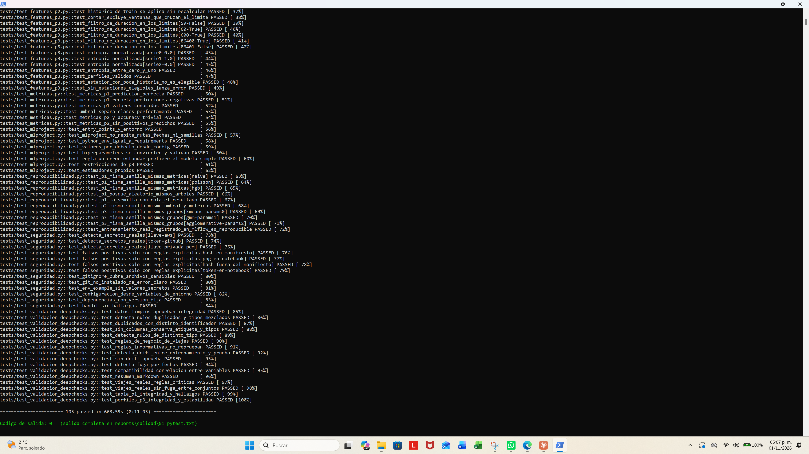
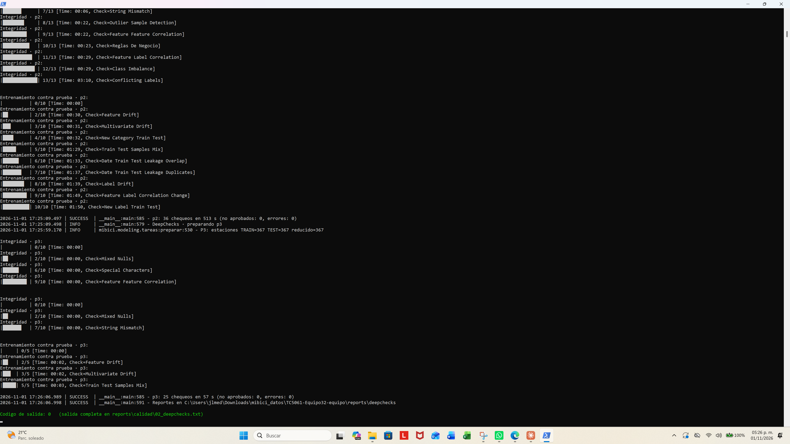
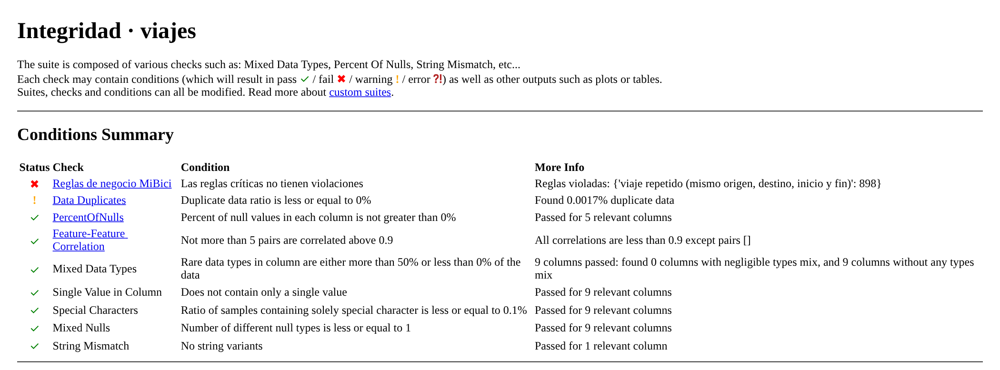
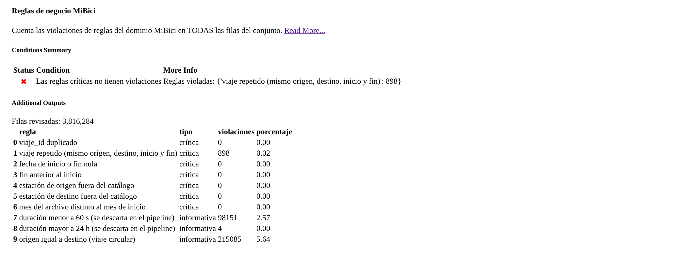
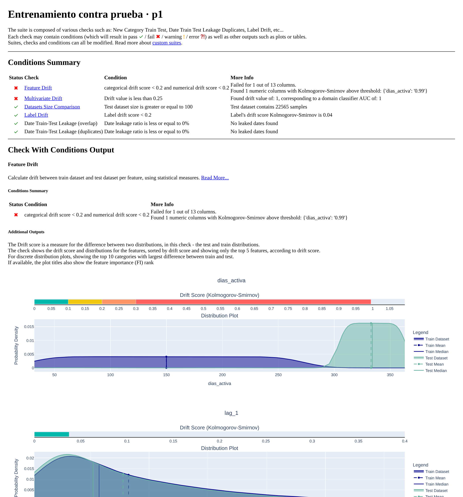
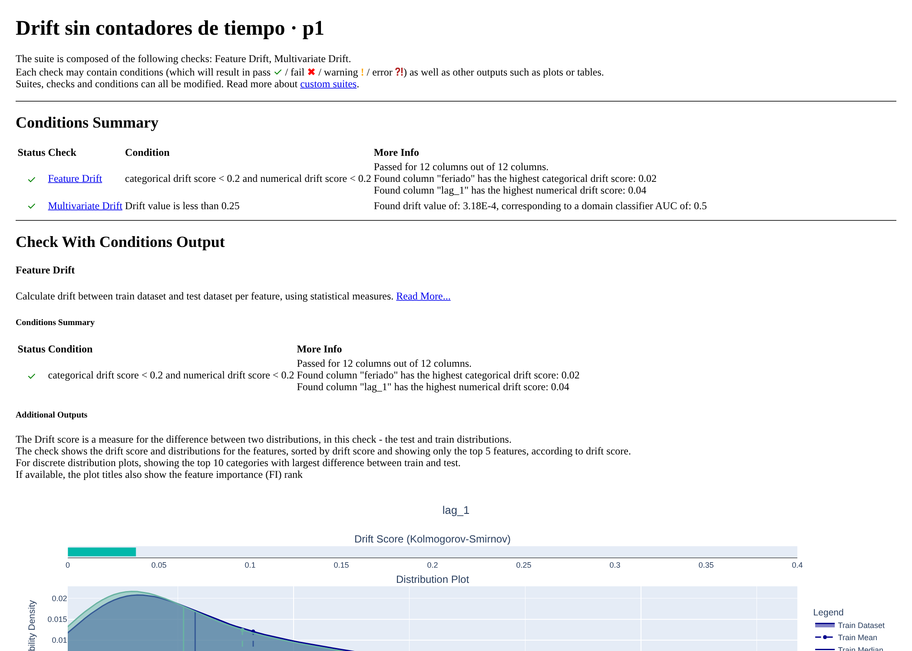
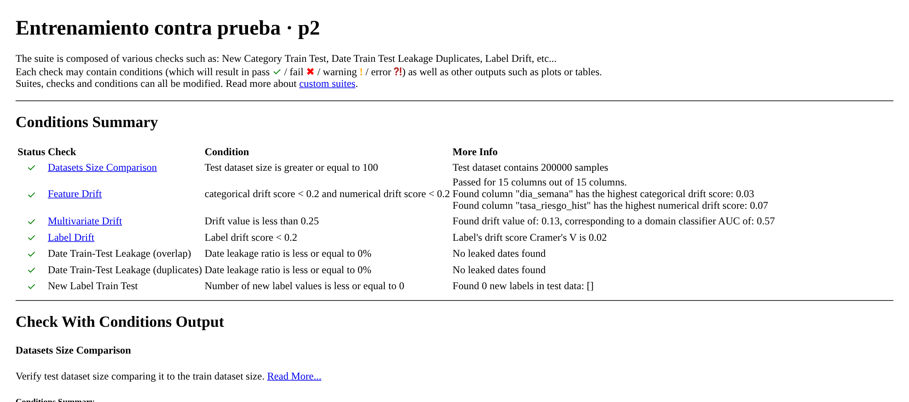
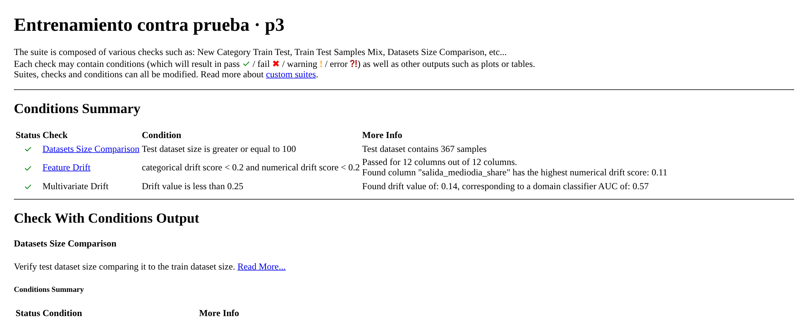
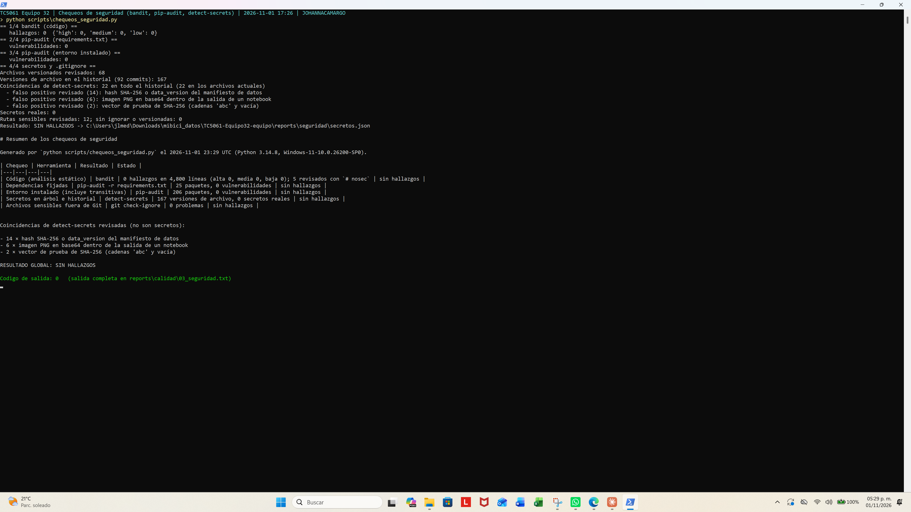
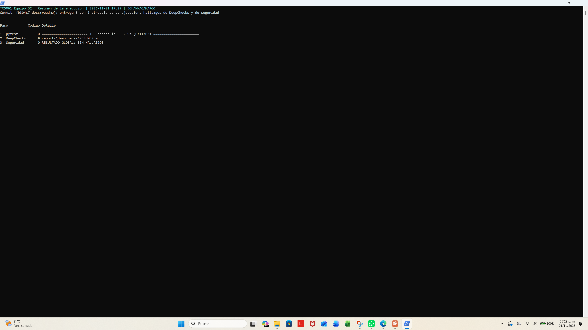

# TC5061-Proyecto-Equipo32
Proyecto integrador de TC5061 (Operaciones de aprendizaje automático): propuesta de solución de ML
sobre los datos abiertos de [MiBici](https://mibici.net/es/datos-abiertos/), el sistema de bicicleta
pública del Área Metropolitana de Guadalajara. Datos: ene–dic 2025 (4,532,032 viajes, 484 estaciones).

El proyecto responde tres preguntas de negocio:

| # | Pregunta | Tipo de tarea | Usuario |
|---|----------|---------------|---------|
| P1 | ¿Cuántos viajes se iniciarán en una estación o zona en un periodo futuro? | Regresión | Operador del sistema (planeación de flota) |
| P2 | ¿Una estación estará en riesgo de quedarse sin bicicletas o sin anclajes? | Clasificación | Equipo de rebalanceo |
| P3 | ¿Qué grupos de estaciones comparten patrones de uso y dónde se ubican? | Clustering | Planeación urbana y expansión |

El ML Canvas y el diagrama de arquitectura se encuentran en `references/`.

## Entrega 3: pruebas automatizadas, validación de datos y seguridad

**Versión individual de Leydy Johanna Camargo Medina (A01840540).** De acuerdo con la mecánica que
acordó la coordinación con el profesor para las actividades en equipo que faltan, cada integrante
puede entregar su propia versión. Esta versión vive en este repositorio
(<https://github.com/JohannaCamargo2805/TC5061-Proyecto-Equipo32>, rama `main`). Se trabajó en seis
ramas, integradas a `main` con *merge commits* (ver [Historial de Git](#historial-de-git-de-la-entrega-3)).

### Cómo ejecutar todo (un solo comando por paso)

```bash
python -m pip install -r requirements.txt     # incluye deepchecks, bandit, pip-audit y detect-secrets

python -m pytest                              # 1. TODAS las pruebas (105): unitarias, reproducibilidad, DeepChecks y seguridad
python -m pytest -m "not datos"               #    solo las que no necesitan data/processed (p. ej. en un clon sin datos)
python -m mibici.validacion                   # 2. reportes de DeepChecks en reports/deepchecks (HTML + RESUMEN.md); necesita data/processed
python scripts/chequeos_seguridad.py          # 3. bandit + pip-audit + secretos; reportes en reports/seguridad (pip-audit consulta PyPI/OSV: requiere Internet)

make calidad                                  # los tres pasos (Linux/macOS)
powershell -ExecutionPolicy Bypass -File scripts\ejecutar_calidad.ps1 -Capturas   # los tres pasos en Windows + capturas
```

Las pruebas marcadas `datos` usan los Parquet de `data/processed` (se generan con
`python -m mibici.dataset`); si no existen, pytest las omite y lo indica. La configuración de pytest
(carpeta, marcadores y filtros de avisos) está en `pyproject.toml`.

### 1. Pruebas unitarias con PyTest

Todas las pruebas están en `tests/` y se corren con `python -m pytest`. Cubren las funciones clave
de cada etapa del pipeline, con casos normales y casos límite:

| Archivo | Funciones probadas | Casos normales | Casos límite |
|---|---|---|---|
| `test_dataset.py` (19) | Ingesta: `_normalizar_nombre`, `normalizar_viajes`, `leer_csv`, `_sha256`, `descargar`, manifiesto | Esquema de columnas, UTF-8 y Latin-1, hash conocido, copia local | Encabezado vacío, variantes del año de nacimiento, fecha inválida (NaT), archivo vacío, error HTTP, descarga idempotente sin red |
| `test_features_p1.py` (8) | `p1_construir_panel_diario`, `p1_agregar_features` | Panel contiguo, rezagos y medias | Rango sin actividad, feriado y fin de semana, capacidad desconocida, estación sin historia, **no fuga al alterar el futuro**, rezago < horizonte |
| `test_features_p2.py` (13) | `p2_construir_panel`, `p2_agregar_etiqueta`, `p2_agregar_features`, `p2_historico_pasado`, `p2_aplicar_historico`, `cortar` | Neto = llegadas − salidas, horas sin viajes en 0 | Etiqueta **justo en el umbral** del 40 %, capacidad 0, horizonte 0/24/−1, histórico sin la fila actual, ventana que cruza el corte |
| `test_features_p3.py` (12) | `p3_filtrar_viajes`, `p3_entropia_normalizada`, `p3_construir_features` | Proporciones que suman 1, balance en [−1, 1] | Duraciones de 59, 60, 86 400 y 86 401 s; serie vacía o constante; estación nueva no elegible; sin estaciones elegibles |
| `test_metricas.py` (6) | `p1.evaluar`, `p2.elegir_umbral`, `p2.evaluar` | Valores conocidos de MAE, WAPE y RMSE | Predicción perfecta, predicciones negativas, modelo que nunca alerta |
| `test_mlproject.py` (8) | `MLproject`, `resolver`, `convertir`, regla de selección, estimadores propios | (entrega 2) | Parámetros inválidos |
| `test_reproducibilidad.py` (10) | `P1Tarea`, `P2Tarea`, `P3Tarea` (los mismos constructores de `mlflow run -e train`) y `train.ejecutar` | Ver abajo | Control negativo: otra semilla cambia el resultado |
| `test_validacion_deepchecks.py` (16) | `mibici/validacion.py` | Ver [sección 2](#2-validación-de-datos-con-deepchecks) | |
| `test_seguridad.py` (13) | Escáner de secretos, `.gitignore`, configuración, `git_seguro`, bandit | Ver [sección 3](#3-chequeos-de-seguridad) | |

**Reproducibilidad del entrenamiento** (`tests/test_reproducibilidad.py`). Con la semilla del
proyecto (`config.SEED = 42`), dos entrenamientos dan el mismo resultado:

- **P1** (ingenuo, Poisson y HGB): mismas métricas y predicciones **bit a bit**.
- **P1 random forest** (`n_jobs=-1`): los árboles son idénticos (variables, umbrales y hojas). Las
  predicciones promedian los árboles en paralelo y el orden de la suma puede cambiar entre hilos,
  así que las métricas se comparan con tolerancia relativa de 1e-9 y las predicciones con 1e-12
  (las diferencias observadas son del orden de 1e-15).
- **P2** (HGB): mismo umbral de decisión, mismas métricas y mismas predicciones.
- **P3** (K-Means, GMM y aglomerativo): mismas etiquetas de grupo.
- **Control negativo:** con `SEED + 1` el bosque aleatorio cambia sus predicciones, así que la
  igualdad se debe a la semilla y no al azar. Varios modelos del catálogo son deterministas (ingenuo,
  Poisson, aglomerativo y HGB sin `early_stopping`); la semilla es la que decide el resultado en el
  bosque aleatorio, K-Means y GMM, y en todos queda fijada desde `config.py`.
- **Con los datos reales y MLflow:** `train.ejecutar` entrena P1 dos veces y las dos corridas
  registran en MLflow las mismas métricas, el mismo `random_state` y la misma `data_version`.

### 2. Validación de datos con DeepChecks

`mibici/validacion.py` arma los conjuntos con las **mismas funciones y la misma partición temporal**
del pipeline (`config.py`) y corre dos suites de DeepChecks 0.19.1 sobre cada uno:

| Conjunto | Entrenamiento contra prueba | Filas |
|---|---|---|
| `viajes` | Viajes procesados antes / desde el 1 de noviembre de 2025 | 3,816,284 / 715,748 (reglas sobre todas; chequeos estadísticos sobre 300,000 por conjunto) |
| `p1` | Tabla estación × día: TRAIN ene-sep / TEST nov-dic | 90,230 / 22,565 |
| `p2` | Tabla estación × hora: TRAIN ene-sep / TEST nov-dic | muestra de 200,000 por conjunto |
| `p3` | Perfiles por estación: 1 ene-19 oct / 20 oct-31 dic | 367 / 367 |

- **Integridad (cada conjunto):** porcentaje de nulos (umbral 0 %), nulos de distinto tipo, tipos
  mezclados (cualquier mezcla reprueba), columnas con un solo valor, duplicados (umbral 0 %),
  caracteres especiales, variantes de texto, muestras atípicas, correlación entre variables, PPS de
  cada variable con la etiqueta (> 0.9 sugiere fuga), desbalance de clases y etiquetas en conflicto (P2).
- **Chequeo propio `ReglasDeNegocio`** (una subclase de `SingleDatasetCheck`): cuenta las violaciones
  de reglas del dominio en **todas** las filas. Las reglas críticas tienen la condición "0 violaciones"
  y las informativas solo se reportan. Ejemplos: `viaje_id` único, fin posterior al inicio, estaciones
  en el catálogo, mes del archivo igual al mes del viaje, llave estación-fecha única, proporciones en
  [0, 1] y bloques horarios que suman 1.
- **Entrenamiento contra prueba:** drift por variable (Kolmogorov-Smirnov o Cramér's V, umbral 0.2),
  drift de la etiqueta, drift multivariado (clasificador de dominio, umbral 0.25), categorías y
  etiquetas nuevas, fuga por fechas (traslape y duplicados), fuga por índice (`viaje_id`), muestras
  repetidas entre conjuntos y tamaño de los conjuntos.

Los reportes HTML (`reports/deepchecks/*.html`, de 10 a 40 MB cada uno, fuera de Git) se regeneran con
`python -m mibici.validacion`; el estado de cada chequeo queda versionado en
[`reports/deepchecks/RESUMEN.md`](reports/deepchecks/RESUMEN.md) y `resumen.json`.

**Problemas detectados y cómo se documentan** (datos `data_version = 7aa5e436d887`):

| # | Conjunto | Chequeo | Resultado | Interpretación y acción |
|---|---|---|---|---|
| 1 | viajes | Reglas de negocio (crítica) | **No aprobado:** 1,076 viajes repetidos (898 en entrenamiento y 178 en prueba, 0.024 %). `Data Duplicates`, sin la columna `viaje_id`, también los detecta en la muestra (advertencia). | Son pares de registros con `viaje_id` consecutivo o casi consecutivo (diferencia de 1 o 2) y el mismo origen, destino, inicio y fin al segundo, repartidos en los 12 meses: probable doble registro en la fuente. El efecto sobre los conteos de P1 y P2 es menor a 0.03 %. Queda documentado; se recomienda deduplicarlos en la ingesta en la siguiente versión de datos (cambia la `data_version` y obliga a reentrenar). La prueba fija el máximo tolerado en 0.05 %. |
| 2 | viajes | Reglas de negocio (informativas) | 117,226 viajes de menos de 60 s (2.6 %), 6 de más de 24 h y 254,801 circulares (5.6 %) | Los dos primeros ya los descarta el filtro de duración de P1-P3 (`*_MIN/MAX_DURATION_SECONDS`). Los viajes circulares (mismo origen y destino) son uso válido y se conservan. |
| 3 | viajes | Nulos, identificadores, tipos, catálogo y calendario | **Aprobado:** 0 nulos, 0 `viaje_id` duplicados, 0 estaciones fuera del catálogo de 484, 0 viajes que terminan antes de empezar y 0 viajes en un archivo mensual equivocado | Integridad de la ingesta confirmada sobre los 4,532,032 viajes. |
| 4 | viajes | Drift y fuga | **Aprobado:** drift máximo por variable 0.04 (día de la semana), drift multivariado 0.04 (AUC 0.52), sin fechas ni `viaje_id` compartidos | La partición temporal no tiene fuga. En prueba aparece 1 estación nueva (la 402, origen de 122 de los 715,748 viajes). El 0.22 % de muestras idénticas entre conjuntos son combinaciones repetidas de origen, destino, hora y duración, no viajes repetidos (su `viaje_id` es distinto). |
| 5 | P1 | Feature Drift y Multivariate Drift | **No aprobado:** `dias_activa` con KS = 0.99 y drift multivariado 1.0 (AUC 1.0) | `dias_activa` es la antigüedad de la estación en días y crece con el calendario: en entrenamiento llega a 272 y en prueba a 364, así que separa los conjuntos por construcción. **Sin esa variable** (suite aparte `p1_train_test_sin_tiempo`) ninguna variable supera 0.2 y el drift multivariado es 0.0003 (AUC 0.50). Acción recomendada: acotarla (p. ej. `min(dias_activa, 90)`) o sustituirla por un indicador de estación nueva, porque los árboles no extrapolan fuera del rango de entrenamiento. |
| 6 | P1 | Feature-Feature Correlation | **No aprobado:** varios rezagos y medias móviles con correlación > 0.9 | Es esperado: todas salen de la misma serie diaria. El modelo Poisson lineal usa regularización (`alpha`) y los modelos de árboles no se ven afectados; queda como dato para una futura selección de variables. |
| 7 | P1 | Nulos, duplicados, reglas, PPS, etiqueta y fechas | **Aprobado:** sin nulos ni llaves estación-fecha repetidas, PPS < 0.9 (sin variables que filtren la etiqueta), drift de la etiqueta 0.04 y sin traslape de fechas | Las variables `p1_*` cumplen la regla de no fuga también con los datos reales. |
| 8 | P2 | Integridad, drift y fuga | **Aprobado:** drift máximo 0.07 (`tasa_riesgo_hist`), drift multivariado 0.13, drift de la etiqueta 0.02, PPS < 0.9 y sin traslape de fechas | Desbalance esperado: 3.8 % de horas en riesgo en entrenamiento y 2.9 % en prueba (tabla completa; ≈4 % y ≈3 % en la muestra), lo que justifica `class_weight` balanceado y elegir el umbral en validación. Etiquetas en conflicto 0.01 %. El 9.6 % de vectores idénticos entre conjuntos son horas sin movimiento (flujos en 0), no fuga. |
| 9 | P3 | Integridad y estabilidad | **Aprobado:** sin nulos ni duplicados, proporciones en [0, 1] que suman 1, drift máximo 0.11 y drift multivariado 0.14 | Los perfiles de las 367 estaciones son estables entre periodos, lo que respalda los grupos de P3. |

Las pruebas de `tests/test_validacion_deepchecks.py` comprueban dos cosas. Con datos sintéticos, que
las suites **detectan** nulos, duplicados, tipos mezclados, nulos de distinto tipo, drift, fuga por
fechas y violaciones de reglas, y que ningún chequeo termina en error. Con los datos reales, que las
reglas críticas se cumplen (los viajes repetidos, el único hallazgo, quedan acotados a menos de
0.05 %), que no hay fuga entre conjuntos y que el drift de P1 se debe solo a `dias_activa`.

**Compatibilidad.** DeepChecks 0.19.1, la versión más reciente, todavía usa APIs que ya no existen en
NumPy 2, pandas 3 y scikit-learn 1.9. `mibici/compat_deepchecks.py` aplica siete ajustes mínimos y
documentados: tres sustituyen funciones solo dentro de módulos de DeepChecks y los demás agregan
alias de nombres que ya no existen (`np.Inf`, `DataFrame.applymap`, el scorer `max_error`,
`pkg_resources`), sin cambiar nada de lo que ya existía en esas librerías. Entre ellos está un `pkg_resources` mínimo en lugar de fijar
`setuptools<81`, que pip-audit marcó como vulnerable. Una prueba verifica que la condición de
correlación corregida reporta solo el par realmente correlacionado.

### 3. Chequeos de seguridad

**Prácticas en el repositorio**

- **Sin datos ni credenciales en Git:** `.gitignore` excluye `data/` (salvo el manifiesto), `*.csv`,
  `*.parquet`, `mlflow.db`, `mlruns/`, `mlartifacts/`, modelos serializados, `.env` y `.env.*`, llaves
  (`*.pem`, `*.key`, `*.p12`, `*.pfx`, `id_rsa*`), `credentials*.json`, `secrets*.json`, `.netrc` y `.pypirc`.
- **Variables de entorno:** `config.py` carga un `.env` local con `python-dotenv` (sin sobrescribir las
  variables del sistema); la plantilla [`.env.example`](.env.example) se versiona sin valores secretos.
  El código no contiene usuarios, contraseñas ni tokens.
- **Minimización de datos:** la ingesta elimina el pseudónimo de usuario, el género y el año de
  nacimiento antes de guardar los Parquet (entrega 1).
- **Dependencias con versión exacta** (`==`) en `requirements.txt`, verificadas por una prueba.

**Herramientas** (`python scripts/chequeos_seguridad.py`; reportes en
[`reports/seguridad/`](reports/seguridad/RESUMEN.md)):

| Herramienta | Qué revisa | Resultado inicial | Corrección | Resultado final |
|---|---|---|---|---|
| **bandit** 1.9.4 | Código de `mibici/` y `scripts/` (~4,800 líneas) | 16 hallazgos de severidad baja (B404, B603 y B607): `subprocess` llamando a `git` sin ruta absoluta en cuatro módulos | `mibici/git_seguro.py` centraliza las llamadas: `git` se resuelve con `shutil.which`, sin shell y con argumentos fijos. Las llamadas a `subprocess` del paquete y de los scripts se revisaron y se marcaron con `# nosec` | **0 hallazgos** (alta 0, media 0, baja 0) |
| **pip-audit** 2.10.1 (`-r requirements.txt`) | Versiones fijadas del proyecto | `mlflow 3.17.1`: CVE-2026-53995 (path traversal en el servidor de tracking con FileStore) | `mlflow==3.17.2` en `requirements.txt` y `python_env.yaml` | **0 vulnerabilidades** |
| pip-audit (`-r requirements.txt`) | `setuptools==80.10.2`, agregado en `2813b77` porque DeepChecks necesita `pkg_resources` | CVE-2026-59890 y GHSA-xmj3-9gf7-h52w | Se retiró en `09ebda8`; un sustituto mínimo de `pkg_resources` en `mibici/compat_deepchecks.py` evita fijar `setuptools` | **0 vulnerabilidades** |
| **pip-audit** (entorno instalado) | Todos los paquetes del `.venv`, incluidas las dependencias transitivas | 7 CVE: `tornado 6.5.10` (CVE-2026-116577, -115927 y -116578; la usan Jupyter e ipykernel) y `pyasn1 0.6.4` (CVE-2026-119194 a -119197) | `tornado==6.6` y `pyasn1==0.6.5` fijadas en `requirements.txt` | **0 vulnerabilidades** |
| **detect-secrets** 1.5.0 (`scripts/escanear_secretos.py`) | Cada versión de cada archivo de texto en **todo el historial** de Git (todas las ramas) | Coincidencias de los detectores de entropía: hashes SHA-256 de los manifiestos, imágenes PNG en base64 de los notebooks y vectores de prueba de SHA-256 | Cada tipo se clasifica con una regla explícita y revisada; el reporte solo guarda los primeros 12 caracteres de la línea | **0 secretos reales** |
| `git check-ignore` | 12 rutas sensibles (`.env`, datos, `mlflow.db`, `mlruns/`, modelos, llaves, credenciales) | — | `.gitignore` reforzado | **12 de 12 ignoradas**, ninguna versionada |

`tests/test_seguridad.py` vuelve automática parte de esta revisión. Comprueba que el escáner detecta
una llave de AWS, un token de GitHub y una llave privada, todos falsos y armados en tiempo de
ejecución. También comprueba que las reglas de falsos positivos no ocultan un token, que `.gitignore`
cubre las rutas sensibles, que `.env.example` no trae valores, que la configuración se lee de variables
de entorno, que todas las dependencias tienen versión exacta y que bandit no reporta hallazgos.

### 4. Evidencia de la ejecución

Ejecución con `scripts\ejecutar_calidad.ps1 -Capturas` en la computadora de la autora (Windows 11,
Python 3.14.8, `.venv` del proyecto) sobre el commit que precede al que agrega esta evidencia; su hash
aparece en la captura del resumen y en `reports/calidad/00_resumen.txt`. El script toma las cuatro
capturas de la terminal al terminar cada paso, y la salida completa de cada paso está en
[`reports/calidad/`](reports/calidad/). Las seis capturas de los reportes de DeepChecks se tomaron
abriendo en un navegador (Chromium, con Playwright) los archivos HTML que generó esa misma ejecución.

**Paso 1 — `python -m pytest -v`: 105 pruebas aprobadas** (salida completa en `reports/calidad/01_pytest.txt`)



**Paso 2 — `python -m mibici.validacion`: DeepChecks sobre viajes, P1, P2 y P3**



Capturas de los reportes HTML de DeepChecks que generó esa ejecución:

| Viajes: resumen de condiciones | Viajes: reglas de negocio sobre 3.8 millones de viajes |
|---|---|
|  |  |

| P1: drift de `dias_activa` | P1 sin `dias_activa`: sin drift |
|---|---|
|  |  |

| P2: entrenamiento contra prueba | P3: entrenamiento contra prueba |
|---|---|
|  |  |

**Paso 3 — `python scripts/chequeos_seguridad.py`: bandit, pip-audit y secretos**



**Resumen de los tres pasos**



### Historial de Git de la entrega 3

Cada tema se desarrolló en su propia rama y se integró a `main` con `git merge --no-ff`, así que el
historial conserva la rama y su *merge commit* (`git log --graph --oneline main`). Los mensajes siguen
[Conventional Commits](https://www.conventionalcommits.org/es/v1.0.0/).

| Rama | Commits | Contenido |
|---|---|---|
| `test/pruebas-unitarias` | 8 | Configuración de pytest y fixtures; pruebas de ingesta, variables de P1, P2 y P3, métricas y reproducibilidad |
| `test/validacion-deepchecks` | 4 | DeepChecks y capa de compatibilidad, suites y chequeo propio, pruebas de detección y `.gitignore` de los reportes |
| `chore/seguridad` | 9 | Llamadas a git sin hallazgos de bandit, `.env`, `mlflow` 3.17.2, sin `setuptools` 80, herramientas fijadas, escáner de secretos, script de seguridad y pruebas |
| `fix/ajustes-primera-ejecucion` | 7 | Script de Windows y objetivos de `make`; correcciones que salieron de la primera ejecución en Windows: drift de P1 sin `dias_activa`, reportes que se sobrescriben, `tornado` y `pyasn1` corregidas y escaneo de secretos más rápido |
| `fix/revision-independiente` | 4 | Correcciones de una revisión independiente: duplicados sin `viaje_id`, más tipos de archivo sensible, prueba de `.gitignore` sin `.git` y commit en el resumen de la ejecución |
| `docs/readme-evidencia` | 2 | Este README, `CONTRIBUCIONES.md`, reportes de DeepChecks y de seguridad y capturas de la ejecución final |

**Uso de herramientas de IA.** El código, las pruebas y este documento se elaboraron con apoyo de
Claude (Anthropic) como asistente de programación; los commits correspondientes lo declaran con la
línea `Co-Authored-By: Claude`. Todas las ejecuciones (pruebas, DeepChecks y seguridad) se hicieron
en la computadora de la autora, que revisó los resultados; las capturas de los reportes de DeepChecks
se tomaron de los HTML de esa ejecución.

## Entrega 2: MLflow Project, experimentación y Model Registry

**Repositorio de entrega:** <https://github.com/JohannaCamargo2805/TC5061-Proyecto-Equipo32>. Conserva el historial completo del repositorio del equipo
([`a01840537/TC5061-Proyecto-Equipo32`](https://github.com/a01840537/TC5061-Proyecto-Equipo32), donde se integró la Propuesta de proyecto con los
Pull Requests #1–#12 de ese repositorio) y recibe la entrega 2 en `main` mediante el Pull Request
[#5](https://github.com/JohannaCamargo2805/TC5061-Proyecto-Equipo32/pull/5). Los commits son los mismos en ambos repositorios; por eso las etiquetas
`git_commit` de las corridas (`e6c1a60`) se pueden consultar aquí.

El repositorio es un **MLflow Project** (`MLproject` + `python_env.yaml`): cualquier integrante
ejecuta la ingesta, el entrenamiento, las búsquedas y el registro con un solo comando
`mlflow run`, contra un **servidor local de tracking respaldado por SQLite** (requerido por el
Model Registry). Todas las corridas de esta entrega se lanzaron así, no desde un notebook.

### 1. Servidor de tracking

```bash
# Terminal 1 (déjala abierta). En Windows: powershell -ExecutionPolicy Bypass -File scripts\servidor_mlflow.ps1
mlflow server --backend-store-uri sqlite:///mlflow.db --artifacts-destination ./mlartifacts \
    --host 127.0.0.1 --port 5000

# Terminal 2: apunta MLflow al servidor y al experimento único del equipo
export MLFLOW_TRACKING_URI=http://127.0.0.1:5000          # PowerShell: $env:MLFLOW_TRACKING_URI="http://127.0.0.1:5000"
export MLFLOW_EXPERIMENT_NAME=mibici-equipo32             # PowerShell: $env:MLFLOW_EXPERIMENT_NAME="mibici-equipo32"
```

`mlflow.db`, `mlruns/` y `mlartifacts/` están en `.gitignore`: la base de datos de MLflow, los
artefactos y los modelos serializados no se versionan.

### 2. Puntos de entrada del `MLproject`

| Punto de entrada | Qué hace | Parámetros principales |
|---|---|---|
| `ingest` | Ejecuta `dataset.py`: descarga/normaliza los CSV y genera `data/manifest.json` (`data_version`) | `raw_source` (carpeta con copia local de los CSV, opcional) |
| `train` | Entrena **un** modelo de **una** pregunta y registra métricas, artefactos y modelo con firma | `question` (p1, p2, p3), `model`, `stage` (baseline/candidate), hiperparámetros (`n_estimators`, `learning_rate`, `max_leaf_nodes`, `min_samples_leaf`, `alpha`, `C`, `k`, `linkage`, …), `from_search` |
| `search` | Búsqueda de hiperparámetros: una corrida **padre** y una corrida **hija anidada** por combinación | `question`, `model`, `grid` |
| `register` | Registra la corrida elegida en el Model Registry y le asigna los aliases `champion`/`challenger` | `question`, `run_id`, `challenger_run_id` |
| `verify` | Carga `models:/<nombre>@champion` y comprueba que reproduce la métrica registrada | `question`, `alias` |

Los parámetros con valor `config` (o `auto`) toman su valor de `mibici/config.py` (catálogos `P1_MODELOS`,
`P2_MODELOS`, `P3_MODELOS`, rejillas `BUSQUEDAS`, partición temporal, rutas y semilla): el
`MLproject` no repite rutas, fechas ni semillas. Se usan palabras clave y no cadenas vacías porque
`mlflow run` en Windows ejecuta el comando con `cmd /c`, que no transmite bien los argumentos vacíos.

### 3. Comandos para reproducir desde un clon limpio

```bash
git clone https://github.com/JohannaCamargo2805/TC5061-Proyecto-Equipo32.git
cd TC5061-Proyecto-Equipo32
python -m venv .venv && source .venv/bin/activate      # Windows: .venv\Scripts\Activate.ps1
python -m pip install -r requirements.txt
# (servidor y variables de entorno del paso 1)

mlflow run . -e ingest --env-manager local             # data_version = 7aa5e436d887
mlflow run . -e train  --env-manager local -P question=p1 -P model=poisson               # P1 champion
mlflow run . -e train  --env-manager local -P question=p2 -P model=hgb                   # P2 champion
mlflow run . -e train  --env-manager local -P question=p3 -P model=kmeans -P k=4         # P3 champion
```

- `--env-manager local` usa el entorno ya activado (instalado con `requirements.txt`, mismas
  versiones que `python_env.yaml`). Sin esa opción, MLflow crea el entorno declarado en
  `python_env.yaml` (`--env-manager uv` si tienes `uv`, o `virtualenv` con `pyenv`).
- Si no hay red hacia el portal de MiBici, la ingesta puede copiar los CSV de una carpeta local
  (`-P raw_source=<carpeta>`); el SHA-256 del manifiesto confirma que son los mismos archivos.
- Protocolo completo de la entrega (baselines, candidatas, búsquedas, registry y verificación):
  `scripts/ejecutar_entrega2.ps1` (Windows) o `scripts/ejecutar_entrega2.sh` / `make experimentos`
  (Linux/macOS).

Ejemplos de variaciones:

```bash
mlflow run . -e train -P question=p1 -P model=rf -P n_estimators=300
mlflow run . -e train -P question=p2 -P model=hgb -P learning_rate=0.05 -P max_leaf_nodes=63
mlflow run . -e search -P question=p1                    # rejilla de BUSQUEDAS["p1"] (nested runs)
mlflow run . -e train -P question=p1 -P from_search=latest   # entrena la mejor combinación
```

### 4. Qué registra cada corrida candidata

| Elemento | Dónde |
|---|---|
| Etiquetas para filtrar | `question`, `model_family`, `stage_of_work` (`baseline`, `search`, `candidate`), `entrega`, `equipo`, `git_commit`, `git_sucio`, `data_version`, `responsable` (y `mlflow.source.git.commit` que agrega `mlflow run`) |
| Modelo con firma y ejemplo de entrada | *Logged model* `model` (skops; el paquete `mibici` viaja con el modelo en `code_paths`) |
| Versión de los datos | `data/manifest.json`, `data/resumen_conjuntos.json` y los conjuntos TRAIN/VAL/TEST con `mlflow.log_input` (solo esquema, filas y huella digital) |
| Gráficas | `plots/`: P1 real contra predicho, residuales, total diario y MAE por día; P2 matriz de confusión, curva precisión-recall y elección del umbral; P3 PCA, perfiles de los grupos y mapa |
| Configuración | `config/`: `config.py`, `MLproject`, `python_env.yaml`, `requirements.txt` y `run_config.json` (parámetros resueltos) |
| Evaluación | `evaluation/`: métricas, predicciones de prueba, importancia por permutación y tablas |

Métricas: las mismas de la entrega anterior con prefijo `train_`, `val_` y `test_` (P1: MAE, RMSE,
WAPE, R², sesgo, error del total diario; P2: PR-AUC, F1, recall, precisión, recall por tipo;
P3: silueta, Davies-Bouldin, Calinski-Harabasz y ARI de estabilidad), más estabilidad
(`test_mae_semanal_std`, `test_f1_semanal_std`, `estabilidad_semillas_ari`), error estándar de
validación (`val_mae_se`, `val_pr_auc_se`) y costo (`costo_entrenamiento_seg`,
`costo_inferencia_ms_1k`, `tamano_modelo_mb`). No se registran datos personales: la ingesta
elimina el pseudónimo, el género y el año de nacimiento.

### 5. Model Registry: esquema de aliases

| Pregunta | Modelo registrado | Producción | Retador |
|---|---|---|---|
| P1 | `mibici-equipo32-p1-demanda` | `@champion` | `@challenger` |
| P2 | `mibici-equipo32-p2-riesgo` | `@champion` | `@challenger` |
| P3 | `mibici-equipo32-p3-grupos` | `@champion` | `@challenger` |

```bash
mlflow run . -e register -P question=p1        # run_id=auto: aplica la regla de selección de config.py
mlflow run . -e verify                         # carga models:/<nombre>@champion de las tres preguntas
```

```python
import mlflow
modelo = mlflow.pyfunc.load_model("models:/mibici-equipo32-p1-demanda@champion")
```

Usamos **aliases** y no las etapas clásicas (`Staging`/`Production`) porque las etapas están
obsoletas desde MLflow 2.9 y los aliases son el esquema vigente: un alias es un puntero
mutable a una versión, así que pasar a producción o hacer *rollback* es mover `@champion`
sin que los consumidores cambien su URI, y `@challenger` deja lista la siguiente mejor versión
para comparación. Cada versión guarda su linaje como etiquetas (`experimento`,
`source_run_id`, `git_commit`, `data_version`, `mlproject_entry_point`) y en su descripción.

**Regla de selección** (`SELECCION` en `config.py`, se calcula solo con TRAIN/VAL): P1 y P2
usan la regla de un error estándar (entre los candidatos a menos de 1 EE del mejor en
validación se elige el de menor complejidad); P3 maximiza la silueta entre los modelos con al
menos 3 grupos, `ari_historico_reducido >= 0.8` y `estabilidad_semillas_ari >= 0.9`.

<a target="_blank" href="https://cookiecutter-data-science.drivendata.org/">
    
</a>

Entregas: Propuesta de proyecto (semana 5) y MLflow Project con experimentación y Model Registry (semana 6).

### 6. Resultados de la entrega 2

Corridas oficiales lanzadas con `mlflow run` desde el commit `e6c1a60` (árbol limpio,
`data_version = 7aa5e436d887`) en el experimento `mibici-equipo32`. Detalle, análisis y capturas en
`TC5061_Reporte_MLFlow_Equipo32.pdf`; bitácora en [`docs/entrega2_bitacora.md`](docs/entrega2_bitacora.md).

| Pregunta | Corrida | Métrica de selección (VAL) | Métrica de prueba | Registry |
|---|---|---|---|---|
| P1 | `p1-baseline-naive` | `val_mae` = 6.232 ± 0.116 | `test_mae` = 7.219 |  |
| P1 | `p1-candidate-poisson` | `val_mae` = 5.104 ± 0.103 | `test_mae` = 5.410 | @champion (v1) |
| P1 | `p1-candidate-hgb` | `val_mae` = 5.326 ± 0.113 | `test_mae` = 6.339 |  |
| P1 | `p1-candidate-rf` | `val_mae` = 5.068 ± 0.090 | `test_mae` = 5.718 |  |
| P1 | `p1-candidate-hgb-tuned` | `val_mae` = 5.129 ± 0.095 | `test_mae` = 5.904 | @challenger (v2) |
| P2 | `p2-baseline-logreg` | `val_pr_auc` = 0.415 ± 0.006 | `test_pr_auc` = 0.351 |  |
| P2 | `p2-candidate-hgb` | `val_pr_auc` = 0.484 ± 0.009 | `test_pr_auc` = 0.394 | @champion (v1) |
| P2 | `p2-candidate-rf` | `val_pr_auc` = 0.470 ± 0.008 | `test_pr_auc` = 0.383 |  |
| P2 | `p2-candidate-hgb-tuned` | `val_pr_auc` = 0.488 ± 0.008 | `test_pr_auc` = 0.402 | @challenger (v2) |
| P3 | `p3-baseline-kmeans` | `train_silhouette` = 0.198 | `test_silhouette` = 0.186 |  |
| P3 | `p3-candidate-kmeans` | `train_silhouette` = 0.186 | `test_silhouette` = 0.167 | @champion (v1) |
| P3 | `p3-candidate-agglomerative` | `train_silhouette` = 0.109 | `test_silhouette` = 0.122 |  |
| P3 | `p3-candidate-gmm` | `train_silhouette` = 0.162 | `test_silhouette` = 0.132 | @challenger (v2) |


## Project Organization

```
├── LICENSE            <- Open-source license if one is chosen
├── MLproject          <- MLflow Project: puntos de entrada ingest, train, search, register y verify
├── python_env.yaml    <- Entorno del MLflow Project (mismas versiones que requirements.txt)
├── Makefile           <- Comandos: `make server`, `make data`, `make experimentos`, `make verify`,
│                         `make test`, `make deepchecks`, `make seguridad`, `make calidad`
├── .env.example       <- Plantilla de variables de entorno (el .env local no se versiona)
├── CONTRIBUCIONES.md  <- Qué hizo cada integrante en cada entrega
├── README.md          <- The top-level README for developers using this project.
├── data
│   ├── external       <- Data from third party sources.
│   ├── interim        <- Intermediate data that has been transformed.
│   ├── processed      <- The final, canonical data sets for modeling.
│   └── raw            <- The original, immutable data dump.
│
├── docs               <- A default mkdocs project; see www.mkdocs.org for details
│   └── evidencia      <- Capturas de la ejecución de pruebas, DeepChecks y seguridad (entrega 3)
│
├── models             <- Trained and serialized models, model predictions, or model summaries
│
├── notebooks          <- Jupyter notebooks. Naming convention is a number (for ordering),
│                         the creator's initials, and a short `-` delimited description, e.g.
│                         `1.0-jqp-initial-data-exploration`.
│
├── pyproject.toml     <- Project configuration file with package metadata for 
│                         mibici and configuration for tools like black
│
├── references         <- Data dictionaries, manuals, and all other explanatory materials.
│
├── scripts            <- Protocolo de la entrega 2 (Windows/Linux) y servidor de tracking;
│                         entrega 3: ejecutar_calidad.ps1, chequeos_seguridad.py, escanear_secretos.py
│
├── tests              <- Pruebas de PyTest (un solo comando: python -m pytest)
│
├── reports            <- Generated analysis as HTML, PDF, LaTeX, etc.
│   ├── figures        <- Generated graphics and figures to be used in reporting
│   ├── deepchecks     <- RESUMEN.md y resumen.json de DeepChecks (los HTML se regeneran)
│   ├── seguridad      <- Reportes de bandit, pip-audit y del escáner de secretos
│   └── calidad        <- Salida completa de pytest, DeepChecks y seguridad
│
├── requirements.txt   <- The requirements file for reproducing the analysis environment, e.g.
│                         generated with `pip freeze > requirements.txt`
│
└── mibici   <- Source code for use in this project.
    │
    ├── __init__.py             <- Makes mibici a Python module
    │
    ├── config.py               <- Store useful variables and configuration
    │
    ├── dataset.py              <- Scripts to download or generate data
    │
    ├── features.py             <- Code to create features for modeling
    │
    ├── validacion.py           <- Entrega 3: suites de DeepChecks y reglas de negocio de MiBici
    ├── compat_deepchecks.py    <- Entrega 3: compatibilidad de DeepChecks con NumPy 2 y pandas 3
    ├── git_seguro.py           <- Entrega 3: llamadas a git sin shell (bandit sin hallazgos)
    │
    ├── modeling                
    │   ├── __init__.py 
    │   ├── p1_regresion.py     <- P1: viajes diarios por estación (baseline + 2 candidatos, MLflow)
    │   ├── p2_clasificacion.py <- P2: riesgo de quedarse sin bicis/anclajes (MLflow)
    │   ├── p3_clustering.py    <- P3: clustering de estaciones por patrón de uso (MLflow)
    │   ├── tareas.py           <- Entrega 2: datos, modelos, métricas y gráficas de P1, P2 y P3
    │   ├── train.py            <- Punto de entrada `train` (una corrida por modelo)
    │   ├── search.py           <- Punto de entrada `search` (nested runs)
    │   ├── registry.py         <- Punto de entrada `register` (Model Registry con aliases)
    │   ├── predict.py          <- Punto de entrada `verify` (carga models:/<nombre>@champion)
    │   ├── seguimiento.py      <- Etiquetas, versión de datos, config y modelo con firma en MLflow
    │   ├── seleccion.py        <- Regla de selección (1 error estándar / restricciones de P3)
    │   └── estimadores.py      <- Estimadores propios (baseline ingenuo, log1p, aglomerativo, GMM)
    │
    └── plots.py                <- Code to create visualizations
```

--------


## Reproducibilidad y MLOps

El proyecto utiliza una estructura basada en Cookiecutter Data Science. La lógica final se mantiene dentro del paquete `mibici`; los notebooks se reservan para exploración.

El entorno fue probado con Python 3.14.4. Las dependencias directas se encuentran fijadas por versión en `requirements.txt`.
También se verificó la ejecución completa (ingesta, pruebas, P1, P2 y P3) con **Python 3.12.13** desde un clon limpio.

### Instalación

```bash
python -m venv .venv
source .venv/bin/activate
python -m pip install -r requirements.txt


```

La consistencia del entorno puede verificarse con:

```bash
python -m pip check
```

### Datos

La ingesta se ejecuta desde el módulo:

```bash
python -m mibici.dataset
```

`dataset.py` descarga los datos públicos de MiBici definidos en `config.py`, genera los archivos procesados y crea `data/manifest.json`.

El manifiesto incluye una `data_version` calculada a partir de los archivos de entrada. Esta versión se registra posteriormente en MLflow para mantener trazabilidad entre datos y experimentos.

Los datos crudos, intermedios y procesados no se versionan en Git.

## Reproducción de la Propuesta de proyecto (entrega 1)

Desde la entrega 2 la reproducción oficial se hace con el **MLflow Project** (ver
[Entrega 2](#entrega-2-mlflow-project-experimentación-y-model-registry)): `mlflow run . -e ingest`
y `mlflow run . -e train ...` contra el servidor de tracking. Los scripts de la propuesta
(`python -m mibici.modeling.p1_regresion`, `p2_clasificacion` y `p3_clustering`) se conservan
como referencia; sus baselines se reproducen ahora con `stage=baseline`:

```bash
mlflow run . -e train -P question=p1 -P model=naive  -P stage=baseline   # p1_baseline_naive_semanal
mlflow run . -e train -P question=p2 -P model=logreg -P stage=baseline   # p2_baseline_logreg
mlflow run . -e train -P question=p3 -P stage=baseline                   # p3_baseline_kmeans_k2
python -m pytest tests                                                          # pruebas
```

La ingesta debe producir `data_version = 7aa5e436d887`; si el valor cambia, los archivos de MiBici
descargados no son los mismos que se usaron en los experimentos.

**Privacidad.** Los CSV de MiBici incluyen un pseudónimo de usuario, el género y el año de nacimiento.
Como ninguna pregunta los necesita, `dataset.py` los elimina antes de escribir los Parquet procesados
(minimización de datos). Los datos se usan con fines académicos citando la fuente (portal de datos
abiertos de MiBici) y no se redistribuyen en este repositorio.

## P1 — Regresión de viajes diarios por estación

**Pregunta:** ¿cuántos viajes se iniciarán en cada estación el día siguiente? Usuario: operador del
sistema (planeación de flota y turnos). Granularidad: estación × día; horizonte: 1 día (la predicción
del día D se emite al cierre de D-1).

```bash
python -m mibici.modeling.p1_regresion
```

- **Partición temporal:** TRAIN ene-sep 2025, VAL oct 2025 (selección del modelo), TEST nov-dic 2025.
- **Variables** (`mibici/features.py`, funciones `p1_*`): calendario del día objetivo (día de la semana,
  fin de semana, feriado), rezagos de 1, 2, 7 y 14 días, medias móviles de 7 y 28 días que terminan en
  D-1, promedio del mismo día de las 4 semanas previas, antigüedad y capacidad de la estación.
  `p1_agregar_features` lanza `LeakageError` si se pide un rezago menor que el horizonte.
- **Modelos:** baseline ingenuo semanal (`t − 7 días`), candidato lineal `PoissonRegressor`
  (conteos en `log1p`) y candidato `HistGradientBoostingRegressor` con pérdida Poisson.
- **Métricas:** `train_/val_/test_` + `mae`, `rmse`, `wape`, `r2`, `sesgo` y `mape_total_dia`.
- **Runs:** `p1_baseline_naive_semanal`, `p1_candidato_poisson_lineal`, `p1_candidato_hgb_poisson`.

## P2 — Clasificación de riesgo de disponibilidad

**Pregunta:** ¿una estación estará en riesgo de quedarse sin bicicletas o sin anclajes en las próximas
2 horas? Usuario: equipo de rebalanceo.

```bash
python -m mibici.modeling.p2_clasificacion
```

- **Etiqueta:** riesgo si `|neto(t+1 … t+2)| >= 0.4 × capacidad` (`p2_agregar_etiqueta`).
- **Partición temporal:** TRAIN ene-sep, VAL oct (umbral de decisión que maximiza F1), TEST nov-dic 2025.
- **Modelos:** baseline regresión logística balanceada y candidato `HistGradientBoostingClassifier`.
- **Runs:** `p2_baseline_logreg`, `p2_candidato_hgb`.

## P3 — Clustering de estaciones

La pregunta P3 busca agrupar estaciones de MiBici de acuerdo con sus patrones de uso y evaluar si esos perfiles se mantienen estables en el tiempo.

La configuración de P3 se encuentra centralizada en `mibici/config.py`. El pipeline final se ejecuta con:

```bash
python -m mibici.modeling.p3_clustering
```

### Partición temporal

Para evitar fuga de información se utiliza una separación temporal sin mezcla aleatoria:

- TRAIN: 1 de enero al 19 de octubre de 2025.
- TEST: 20 de octubre al 31 de diciembre de 2025.
- Ventana histórica reducida: 1 de abril al 19 de octubre de 2025.

Los viajes con duración menor a 60 segundos o mayor a 24 horas se excluyen. También se eliminan viajes que cruzan los límites temporales entre TRAIN y TEST.

### Construcción de características

El feature engineering se encuentra en `mibici/features.py`.

Una estación se considera elegible cuando:

- tiene al menos 30 días de historial;
- presenta menos de 60 días de inactividad al cierre del periodo.

Para cada estación se generan 12 características de comportamiento relacionadas con intensidad, balance, uso en fin de semana y distribución de salidas y llegadas por bloque horario.

Las variables de intensidad se transforman con `log1p` y posteriormente se aplica `StandardScaler`. El escalador se ajusta exclusivamente con TRAIN.

### Comparación de modelos

El pipeline reproduce tres alternativas:

- Baseline: K-Means con k=2.
- Candidato: Agglomerative Clustering con enlace Ward y k=4.
- Modelo final: K-Means con k=4.

La comparación utiliza Silhouette, Davies-Bouldin y Calinski-Harabasz. Para el modelo final también se evalúa estabilidad temporal mediante ARI, NMI y proporción de estaciones que conservan su cluster.

### MLflow Tracking

Todos los runs del proyecto se registran en el experimento único `mibici-equipo32`;
la pregunta atendida se distingue mediante tags (`problema: P1/P2/P3`).

Los runs tienen nombres descriptivos:

- `p3_baseline_kmeans_k2`
- `p3_candidato_agglomerative_k4`
- `p3_kmeans_final`

Además de los tres runs de P3, el experimento contiene los runs de P1 (`p1_baseline_naive_semanal`,
`p1_candidato_poisson_lineal`, `p1_candidato_hgb_poisson`) y de P2 (`p2_baseline_logreg`,
`p2_candidato_hgb`). Todos llevan los tags `equipo = equipo32`, `problema` (P1/P2/P3), `pregunta`,
`etapa` (baseline/candidato), `git_commit` y `data_version`.

Cada run registra, según corresponda:

- versión de los datos (`data_version`);
- commit de Git (`git_commit`);
- pregunta atendida;
- rango temporal;
- semilla y modelo;
- hiperparámetros;
- reglas de filtrado y elegibilidad;
- número de características;
- transformación y escalamiento;
- métricas diferenciadas por conjunto, como `train_silhouette` y `test_silhouette`.

El run final registra como artefactos el modelo serializado, la visualización PCA, el mapa interactivo, el resultado geográfico y la tabla resumen de clusters.

La interfaz local de MLflow puede iniciarse desde la raíz del repositorio con:

```bash
mlflow ui --backend-store-uri sqlite:///mlflow.db --port 5000
```

y consultarse en `http://localhost:5000`.

## Git y control de versiones

Los datos de MiBici, modelos serializados, base de datos de MLflow, artefactos de MLflow y resultados generados por P3 se excluyen mediante `.gitignore`.

El código se desarrolla en ramas independientes y todo cambio hacia `main` debe incorporarse mediante Pull Request revisado por otro integrante del equipo. En la entrega 3, que es una versión individual, cada rama se integró a `main` con `git merge --no-ff` (ver [Historial de Git de la entrega 3](#historial-de-git-de-la-entrega-3)).

Convenciones: ramas `feat/`, `fix/`, `docs/` + descripción corta; mensajes de commit
siguiendo [Conventional Commits](https://www.conventionalcommits.org/es/v1.0.0/). En el
repositorio del equipo la rama `main` está protegida; cada integrante abre al menos un PR y revisa al
menos uno.

Para P3 se utiliza la rama `feature/p3-clustering`.

## Equipo 32

| Integrante | Matrícula | GitHub | Rol |
|------------|-----------|--------|-----|
| Rolando Calderón Carballo | A01840537 | `a01840537` | Infraestructura: repo, ingesta reproducible, versionado de datos, configuración |
| Leydy Johanna Camargo Medina | A01840540 | `JohannaCamargo2805` | P1 — Regresión: demanda de viajes por estación |
| Manuel Alejandro Cardona Esquivel | A01795954 | `alexcard33` | P2 — Clasificación: riesgo de disponibilidad por estación |
| Gerardo Iván Conde Reynoso | A01840602 | `GIvanConder` | P3 — Clustering: patrones de uso de estaciones |

El detalle de qué hizo cada integrante (commits, Pull Requests y revisiones) está en
[`CONTRIBUCIONES.md`](CONTRIBUCIONES.md).