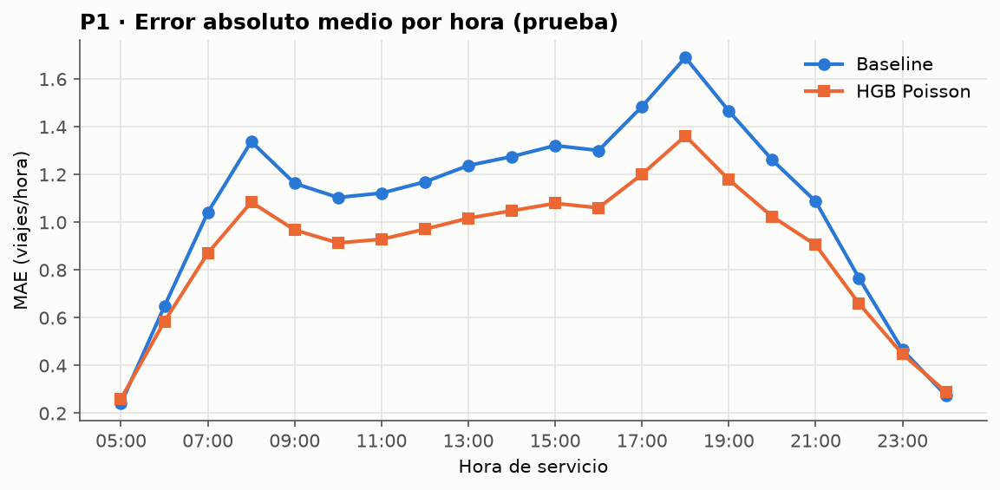
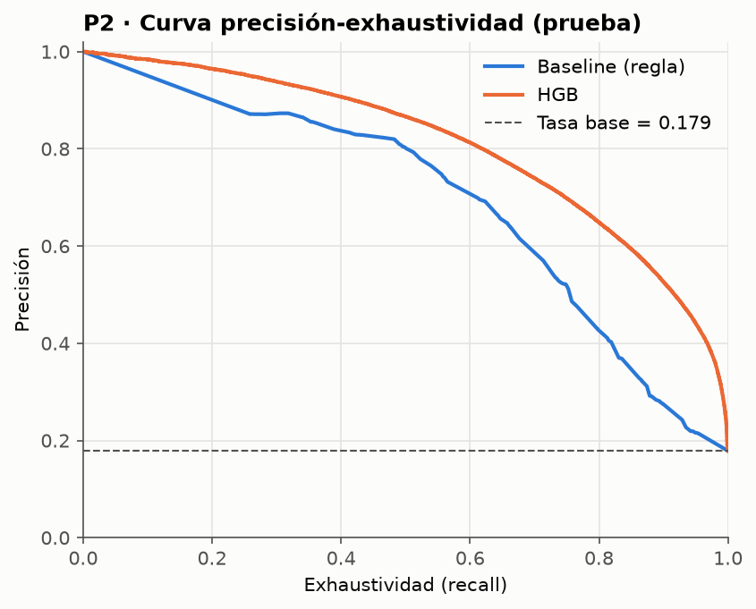
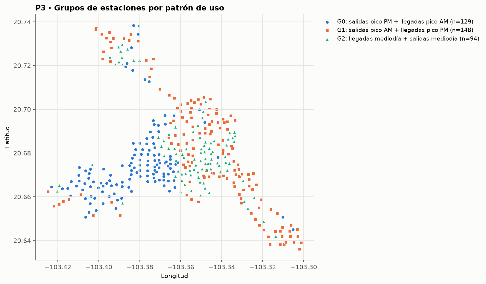

# TC5061-Proyecto-Equipo32 · Proyecto MiBici

<a target="_blank" href="https://cookiecutter-data-science.drivendata.org/">
    
</a>

Propuesta de solución de *Machine Learning* y base reproducible para el sistema de bicicleta pública
**MiBici** del Área Metropolitana de Guadalajara. Proyecto integrador de **TC5061 – Operaciones de
aprendizaje automático (MLOps)**, Maestría en Inteligencia Artificial Aplicada, Tecnológico de Monterrey.

> Repositorio: `https://github.com/JohannaCamargo2805/TC5061-Proyecto-Equipo32` · Experimento MLflow: `mibici-equipo32`

---

## 1. Propósito

Construir, con datos abiertos de MiBici, un sistema de ML que responda tres preguntas de operación y
planeación, sobre una base **reproducible** (ingesta sin pasos manuales, datos versionados, configuración
única y dependencias fijas) y **trazable** (cada experimento registrado en MLflow y ligado a su commit).
Esta primera entrega deja la propuesta, el repositorio y una **línea base de desempeño** para cada
pregunta contra la que se medirá cualquier mejora del curso.

## 2. Preguntas del proyecto

| # | Pregunta de negocio | Formulación de ML (decisión del equipo) | Usuario y decisión |
|---|---|---|---|
| **P1** | ¿Cuántos viajes se iniciarán en una estación o zona en un periodo futuro? | **Regresión de conteo.** Unidad: estación × hora de servicio (05:00–00:59). Objetivo: viajes iniciados. Horizonte: día siguiente (la predicción se emite al cierre del día operativo anterior, solo con rezagos ≥ 24 h). | Operador del sistema: distribuir flota y personal por estación/zona para el día siguiente. |
| **P2** | ¿Una estación estará en riesgo de quedarse sin bicicletas o sin anclajes en un periodo futuro? | **Clasificación binaria.** Unidad: estación × hora de decisión *t*. Objetivo: 1 si la ocupación estimada cae a ≤ 10 % o sube a ≥ 90 % de la capacidad en (t, t + 3 h]. | Equipo de rebalanceo: priorizar qué estaciones visitar en las próximas 3 h. |
| **P3** | ¿Qué grupos de estaciones comparten patrones de uso y dónde se ubican? | **Clustering.** Unidad: estación. Variables: perfil horario de salidas/llegadas, fin de semana, volumen, balance neto, duración, viajes circulares (periodo de entrenamiento). | Planeación urbana: estrategias por tipo de estación y zonas de expansión. |

**Aproximación del riesgo en P2.** MiBici no publica el inventario por estación. Como el servicio opera de
05:00 a 00:59 y la ventana nocturna se usa para rebalancear, suponemos que cada estación inicia el día
operativo al 50 % de su capacidad y acumulamos llegadas − salidas hora por hora:
`ocupación(t) = (0.5·capacidad + Σ(llegadas − salidas)) / capacidad`. Los umbrales (50 %, 10 %, 90 %,
3 h) están en `mibici/config.py` y se registran como parámetros en MLflow.

## 3. Datos utilizados

| Elemento | Detalle |
|---|---|
| Fuente | [Portal de datos abiertos de MiBici](https://mibici.net/es/datos-abiertos/): `datos_abiertos_AAAA_MM.csv` y [`nomenclatura_2026_09.csv`](https://mibici.net/site/assets/files/1118/nomenclatura_2026_09.csv). Las URL exactas están en `config.TRIP_URLS`. |
| Rango | **1-oct-2024 a 30-sep-2026** (24 meses = dos ciclos anuales completos, incluidas dos temporadas de lluvias). |
| Tamaño real | 24 meses · **9,043,925** registros crudos · **8,770,923** viajes tras la limpieza (97.0 %) · **484** estaciones en la nomenclatura (480 con capacidad válida) · **470** estaciones con viajes modelables. Unas 100 estaciones nuevas abrieron entre mayo y agosto de 2026. |
| Versión de datos | `v1.0-202410_202609-226b928677` (ver `references/data_manifest.json`) |
| Variables originales usadas | Identificador del viaje, fecha y hora de inicio y fin, estación de origen y destino; de la nomenclatura: id, nombre, latitud, longitud y capacidad. |
| Datos personales | Las columnas de usuario (`Usuario_Id`, género, año de nacimiento/edad) **se eliminan en la ingesta**: ninguna pregunta las necesita y las trayectorias de movilidad permiten reidentificar personas. Nunca se registran en MLflow. |
| Condiciones de uso | El portal publica los archivos como *datos abiertos* sin licencia específica; aplica la Ley General de Transparencia (art. 3, fr. VIII, inciso j: libre uso con la única condición de citar la fuente). Se cita a MiBici como fuente y los datos no se redistribuyen en este repositorio. |
| Partición temporal | train 2024-10-01 → 2026-03-31 · validación 2026-04-01 → 2026-06-30 · prueba 2026-07-01 → 2026-09-30 (sin barajar). |

## 4. Estructura del repositorio

Generado con [Cookiecutter Data Science v2](https://cookiecutter-data-science.drivendata.org/)
(`ccds`, `include_code_scaffold = Yes`; virtualenv + `requirements.txt`, pydata básico, pytest, ruff).

```
├── .github/pull_request_template.md   <- Lista de verificación de cada Pull Request
├── Makefile               <- Atajos: make data / features / train / mlflow-ui / test
├── README.md
├── data/                  <- (fuera de Git) raw: CSV originales · interim: Parquet · processed: tablas P1-P3
├── models/                <- (fuera de Git) modelos serializados
├── notebooks/             <- Solo exploración: 1.0-<iniciales>-<descripcion>.ipynb
├── pyproject.toml         <- Metadatos del módulo mibici y configuración de ruff
├── references/
│   ├── ml_canvas.md / ml_canvas.png        <- Machine Learning Canvas
│   ├── arquitectura.png / arquitectura.html <- Diagrama de arquitectura
│   └── data_manifest.json                   <- Versionado de datos (conteos + SHA-256)
├── reports/figures/       <- Figuras generadas
├── requirements.in        <- Dependencias directas (editable)
├── requirements.txt       <- Dependencias con versión fija (todas las plataformas)
├── tests/                 <- Pruebas: normalización de la ingesta y ausencia de fuga temporal
└── mibici/                <- Módulo del proyecto
    ├── config.py          <- ÚNICO lugar de rutas, fechas, partición, semillas, URLs e hiperparámetros
    ├── dataset.py         <- Ingesta reproducible y versionado de datos (CLI)
    ├── features.py        <- Feature engineering de P1, P2 y P3 (CLI)
    ├── plots.py           <- Gráficas que se registran como artefactos
    └── modeling/
        ├── train.py       <- Experimento base: baselines y candidatos registrados en MLflow (CLI)
        └── predict.py     <- (plantilla; se implementa en entregas siguientes)
```

## 5. Instalación (desde un clon limpio)

Requisitos: **Python 3.12** y Git.

```bash
git clone https://github.com/JohannaCamargo2805/TC5061-Proyecto-Equipo32.git
cd TC5061-Proyecto-Equipo32
python -m venv .venv
# Windows (PowerShell):  .venv\Scripts\Activate.ps1
# macOS / Linux:         source .venv/bin/activate
python -m pip install -r requirements.txt     # instala versiones fijas y el módulo mibici (-e .)
python -m pytest tests                        # verificación rápida
```

## 6. Ingesta reproducible y versionado de datos

```bash
python -m mibici.dataset ingest    # descarga 24 meses + nomenclatura, normaliza, Parquet y manifiesto
python -m mibici.dataset verify    # comprueba que tus datos son idénticos a la versión del manifiesto
```

Qué hace `ingest`, sin pasos manuales:

1. Descarga los CSV del rango de `config.py` a `data/raw/` (si ya existen no se vuelven a descargar).
2. Detecta por archivo la **codificación** (UTF-8/CP1252), el **separador**, los **nombres de columnas**
   (varían entre años; se mapean a un esquema canónico) y el **formato de fecha** (resuelve día/mes con
   el mes del archivo).
3. Elimina datos personales y aplica reglas de limpieza con conteo por regla: campos nulos, `trip_id`
   duplicado, inicio fuera del mes, duración < 1 min o > 24 h.
4. Guarda un Parquet por mes en `data/interim/trips/` y `data/interim/stations.parquet`.
5. Escribe `references/data_manifest.json` (versionado en Git) con registros y **SHA-256** de cada archivo
   crudo y procesado. De ahí se deriva `data_version`, que cada run registra en MLflow. Si MiBici
   republica un archivo, el hash cambia, el proceso lo advierte y se genera una nueva versión.

### Verificación en un clon limpio

```bash
python -m pytest tests            # 17 pruebas: configuración, ingesta y ausencia de fuga temporal
python -m mibici.dataset ingest   # misma data_version si MiBici no ha republicado archivos
git status                        # references/data_manifest.json no debe mostrar cambios
```

## 7. Variables y experimento base

```bash
python -m mibici.features build    # tablas P1, P2 y P3 en data/processed/
python -m mibici.modeling.train    # 6 runs: baseline + candidato para P1, P2 y P3
mlflow ui --backend-store-uri sqlite:///mlflow.db --port 5000   # http://127.0.0.1:5000
```

Opciones: `python -m mibici.modeling.train --question P2` o `--no-candidates` (solo baselines).
Con `make`: `make data`, `make features`, `make train`, `make pipeline`, `make mlflow-ui`.

| Pregunta | Baseline | Candidato | Métricas (prefijo = conjunto) |
|---|---|---|---|
| P1 | Ingenuo estacional: misma hora de la semana anterior (t − 168 h) | `HistGradientBoostingRegressor` (pérdida Poisson) | `test_mae`, `test_rmse`, `test_wape`, `test_bias`, `test_mae_station_day`, `val_*` |
| P2 | Regla: riesgo si \|ocupación actual − 0.5\| ≥ umbral (umbral elegido en validación) | `HistGradientBoostingClassifier` (`class_weight="balanced"`, umbral por F2 en validación) | `test_pr_auc`, `test_recall`, `test_precision`, `test_f2`, `test_roc_auc`, `val_*` |
| P3 | Zonificación geográfica: K-Means sobre latitud/longitud (mismo k) | K-Means sobre el perfil de uso estandarizado (k por silueta) | `train_silhouette`, `train_davies_bouldin`, `train_calinski_harabasz`, `test_silhouette`, `test_stability_ari` |

Resultados de la línea base:

| Pregunta | Run | Métricas en prueba (jul–sep 2026) |
|---|---|---|
| P1 | Baseline ingenuo estacional | `test_mae` 1.073 · `test_rmse` 1.973 · `test_wape` 0.737 · `test_mae_station_day` 6.82 |
| P1 | HGB Poisson | `test_mae` **0.893** (−16.8 %) · `test_rmse` 1.492 · `test_wape` 0.613 · `test_mae_station_day` 6.13 |
| P2 | Regla de ocupación actual | `test_pr_auc` 0.671 · `test_recall` 0.748 · `test_precision` 0.521 · `test_f2` 0.688 |
| P2 | HGB clasificador | `test_pr_auc` **0.806** · `test_recall` 0.894 · `test_precision` 0.535 · `test_f2` 0.788 |
| P3 | K-Means geográfico (k = 3) | `train_silhouette` 0.102 · `train_davies_bouldin` 4.73 · `test_stability_ari` 0.190 |
| P3 | K-Means patrón de uso (k = 3) | `train_silhouette` **0.146** · `train_davies_bouldin` 1.86 · `test_stability_ari` 0.718 |

Todos los runs se ejecutaron desde el commit `46dbfbf` con la versión de datos `v1.0-202410_202609-226b928677`.
Los grupos de P3 son: G0 estaciones *destino* (llegadas en el pico de la mañana, salidas en la tarde), G1 estaciones
*origen* residenciales (salidas en la mañana, llegadas en la tarde) y G2 estaciones de uso a mediodía (Centro).

| P1 · error por hora de servicio | P2 · curva precisión-exhaustividad | P3 · grupos de estaciones |
|---|---|---|
|  |  |  |

## 8. Flujo de trabajo con Git/GitHub

- **GitHub Flow**: `main` siempre estable y **protegida** (no se permiten *push* directos; se exige
  Pull Request con al menos **1 aprobación** y conversaciones resueltas). Todo cambio entra por PR.
- **Ramas**: `tipo/descripcion-corta` en minúsculas con guiones, donde `tipo` ∈ `feat`, `fix`, `docs`,
  `refactor`, `test`, `chore`, `data`, `exp`. Ejemplos: `feat/ingesta-parquet`, `docs/readme-flujo-git`.
- **Commits**: [Conventional Commits 1.0.0](https://www.conventionalcommits.org/es/v1.0.0/):
  `tipo(alcance): descripción en imperativo` — p. ej. `feat(dataset): versionar datos con SHA-256`,
  `docs(readme): documentar flujo de trabajo`. Alcances: `dataset`, `features`, `train`, `config`,
  `readme`, `references`, `notebooks`, `tests`, `deps`.
- **Pull Requests**: título con la misma convención; se llena `.github/pull_request_template.md`;
  cada integrante abre al menos un PR y revisa al menos uno de otro integrante; se integra con
  **Create a merge commit** tras la aprobación (no *squash*), para que los commits que MLflow registra en
  la etiqueta `git_commit` sigan existiendo en el historial de `main`.
- **Runs oficiales de MLflow**: se ejecutan desde `main` actualizado y sin cambios locales, para que la
  etiqueta `git_commit` apunte a código existente en el repositorio (el código avisa si hay cambios sin commit).

## 9. Buenas prácticas y cómo las aplicamos

| Ámbito | Práctica | Cómo se cumple |
|---|---|---|
| MLflow | Un experimento por proyecto; runs con nombre descriptivo | Experimento `mibici-equipo32`; nombres como `P1-baseline-ingenuo-estacional-semanal` (`train.py`). |
| MLflow | Registrar todo lo necesario para reproducir | Parámetros `data_version`, `data_start`, `data_end`, `split_*`, `seed`, `model` e hiperparámetros. |
| MLflow | Ligar run con código y pregunta | Etiquetas `equipo`, `pregunta`, `tipo_run`, `git_commit`, `git_branch`, `git_dirty`. |
| MLflow | Métricas con el conjunto en el nombre | `test_mae`, `val_f2`, `train_silhouette`, etc. |
| MLflow | Sin credenciales ni datos personales | Columnas de usuario eliminadas en la ingesta; solo agregados por estación; `.env` fuera de Git. |
| Código | Notebooks solo para exploración | `notebooks/1.0-ljcm-exploracion-mibici.ipynb` importa funciones del módulo. |
| Código | Configuración en un solo lugar | `mibici/config.py`; ningún otro archivo repite rutas, fechas ni semillas. |
| Código | Dependencias fijas y entorno reproducible | `requirements.txt` con `==` para Python 3.12 (Windows/macOS/Linux) generado desde `requirements.in`. |
| Datos y Git | Nada de datos, modelos, MLflow ni credenciales en Git | `.gitignore` ampliado: `/data/`, `*.csv`, `*.parquet`, `mlruns/`, `mlartifacts/`, `mlflow.db`, `/models/*`, `*.pkl`, `.env`. |
| Datos y Git | Todo cambio por PR revisado | Rama `main` protegida; historial de PRs en la pestaña *Pull requests*. |

## 10. Integrantes y roles

| Integrante | Matrícula | GitHub | Rol principal |
|---|---|---|---|
| Leydy Johanna Camargo Medina | A01840540 | [@JohannaCamargo2805](https://github.com/JohannaCamargo2805) | Estructura del repositorio, ingesta y versionado de datos, experimento base en MLflow y documentación |
| Rolando Calderón Carballo | *(por confirmar)* | *(por confirmar)* | P1 · demanda por estación: revisión de la ingesta y del modelo de regresión |
| Manuel Alejandro Cardona Esquivel | *(por confirmar)* | *(por confirmar)* | P2 · riesgo de vaciado/llenado: revisión de la etiqueta aproximada y del clasificador |
| Gerardo Iván Conde Reynoso | *(por confirmar)* | *(por confirmar)* | P3 · clustering: revisión de perfiles de uso y de la interpretación de grupos |

Los roles por pregunta son la propuesta inicial del equipo para las siguientes entregas.

## 11. Referencias

- Dorard, L. (2018, 9 de marzo). *From data to AI with the Machine Learning Canvas (Part I)*. Own Machine Learning (Medium).
- Huyen, C. (2022). *Designing machine learning systems: An iterative process for production-ready applications*. O'Reilly Media.
- MiBici. (s.f.). *Datos abiertos* [Conjunto de datos]. https://mibici.net/es/datos-abiertos/
- MLflow. (s.f.). *MLflow Tracking* [Documentación]. https://mlflow.org/docs/latest/ml/tracking/
- Treveil, M., et al. (2020). *Introducing MLOps: How to scale machine learning in the enterprise*. O'Reilly Media.
- Wilson, B. (2022). *Machine learning engineering in action*. Manning Publications.
