# TC5061-Proyecto-Equipo32
Proyecto integrador de TC5061 (Operaciones de aprendizaje automático): propuesta de solución de ML
sobre los datos abiertos de [MiBici](https://mibici.net/es/datos-abiertos/), el sistema de bicicleta
pública del Área Metropolitana de Guadalajara. Datos: ene–dic 2025 (4,532,032 viajes, 484 estaciones).

El proyecto responde tres preguntas de negocio:

| # | Pregunta | Tipo de tarea | Usuario |
|---|----------|---------------|---------|
| P1 | ¿Cuántos viajes se iniciarán en una estación o zona en un periodo futuro? | Regresión | Operador del sistema (planeación de flota) |
| P2 | ¿Una estación estará en riesgo de quedarse sin bicicletas o sin anclajes? | Clasificación | Equipo de rebalanceo |
| P3 | ¿Qué grupos de estaciones comparten patrones de uso y dónde se ubican? | Clustering | Planeación urbana y expansión |

El ML Canvas y el diagrama de arquitectura se encuentran en `references/`.

## Entrega 6: sistema operable con Docker Compose, CI/CD, prueba de carga y FinOps

[](https://github.com/JohannaCamargo2805/TC5061-Proyecto-Equipo32/actions/workflows/ci-cd.yml)

**Versión individual de Leydy Johanna Camargo Medina (A01840540)**, rama `main` de este repositorio, como las
entregas 3 a 5 (Entregable 7 del curso). La API contenerizada de la entrega 4 y el modelo del Model Registry de la
entrega 5 se convierten en un sistema que se levanta con **un solo comando**, se prueba y despliega con **GitHub
Actions**, se mide bajo carga con **Locust** y `docker stats` y se analiza en **costo por inferencia**. Reporte en
PDF: `TC5061_Operacion_FinOps_Equipo32.pdf` (Canvas).

| Pieza | Dónde |
|---|---|
| Orquestación: MLflow, registro del modelo, API, Redis y worker de RQ | `docker-compose.yml`, `docker/mlflow/`, `.env.example` |
| Predicciones asíncronas (opcional del enunciado) | `api/asincrono.py`, `api/worker.py`, `api/tareas.py` |
| Pipeline de CI/CD | `.github/workflows/ci-cd.yml` |
| Prueba de carga (escenario, gráficas y resumen por escalón) | `carga/locustfile.py`, `carga/peticiones.py`, `carga/graficas.py`, `carga/comparar.py`, `scripts/prueba_carga.py` |
| Consumo en reposo según la configuración | `scripts/medir_reposo.py` |
| Costo por inferencia y escenarios de volumen | `finops/costo_inferencia.py`, `finops/precios_referencia.toml` |
| Motor de inferencia en NumPy verificado contra el Pipeline (optimización medida) | `api/acelerado.py`, `scripts/perfil_inferencia.py` |
| Pruebas | `tests/test_entrega6.py` (21), `tests/test_asincrono.py` (7), `tests/test_acelerado.py` (7) |
| Resultados | `reports/carga/<corrida>/` y `reports/finops/` |

### 1. Levantar el sistema con un solo comando

Requisitos: Docker Desktop (o Docker Engine con el plugin Compose v2) o Podman con `podman-compose`. No hace falta
Python ni el registry local: todo se construye desde este repositorio.

```bash
docker compose up -d --build --wait     # construye, levanta y espera a que todo esté sano (~1 min con caché)
docker compose ps                       # 5 servicios: 4 "healthy" y registrar-modelo "exited (0)"
curl -s localhost:8000/health           # {"estado":"ok","modelo":"mibici-equipo32-p1-demanda","version":1,"origen":"registry"}
docker compose down                     # detiene; con -v borra también el registry y la cola
# podman-compose up -d --build          # equivalente con Podman
```

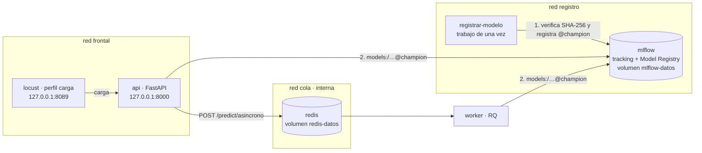

| Servicio | Imagen | Qué hace | Salud / límites |
|---|---|---|---|
| `mlflow` | `mibici-mlflow:3.17.2` (`docker/mlflow/Dockerfile`) | Tracking y Model Registry; SQLite y artefactos en el volumen `mlflow-datos` | `GET /health`; 1 vCPU, 1 GB |
| `registrar-modelo` | la de MLflow | Verifica el SHA-256 de `models/servicio` contra `registro.json`, carga el modelo y predice el ejemplo, y lo registra como `mibici-equipo32-p1-demanda@champion` con el linaje original (idempotente) | termina con código 0 |
| `api` | `mibici-p1-api:modelo-v1` (`Containerfile`) | La API de la entrega 4; descarga del registry la versión del alias y vuelve a verificar sus huellas | `GET /health`; 1 vCPU, 1 GB |
| `redis` | `redis:8.10.3-alpine3.23` | Cola de las predicciones asíncronas; solo en la red interna `cola`, sin puerto publicado | `redis-cli ping`; 0.5 vCPU, 256 MB |
| `worker` | la de la API | `python -m api.worker`: `SimpleWorker` de RQ con el modelo ya en memoria | registrado en Redis; 1 vCPU, 1 GB |
| `locust` | `mibici-carga:2.47.0` (`carga/Dockerfile`) | Generador de carga y análisis (perfil `carga`: no arranca con `up`) | 2 vCPU, 1 GB |

Decisiones de configuración:

* **Arranque ordenado con condiciones**: `mlflow` sano → `registrar-modelo` termina con éxito → `api` y `worker`;
  `redis` sano antes de ambos. Si el modelo no pasa la verificación, la API no arranca.
* **Redes separadas**: `registro` (MLflow), `cola` (`internal: true`, Redis no es alcanzable desde el anfitrión) y
  `frontal` (API y Locust). Los puertos se publican solo en `127.0.0.1`.
* **Volúmenes con nombre** para el registry y la cola; el modelo se monta de solo lectura en `registrar-modelo`.
* **Variables de entorno con valores por defecto** (`.env.example`): puertos, `MODELO_URI` (alias, versión o la copia
  empaquetada), tamaño de la réplica (`API_WORKERS`, `API_CPUS`, `API_MEMORIA`), bitácora de accesos, imágenes
  (`API_IMAGEN`, `MLFLOW_IMAGEN` para usar las publicadas en GHCR) y la imagen base.
* **Rotación de bitácoras** (`json-file`, 10 MB × 3), `restart: unless-stopped` y límites de CPU y memoria en cada servicio.
* **MLflow sin el ejecutor de trabajos de GenAI** (`MLFLOW_SERVER_ENABLE_JOB_EXECUTION=false`) y con 1 proceso web:
  baja su memoria en reposo de ~2 GB a ~0.4 GB (`scripts/medir_reposo.py`, sección 4).

Predicción asíncrona (Redis + RQ):

```bash
curl -s -X POST localhost:8000/predict/asincrono -H "Content-Type: application/json" --data-binary @docs/ejemplos/peticion_lote.json
# {"tarea_id":"b4ff…","estado":"queued","n":3,"consultar":"/tareas/b4ff…"}
curl -s localhost:8000/tareas/b4ff…    # estado "finished" y las mismas predicciones que POST /predict/lote
```

### 2. Pipeline de CI/CD (GitHub Actions)

`.github/workflows/ci-cd.yml` corre en cada *push* (todas las ramas), *pull request* y a mano (`workflow_dispatch`, con
la opción de correr la prueba de carga completa en el runner).

| Job | Qué hace | Optimizaciones |
|---|---|---|
| `calidad` | `ruff check`, `bandit` (paquete, API, scripts, carga, FinOps, MLflow), escaneo de secretos en todo el historial de Git y `docker compose config` | caché de pip |
| `pruebas` | PyTest completo | **matriz** Ubuntu × Windows (la autora trabaja en Windows); caché de pip; resultados JUnit como artefacto |
| `imagenes` | Construye la imagen de la API y la de MLflow, prueba la API en un contenedor (la predicción de referencia debe dar 64.549) y, en `main`, **publica ambas en GitHub Container Registry** (`sha-<commit>`, `modelo-v1`/`3.17.2`, `latest`) | **matriz** por imagen; caché de capas de Buildx en GitHub Actions |
| `sistema` | `docker compose up --no-build --wait` con las 5 piezas, prueba la API servida desde el registry (síncrona y asíncrona) y corre una **prueba de humo con Locust + `docker stats`**; resumen en la página de la ejecución y reportes como artefacto | imágenes desde la caché de capas |
| `despliegue` | Solo en `main`, entorno `produccion`: baja de GHCR las imágenes de ese commit **por digest**, levanta el sistema con ellas sin construir nada y verifica que responda | — |

Para correrlo: basta con hacer *push*; el resultado se ve en la pestaña **Actions** del repositorio. Para levantar en
cualquier máquina exactamente lo que se publicó: `API_IMAGEN=ghcr.io/johannacamargo2805/mibici-p1-api:latest
MLFLOW_IMAGEN=ghcr.io/johannacamargo2805/mibici-mlflow:latest docker compose up -d --no-build --wait`.

El estado de cada ejecución se ve en la [pestaña Actions](https://github.com/JohannaCamargo2805/TC5061-Proyecto-Equipo32/actions/workflows/ci-cd.yml) y en la insignia de arriba.

### 3. Prueba de carga con Locust

```bash
python scripts/prueba_carga.py                                  # escalones con la réplica de 1 vCPU (~7 min)
python scripts/prueba_carga.py --nombre escalado --workers 2 --cpus 2 --escalones "25:45,50:45,100:45,200:45,300:45,400:45,500:45,600:45"
python scripts/prueba_carga.py --nombre optimizado --acelerar --escalones "50:45,100:45,200:45,300:45,400:45,500:45,600:45,800:45"
python scripts/prueba_carga.py --escenario lote --duracion 60   # lotes de 100: costo por inferencia en lote
python scripts/prueba_carga.py --escenario asincrono --duracion 60
docker compose --profile carga up locust                        # o con interfaz web en http://localhost:8089
```

El script solo usa la biblioteca estándar y la CLI de Docker: levanta el sistema con el tamaño de réplica pedido,
guarda el entorno (CPU y memoria del motor, versiones, commit, modelo servido), muestrea `docker stats` cada 2 s en un
hilo aparte, corre Locust sin interfaz dentro del contenedor `locust` y genera las gráficas y el resumen por escalón.

**Escenario** (`carga/locustfile.py`): el tráfico de una app de MiBici y del área de operación a la vez.

* `UsuarioApp` (peso 9): `POST /predict` con entradas **distintas y realistas** en cada petición (`carga/peticiones.py`
  simula 28 días de la estación y calcula rezagos y medias como `mibici/features.py`, así cumplen las reglas de
  consistencia de la API), más `/health`, `/modelo` y un 4 % de entradas inválidas que deben responder **422**.
* `UsuarioOperacion` (peso 1): `POST /predict/lote` con 100 estaciones (rebalanceo).
* Forma de la carga: **escalones** de 10 a 300 usuarios de 45 s cada uno, para encontrar el punto en que la latencia se
  dispara. Los percentiles por escalón se calculan con **cada petición** (no con las ventanas móviles de Locust) y sin
  los primeros 10 s de cada escalón. SLO: p95 ≤ 300 ms con menos de 1 % de errores.

#### Resultados en la computadora de la autora

Intel Core i7-1065G7 (4 núcleos, 8 hilos), 16 GB, Windows 11 Pro, Docker Desktop 29.9.2 sobre WSL2 (8 vCPU y 7.6 GiB
para Docker), Compose 5.6.1. Las corridas `base`, `escalado`, `lote` y `asincrono` usaron el commit `a6f1732` (una
versión previa del merge de `ci/github-actions` que difiere de `845defb` solo en el flujo de CI) y `optimizado`, el
`6431d71`. Cada carpeta de `reports/carga/<corrida>/` guarda las peticiones crudas (`peticiones.csv.gz`), `docker stats`
(`recursos.jsonl`), el entorno, el reporte HTML de Locust, `escalones.csv`, `resumen.json` y las gráficas.

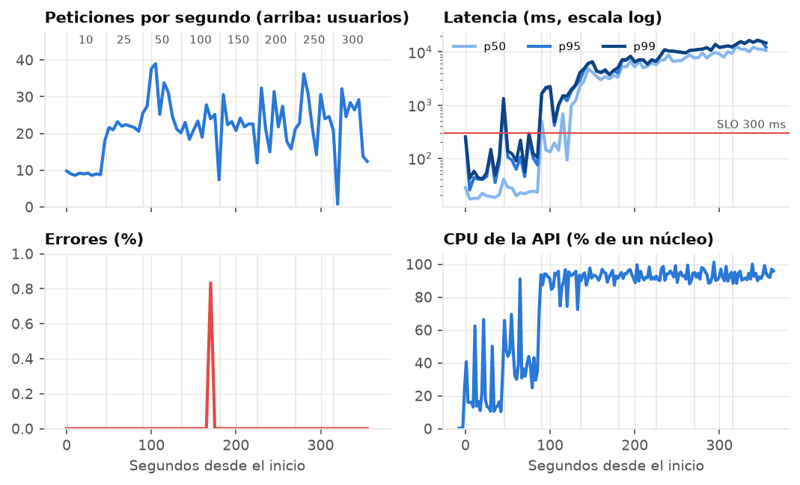

| Usuarios | Pet/s | p50 (ms) | p95 (ms) | p99 (ms) | Errores (%) | CPU API (%) |
|---:|---:|---:|---:|---:|---:|---:|
| 10 | 8.9 | 19 | 53 | 118 | 0.00 | 23 |
| 25 | 22.1 | 23 | 104 | 220 | 0.00 | 45 |
| 50 | 30.4 | 256 | 2,004 | 2,267 | 0.00 | 89 |
| 100 | 22.5 | 3,499 | 5,019 | 6,165 | 0.13 | 93 |
| 150 | 23.2 | 5,595 | 7,133 | 8,048 | 0.00 | 93 |
| 200 | 22.1 | 7,460 | 10,628 | 10,923 | 0.00 | 93 |
| 250 | 24.2 | 9,112 | 12,769 | 13,668 | 0.00 | 93 |
| 300 | 23.9 | 11,242 | 15,609 | 16,425 | 0.00 | 93 |

* **Capacidad de una réplica de 1 vCPU: 22.1 pet/s con p95 de 104 ms** (25 usuarios, CPU
  de la API al 45 %). Con 50 usuarios llega a su techo, 30.4 pet/s, con la CPU al
  89 % y p95 de 2.0 s: las peticiones esperan en cola.
* Después del codo el rendimiento no crece (22–24 pet/s) y el p95 sube hasta 15.6 s.
* Errores: 1 de 7,740 peticiones (0.013 %), un `/predict/lote` que
  el cliente cerró por tiempo de espera durante la sobrecarga. Las entradas inválidas respondieron 422 como se espera.

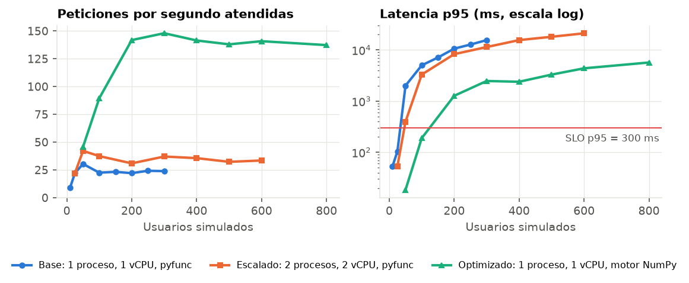

| Configuración | Pet/s bajo el SLO | p95 (ms) | Pet/s máximas | CPU por petición (ms) |
|---|---:|---:|---:|---:|
| Base: 1 proceso, 1 vCPU, pyfunc | 22.1 | 104 | 30.4 | 20.2 |
| Escalado: 2 procesos, 2 vCPU, pyfunc | 22.0 | 53 | 42.1 | 20.6 |
| Optimizado: 1 proceso, 1 vCPU, motor NumPy | 89.5 | 189 | 148.0 | 6.9 |

* **Escalado**: el doble de procesos y de CPU da ×1.39 de rendimiento
  máximo (eficiencia de 69 % por vCPU) y menor latencia a 25 usuarios, pero tampoco cumple
  el SLO con 50.
* **Motor NumPy** (`python scripts/prueba_carga.py --nombre optimizado --acelerar ...`): ×4.04 de capacidad
  bajo el SLO y ×4.87 de rendimiento máximo con la misma réplica. `scripts/perfil_inferencia.py` explica por
  qué: una llamada a `pyfunc.predict` cuesta 15.5 ms con 1 fila y 19.7 ms
  con 100, y la misma transformación en NumPy, 0.084 ms (`reports/finops/perfil_inferencia.json`).
* **Lote** (lotes de 100 seguidos): 2,376 inferencias/s con 0.30 ms de
  CPU por inferencia, 66 veces menos que una petición individual.
* **Asíncrona**: 356 tareas sin fallas; de encolar a terminar, p50
  227 ms y p95 260 ms.

Pruebas en la misma computadora: 216 aprobadas y 1 omitida (RQ no corre de forma nativa en Windows; en Linux corren
las 7 de `test_asincrono.py`) en `reports/carga/pytest_entrega6.txt`, y 71 aprobadas después del motor NumPy
(`reports/carga/pytest_motor.txt`). Evidencia de la ejecución en `docs/evidencia/entrega6/`:

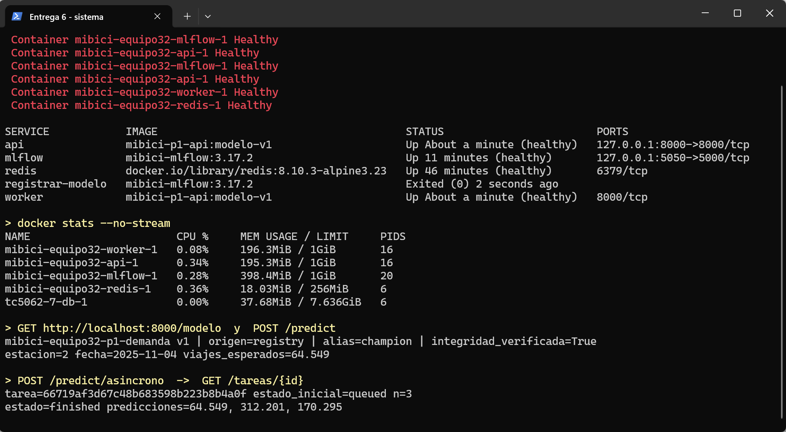

### 4. Monitoreo de recursos y análisis FinOps

```bash
python scripts/medir_reposo.py                 # memoria y CPU en reposo de MLflow y la API según su configuración
python finops/costo_inferencia.py              # costo por inferencia, escenarios y curva (lee reports/carga y reports/finops)
python carga/comparar.py reports/carga         # gráfica comparativa de las corridas base, escalado y optimizado
```

**Consumo por contenedor** en la corrida base (`docker stats` cada 2 s; reposo antes de la carga, pico durante ella):

| Contenedor | CPU reposo (%) | Memoria reposo (MiB) | CPU pico (%) | Memoria pico (MiB) |
|---|---:|---:|---:|---:|
| `api` | 6.3 | 199 | 101.3 | 250 |
| `worker` | 10.4 | 203 | 99.8 | 232 |
| `mlflow` | 12.6 | 392 | 74.0 | 406 |
| `redis` | 0.3 | 11 | 10.1 | 16 |

La CPU es el recurso que limita (la API llega a 1 vCPU y su memoria no pasa de 250 MiB). MLflow en reposo:
**2,083 MiB** con la configuración de fábrica (2 procesos y ejecutor de trabajos, que además no llegó a estar
sano con 1 vCPU), 612 MiB con 2 procesos sin trabajos y **388 MiB** con 1 proceso
sin trabajos, la configuración del `docker-compose.yml` (`reports/finops/reposo.json`).

**Costo por inferencia** (`reports/finops/costos.json`; precios de lista del 18 de noviembre de 2026 en
`finops/precios_referencia.toml`): costo por millón = precio por hora de la réplica ÷ (capacidad en pet/s × 0.6 ×
3,600) × 10⁶, con una utilización objetivo de 60 %. Con Fargate x86 (1 vCPU, 2 GB: USD 0.04937/h) y
22.12 pet/s: **USD 1.03 por millón de peticiones**.

| Opción de despliegue | Precio réplica (USD/h) | En línea, pyfunc | En línea, motor NumPy | Lote de 100 (por millón de inferencias) |
|---|---:|---:|---:|---:|
| Fargate x86 (1 vCPU, 2 GB) | 0.0494 | 1.03 | 0.26 | 0.0058 |
| Fargate ARM (Graviton) | 0.0395 | 0.83 | 0.20 | 0.0046 |
| Fargate Spot x86 | 0.0152 | 0.32 | 0.08 | 0.0018 |
| EC2 c7g.medium (ARM) | 0.0363 | 0.76 | 0.19 | 0.0042 |
| Cloud Run por petición | por uso | 2.40 | 0.89 | — |

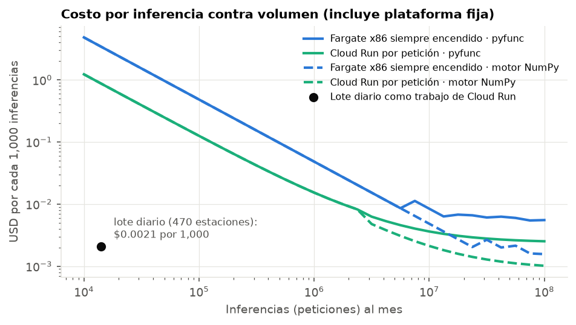

| Escenario | Opción | USD/mes | USD por 1,000 | Réplicas en pico |
|---|---|---:|---:|---:|
| Uso actual: lote diario, 14,100 pred./mes | Trabajo diario en Cloud Run | 0.03 | 0.0021 | — |
|  | Sistema completo encendido (t4g.small) | 12.26 | 0.8695 | — |
| App: 1 M peticiones/mes | Fargate x86 siempre encendido | 48.30 | 0.0483 | 1 |
|  | Cloud Run por petición (escala a cero) | 15.31 | 0.0153 | 1 |
| App: 30 M peticiones/mes | Fargate x86, pyfunc | 192.46 | 0.0064 | 5 |
|  | Fargate x86, motor NumPy | 84.34 | 0.0028 | 2 |
|  | Cloud Run por petición, motor NumPy | 39.07 | 0.0013 | 2 |

**Optimizaciones respaldadas por los datos**

1. **Motor de inferencia en NumPy** (implementado: `API_ACELERAR=1` en `.env` o `ACELERAR_INFERENCIA=1`; se verifica
   contra el Pipeline al cargar y, si no coincide, la API sigue con pyfunc): ×4.04 de capacidad y
   USD 0.26 por millón de peticiones en lugar de USD 1.03.
2. **Lotes para el uso actual**: la predicción diaria de las 470 estaciones como trabajo programado que escala a cero
   cuesta USD 0.03 al mes, frente a USD 12.26 con el sistema siempre encendido; las predicciones se
   sirven desde Redis.
3. **MLflow ajustado** (ya aplicado en el Compose): la plataforma fija cabe en una t4g.small
   (USD 12.26/mes) en lugar de una t3.medium (USD 30.37/mes).
4. **Réplicas de 1 vCPU con autoescalado al 60 % de CPU y concurrencia limitada** en lugar de réplicas más grandes
   (la de 2 vCPU rinde ×1.39); el exceso puede ir a la cola asíncrona.
5. **ARM y Spot**: Graviton −20 % (requiere la imagen
   `linux/arm64`) y Spot −69 % para el lote y el worker.
6. **Memoria y salud**: 512 MiB bastan para la API donde la memoria se cobra aparte, y el worker puede comprobar su
   latido en Redis en lugar de arrancar un intérprete en cada verificación de salud (picos periódicos de CPU).

### 5. Historial de Git de la entrega 6

Ramas de la versión individual integradas en `main` con `git merge --no-ff` (todos los commits a nombre de la autora):

| Rama | Commits | Contenido |
|---|---:|---|
| `feat/prediccion-asincrona` | 4 | Verificación SHA-256 también desde el registry, `POST /predict/asincrono` y `GET /tareas/{id}` con Redis y RQ, worker y pruebas con fakeredis |
| `feat/compose-orquestacion` | 2 | Imagen de MLflow 3.17.2, registro idempotente del modelo y `docker-compose.yml` con cinco servicios |
| `feat/prueba-carga-finops` | 4 | Escenario de Locust, prueba de punta a punta con `docker stats`, gráficas, costo por inferencia y 21 pruebas |
| `ci/github-actions` | 3 | Pipeline de CI/CD, `bandit` sobre los módulos nuevos y corrección de DeepChecks con pandas 3 |
| `perf/motor-numpy` | 3 | Motor de inferencia en NumPy verificado contra el Pipeline, perfil por capa y consumo de MLflow de fábrica |
| `fix/carga-ventanas` | 1 | Peticiones asignadas al escalón por su hora de término |
| `fix/perfil-inferencia` | 1 | Ruta del paquete `api` dentro de la imagen para el perfil |
| `feat/finops-motor-numpy` | 1 | Escenarios y curva de costo con el motor medido |
| `fix/finops-eficiencia` | 1 | Eficiencia del escalado con el rendimiento de saturación |
| `feat/carga-comparacion` | 1 | Gráfica comparativa de las tres configuraciones |
| `feat/grafica-desempeno-compacta` | 1 | Gráfica de desempeño en cuadrícula de 2 × 2 |
| `docs/operacion-finops` | 3 | Resultados de las pruebas, evidencia, regla del escáner para las tablas de resultados, README y contribuciones |

**Uso de herramientas de IA.** El código, las pruebas y esta documentación se elaboraron con apoyo de Claude
(Anthropic); los commits lo declaran con `Co-Authored-By: Claude`. Las pruebas de carga, las mediciones con `docker
stats` y la ejecución del sistema se hicieron en la computadora de la autora.

## Entrega 5: monitoreo de drift con Evidently, reentrenamiento y A/B testing

**Versión individual de Leydy Johanna Camargo Medina (A01840540)**, rama `main` de este repositorio, como las
entregas 3 y 4. Se agrega al proyecto la capa de observabilidad del modelo **P1** que sirve la API:
`mibici-equipo32-p1-demanda` v1 (`@champion`). Reporte en PDF: `TC5061_Drift_ABTest_Equipo32.pdf` (Canvas).

| Pieza | Dónde |
|---|---|
| Datos de producción 2026 (ingesta con manifiesto SHA-256 propio) | `mibici/monitoreo.py ingesta` → `data/manifest_produccion.json` |
| Conjuntos de referencia y actual, reportes de Evidently y corrida `p1-monitoreo-drift` | `mibici/monitoreo.py drift` |
| Versión alternativa reentrenada, registrada como v3 `@challenger` | `mibici/modeling/reentrenamiento.py` |
| A/B testing pareado v1 contra v3 con reglas de decisión | `mibici/modeling/ab_testing.py` |
| Periodos, umbrales y reglas (fijados antes de ver resultados) | `mibici/config.py` (sección *Entrega 5*) |
| Puntos de entrada del MLflow Project | `ingest_produccion`, `monitor`, `retrain`, `abtest` en `MLproject` |
| Pruebas | `tests/test_monitoreo_ab.py` (13) |
| Evidencia | `reports/monitoreo/` (HTML de Evidently, resúmenes JSON y gráficas; las tablas CSV quedan como artefactos en MLflow) y `docs/evidencia/entrega5/` (capturas) |

### Cómo ejecutarlo

```bash
python -m pip install -r requirements.txt                       # agrega evidently 0.7.23 (con plotly 5.24.1)
make server                                                      # MLflow con SQLite (Windows: scripts\servidor_mlflow.ps1)
python -m mibici.monitoreo ingesta --raw-source <carpeta CSV>   # o sin opción: descarga de PRODUCCION_URLS
python -m mibici.monitoreo drift                                 # Evidently sobre models:/mibici-equipo32-p1-demanda@champion
python -m mibici.modeling.reentrenamiento                        # nueva versión -> @challenger
python -m mibici.modeling.ab_testing                             # A=@champion contra B=@challenger
# o: mlflow run . -e monitor|retrain|abtest --env-manager local ;  make entrega5
```

### 1. Conjuntos

| Conjunto | Periodo | Estación-días | Estaciones | Viajes por estación-día |
|---|---|---|---|---|
| Referencia = TRAIN de la v1 | 2025-01-29 a 2025-09-30 | 90,230 | 369 | 33.03 |
| Prueba de la v1 (para el desempeño) | 2025-11-01 a 2025-12-31 | 22,565 | 370 | 30.87 |
| Actual = producción | 2026-07-01 a 2026-09-30 | 40,512 | 472 | 29.77 |

El panel se arma continuo de ene 2025 a sep 2026 con las mismas funciones de `mibici/features.py`; la prueba de la
v1 reconstruida reproduce su `test_mae` registrado (5.4097, `tests/test_monitoreo_ab.py`). La API no guarda sus
peticiones, por eso el periodo actual sale de los datos abiertos de 2026 (`data_version` 5fb2c4834870).

### 2. Reporte de drift (Evidently 0.7.23)

`DataDriftPreset` (Wasserstein normalizada / Jensen-Shannon, umbral 0.1; drift del conjunto con ≥ 50 % de columnas)
+ `DataSummaryPreset` con pruebas, el mismo drift con PSI (umbral 0.2), el drift solo de estaciones existentes y
`RegressionPreset` de la v1. Resultado: **drift del conjunto, 10 de 14 columnas (71.4 %)**.

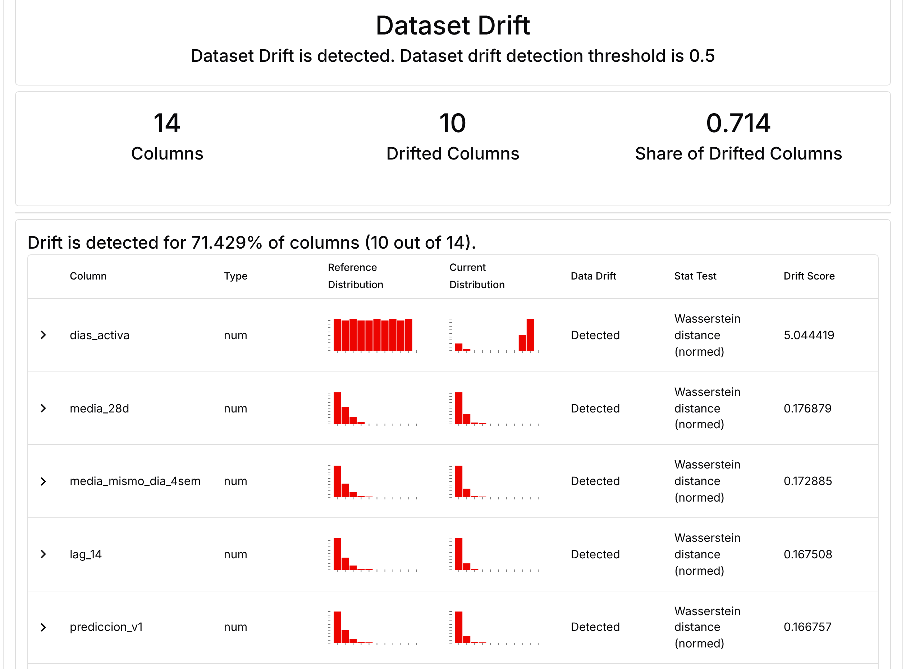

| Variable | Wasserstein/JS | ¿Drift? | PSI | Solo estaciones existentes | Media ref. → actual |
|---|---|---|---|---|---|
| `dias_activa` | 5.044 | **sí** | 10.483 | 6.237 (sí) | 149.9 → 506.7 |
| `media_28d` | 0.177 | **sí** | 0.060 | 0.070 | 33.1 → 27.9 |
| `media_mismo_dia_4sem` | 0.173 | **sí** | 0.059 | 0.067 | 33.1 → 27.7 |
| `lag_14` | 0.168 | **sí** | 0.042 | 0.065 | 33.1 → 27.8 |
| `prediccion_v1` | 0.167 | **sí** | 0.042 | 0.065 | 33.0 → 27.8 |
| `lag_7` | 0.140 | **sí** | 0.031 | 0.038 | 33.1 → 28.7 |
| `media_7d` | 0.139 | **sí** | 0.037 | 0.040 | 33.1 → 29.1 |
| `lag_2` | 0.119 | **sí** | 0.027 | 0.027 | 33.1 → 29.4 |
| `lag_1` | 0.113 | **sí** | 0.026 | 0.026 | 33.0 → 29.6 |
| `viajes` | 0.109 | **sí** | 0.026 | 0.026 | 33.0 → 29.8 |
| `capacidad` | 0.087 | no | 0.033 | 0.002 | 16.9 → 17.0 |
| `feriado` | 0.034 | no | 0.010 | 0.037 | 0.0 → 0.0 |
| `dia_semana` | 0.009 | no | 0.001 | 0.009 | 3.0 → 3.0 |
| `fin_semana` | 0.003 | no | 0.000 | 0.002 | 0.3 → 0.3 |

**Interpretación.** `dias_activa` tiene drift estructural (la antigüedad crece cada día; 84 % de las filas actuales
superan el máximo de TRAIN y la v1 extrapola). El drift de la demanda es de **composición**: entre jun y sep 2026 la
red pasó de 369 a 472 estaciones y las 103 nuevas, con menos viajes, bajan el promedio por estación; con solo las
estaciones existentes únicamente `dias_activa` conserva drift y el PSI de la demanda es < 0.07. La v1 se degradó del
periodo de prueba al actual: MAE 5.41 → 5.87, WAPE 17.5 % → 19.7 % y sesgo
+1.36 → -1.96 (subestima), sobre todo en sep 2026, cuando el sistema creció ~29 %. El monitoreo
también reveló que el calendario de feriados solo cubría 2025: se agregaron los de 2026.

### 3. Versión alternativa y A/B testing

**v3** = mismo pipeline e hiperparámetros, TRAIN ene 2025-may 2026, compuerta en VAL jun 2026 (MAE 7.27 contra
7.47 de la v1), registrada como `@challenger`. A/B **pareado** sobre las mismas 40,512 estación-días de jul-sep 2026,
IC 95 % por *bootstrap* de días (2,000 réplicas) y Wilcoxon sobre el MAE diario:

| Métrica | A: v1 `@champion` | B: v3 `@challenger` | B − A [IC 95 %] |
|---|---|---|---|
| MAE | 5.873 | 5.657 | -0.215 [-0.316, -0.119] |
| RMSE | 10.783 | 10.374 | -0.409 |
| WAPE | 19.73 % | 19.00 % | -0.72 pp |
| R² | 0.8989 | 0.9064 | +0.0075 |
| Sesgo | -1.961 | -1.056 | +0.905 |
| Días con menor MAE (Wilcoxon) | | 59 de 92 | p = 0.0004 |

| Mes | MAE A | MAE B | Cambio | Sesgo A | Sesgo B |
|---|---|---|---|---|---|
| 2026-07 | 5.577 | 5.568 | -0.1 % | -0.20 | +0.47 |
| 2026-08 | 4.847 | 4.792 | -1.1 % | -0.96 | -0.20 |
| 2026-09 | 7.141 | 6.584 | -7.8 % | -4.52 | -3.27 |

Se cumplen las cuatro reglas de `config.py` (IC bajo cero, ningún mes peor por más de 2 %, sesgo no mayor, costo
similar): **la v3 debe quedar como versión vigente.** La decisión quedó como etiqueta `ab_test_jul_sep_2026` en las
dos versiones del registry; mover `@champion` se hace junto con la reconstrucción de la imagen de la API
(`scripts\ejecutar_servicio.ps1 -Exportar`). Un A/B en línea simulado (estaciones 50/50 por *hash*) da un IC
9 veces más ancho que el pareado.

**Recomendación (Continuous Training):** reentrenamiento mensual con ventana creciente y la misma compuerta + A/B;
disparadores por desempeño (MAE móvil de 7 días +10 % o sesgo > 1.5) porque la etiqueta llega al día siguiente;
Evidently semanal como diagnóstico estratificado por cohorte; acotar o quitar `dias_activa` y registrar las
peticiones de la API.

### Ejecución en la computadora de la autora

Windows 11, Python 3.14.8, MLflow 3.17.2 con SQLite, commit `62b4cf0` (rama local `entrega5-monitoreo`). Corridas en el
experimento `mibici-equipo32`: `p1-monitoreo-drift` (b6e0a185…), `p1-reentreno-ventana-2026` (1d685b6b…) y
`p1-ab-test-v1-vs-v3` (93d20255…). Pruebas: 29 aprobadas (`reports/monitoreo/pytest_entrega5.txt`); ruff sin hallazgos.

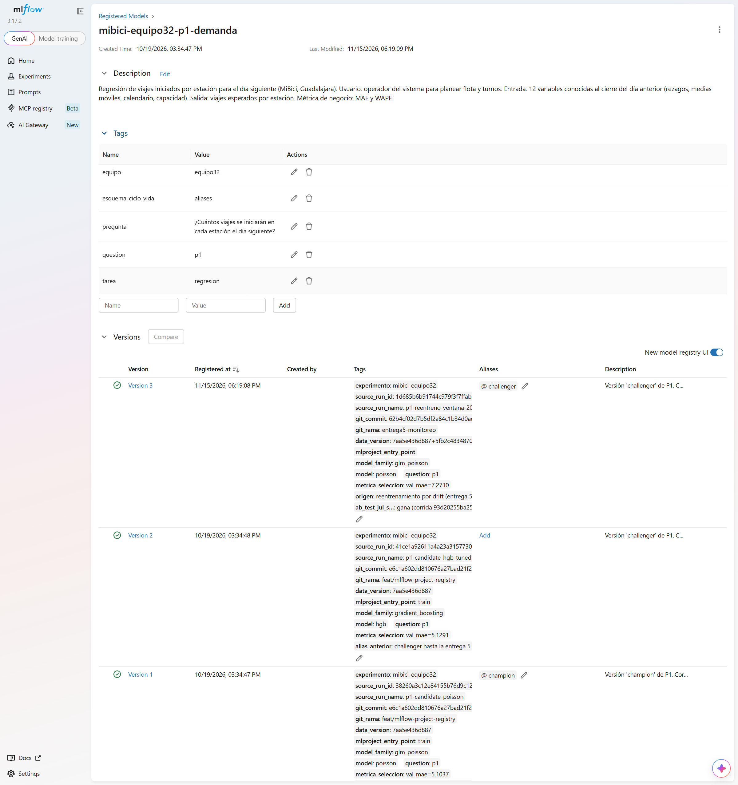

### Historial de Git de la entrega 5

| Rama | Contenido |
|---|---|
| `feat/monitoreo-evidently` | Configuración (periodos, feriados 2026, umbrales y reglas), dependencias, `mibici/monitoreo.py`, `MLproject` y `make monitoreo` |
| `feat/reentrenamiento-ab-testing` | `reentrenamiento.py`, `ab_testing.py`, puntos de entrada `retrain` y `abtest` |
| `test/monitoreo-ab` | 13 pruebas y reglas del escáner de secretos para los datos de 2026 |
| `docs/reporte-drift-ab` | Evidencia de la ejecución (Evidently, A/B y capturas de MLflow) y este README |

**Uso de herramientas de IA.** El código, las pruebas y esta documentación se elaboraron con apoyo de Claude
(Anthropic); los commits lo declaran con `Co-Authored-By: Claude`. La ejecución, el registro en MLflow y las capturas
se hicieron en la computadora de la autora.

## Entrega 4: el modelo P1 como API REST en un contenedor (FastAPI + Podman/Docker)

**Versión individual de Leydy Johanna Camargo Medina (A01840540).** Por el acuerdo de la coordinación
con el profesor para las actividades en equipo que faltan, cada integrante puede entregar su propia
versión; esta vive en este repositorio (rama `main`), como la de la entrega 3. El modelo que se despliega es el de **P1** (regresión de viajes por estación para el día
siguiente): la versión **1** de `mibici-equipo32-p1-demanda` en el Model Registry de MLflow, que es la
que apunta el alias `@champion` (Poisson lineal, `test_mae` = 5.41 viajes, `test_wape` = 0.175).

| Pieza | Dónde |
|---|---|
| Recuperación del modelo del Model Registry (nombre + versión o alias) | `scripts/exportar_modelo_registry.py` → `models/servicio/` + `registro.json` |
| API REST con FastAPI | `api/main.py` (endpoints), `api/esquemas.py` (Pydantic), `api/modelo.py` (carga y predicción), `api/config.py` |
| Contenedor (estándar OCI) | `Containerfile` (y `Dockerfile`, copia idéntica para Docker), `.dockerignore` |
| Dependencias | `requirements-api.in` → `requirements-api.txt` (imagen); `requirements.txt` (desarrollo y pruebas) |
| Pruebas | `tests/test_api.py` (43), `tests/test_contenedor.py` (24) |
| Un solo comando | `scripts/ejecutar_servicio.ps1` (Windows) y `make modelo-servicio imagen contenedor probar-api` |
| Peticiones de ejemplo | `docs/ejemplos/peticion_predict.json`, `peticion_lote.json`, `peticion_invalida.json` |
| Evidencia | `docs/evidencia/entrega4/` (capturas) y `reports/servicio/` (salida completa) |

### 1. Recuperar el modelo del Model Registry

El modelo se recupera del registry **por nombre y versión** (o por alias, que se resuelve a una versión)
con el servidor de tracking del proyecto:

```bash
# Terminal 1: servidor de MLflow (entrega 2). En Windows: powershell -ExecutionPolicy Bypass -File scripts\servidor_mlflow.ps1
make server
# Terminal 2
export MLFLOW_TRACKING_URI=http://127.0.0.1:5000        # PowerShell: $env:MLFLOW_TRACKING_URI="http://127.0.0.1:5000"
python scripts/exportar_modelo_registry.py --nombre mibici-equipo32-p1-demanda --version 1   # nombre + versión
python scripts/exportar_modelo_registry.py --alias champion                                  # o la versión en producción
```

Salida real en la computadora de la autora (`reports/servicio/01_registry.txt`):

```
Model Registry      : http://127.0.0.1:5000
Modelo registrado   : mibici-equipo32-p1-demanda  (@challenger -> v2, @champion -> v1)
Versión recuperada  : v1 por alias @champion  ->  models:/mibici-equipo32-p1-demanda/1
Corrida de origen   : p1-candidate-poisson (38260a3c12e84155b76d9c126b7be2e1), estado READY
Linaje              : commit e6c1a60, data_version 7aa5e436d887, modelo poisson (glm_poisson)
Métricas            : val_mae=5.104  test_mae=5.410  test_wape=0.175
Firma de entrada    : 12 variables: dia_semana, fin_semana, feriado, lag_1, lag_2, lag_7, lag_14, media_7d, media_28d, media_mismo_dia_4sem, dias_activa, capacidad
Descargado en       : models\servicio (25 archivos, SHA-256 en registro.json)
Verificación        : mlflow.pyfunc carga la copia y predice el input_example -> [36.655, 26.091, 58.991, 64.549, 65.071]
```

El script descarga `models:/mibici-equipo32-p1-demanda/1` a `models/servicio/` y escribe
[`registro.json`](models/servicio/registro.json): versión, aliases, corrida de origen, linaje (commit,
`data_version`), métricas de validación y prueba, costo de inferencia y tamaño del modelo, firma de
entrada y el **SHA-256 de cada archivo**. El modelo se registró con MLflow 3.17.1 y el proyecto usa
3.17.2 (por CVE-2026-53995, entrega 3); el formato del modelo es el mismo y las librerías que
determinan las predicciones (scikit-learn, numpy, pandas, scipy y skops) tienen exactamente las
versiones del registro (`tests/test_contenedor.py` lo comprueba), por eso la carga omite el aviso de
MLflow sobre esa diferencia.

**Opción elegida: empaquetar en la imagen el modelo descargado del registry.** El `Containerfile`
copia `models/servicio/` a la imagen y la API, al arrancar, (1) verifica el SHA-256 de cada archivo
contra `registro.json` y (2) comprueba que la firma del modelo tenga exactamente las 12 variables del
contrato; si algo no coincide, el contenedor no arranca. Razones:

- **Reproducible e inmutable:** la imagen `mibici-p1-api:modelo-v1` contiene la versión 1 y responde
  igual en cualquier máquina, sin depender de que el servidor de MLflow esté encendido o accesible.
- **El registry del proyecto guarda los artefactos en rutas locales:** el experimento `mibici-equipo32`
  tiene su ubicación de artefactos en `file:C:/Users/.../mlruns/1`, que un contenedor Linux no puede leer.
- **Cambio de versión y *rollback* explícitos:** al mover `@champion` se vuelve a correr el script y
  se construye `modelo-v2` (`make imagen` y `scripts\ejecutar_servicio.ps1` toman la versión de
  `registro.json` para la etiqueta y para `--build-arg MODELO_VERSION`); regresar es volver a levantar
  la imagen anterior.
- `models/servicio/` se versiona en Git (360 KB, sin datos ni credenciales) para que la imagen se
  construya desde un clon limpio. `.gitattributes` lo marca `-text`: sin eso, Git para Windows
  convertiría LF a CRLF al clonar y el SHA-256 dejaría de coincidir.

**Alternativa también soportada (registry en vivo):** con `MODELO_URI=models:/<nombre>/<versión>` (o
`@<alias>`) la API descarga el modelo del registry al arrancar, usando `MLFLOW_TRACKING_URI`:

```bash
podman run -d -p 8000:8000 -e MODELO_URI=models:/mibici-equipo32-p1-demanda/1 \
    -e MLFLOW_TRACKING_URI=http://host.containers.internal:5000 mibici-p1-api:modelo-v1
# Docker: -e MLFLOW_TRACKING_URI=http://host.docker.internal:5000 (en Linux agrega --add-host=host.docker.internal:host-gateway)
```

Requiere que el contenedor alcance al servidor (con Podman, normalmente `--host 0.0.0.0` en `mlflow
server`) y que el servidor sirva los artefactos por HTTP (experimentos con ubicación `mlflow-artifacts:/`). Un alias se resuelve una sola vez al
arrancar. Esta ruta se prueba contra un registry temporal en `tests/test_api.py::test_carga_directa_desde_el_registry`.

### 2. La API

| Método y ruta | Qué hace |
|---|---|
| `GET /` | Nombre del servicio, modelo y lista de endpoints |
| `GET /health` | Estado del servicio y versión del modelo (lo usa el `HEALTHCHECK` del contenedor) |
| `GET /modelo` | Versión del registry que se sirve, aliases, corrida de origen, commit, `data_version`, métricas y descripción de las 12 variables |
| `POST /predict` | Viajes esperados de **una** estación para el día D |
| `POST /predict/lote` | Lo mismo para **hasta 1000** estaciones o días en una sola llamada al modelo |
| `GET /docs` | Documentación interactiva (Swagger UI) generada por FastAPI con los esquemas y un ejemplo |

**Entrada** (`EntradaP1`, `api/esquemas.py`): las 12 variables con las que se entrenó el modelo, todas
conocidas al cierre del día anterior, más `estacion_id` y `fecha` opcionales que se devuelven con la
predicción.

| Variable | Tipo y rango | Significado |
|---|---|---|
| `dia_semana` | entero 0–6 | Día de la semana del día que se predice (0 = lunes) |
| `fin_semana`, `feriado` | entero 0/1 | Sábado o domingo; día de descanso obligatorio |
| `lag_1`, `lag_2`, `lag_7`, `lag_14` | entero 0–2000 | Viajes iniciados hace 1, 2, 7 y 14 días |
| `media_7d`, `media_28d` | número 0–2000 | Promedio diario de viajes de los últimos 7 y 28 días |
| `media_mismo_dia_4sem` | número 0–2000 | Promedio de D-7, D-14, D-21 y D-28 |
| `dias_activa` | entero 28–3650 | Días de historia de la estación (28 = mínimo para `media_28d`) |
| `capacidad` | entero 1–100 | Anclajes de la estación |

**Validación en tres capas** (un error responde **422** con el campo y el motivo):

1. *Tipo y rango de cada campo*: conteos enteros no negativos, banderas 0/1, números finitos (sin
   `NaN`), textos y booleanos rechazados aunque parezcan números (`"62"`, `true`), también en
   `estacion_id` (1 a 99,999); `fecha` solo como `AAAA-MM-DD`; y campos desconocidos rechazados
   (`extra="forbid"`), así que un nombre mal escrito no pasa en silencio.
2. *Consistencia entre campos*, que se cumple por construcción en los datos reales (se comprobó en las
   124,234 filas): `fin_semana` debe corresponder a `dia_semana` y a `fecha`; y las medias deben
   contener los rezagos de su ventana: `7·media_7d ≥ lag_1 + lag_2 + lag_7`,
   `4·media_mismo_dia_4sem ≥ lag_7 + lag_14` y `28·media_28d ≥ 7·media_7d + 4·media_mismo_dia_4sem − lag_7`
   (tolerancia de 0.5 viajes para medias redondeadas).
3. *Advertencias* que no bloquean: valores fuera del rango visto en entrenamiento (ene–sep 2025), donde
   el modelo extrapola. Por ejemplo, `dias_activa` crece cada día y ya pasó el máximo de TRAIN (272):
   es el mismo *drift* que encontró DeepChecks en la entrega 3, ahora visible en cada respuesta.

**Salida** (`PrediccionP1`): `viajes_esperados` (número finito ≥ 0), `viajes_esperados_redondeado`,
`advertencias` y el modelo que respondió (`nombre`, `version`, `alias`, `run_id`). Cada respuesta
trae además las cabeceras `X-Modelo` (p. ej. `mibici-equipo32-p1-demanda/1`) y `X-Tiempo-Respuesta-ms`.

Para correrla sin contenedor: `python -m uvicorn api.main:app --port 8000` (o `make api`).

### 3. El Containerfile

- **Imagen base fija** `docker.io/library/python:3.14.8-slim-trixie@sha256:fbecd461…`: la misma versión
  de Python con la que se registró el modelo (`MLmodel` → `python_version`), con el nombre completo del
  registro (para que Podman no tenga que preguntar de dónde descargarla) y el *digest* del índice
  multiplataforma que resolvió la construcción de la evidencia (una etiqueta re-publicada no cambia la base).
- **Dos etapas:** la primera instala `requirements-api.txt` en un entorno virtual solo con ruedas
  precompiladas (`--only-binary=:all:`); la final copia el entorno, `api/` y `models/servicio/`, sin
  caché de pip ni herramientas de construcción.
- **Dependencias fijas e iguales a las del entrenamiento:** las 53 de `requirements-api.txt` (directas y
  transitivas). scikit-learn, numpy, pandas, scipy y skops tienen exactamente las versiones del
  `requirements.txt` que MLflow guardó con el modelo; `mlflow-skinny` basta para `mlflow.pyfunc` y deja
  fuera Flask, SQLAlchemy y el servidor. `pip-audit -r requirements-api.txt`: sin vulnerabilidades conocidas.
- **Usuario sin privilegios** (UID 10001), puerto `8000`, `HEALTHCHECK` contra `/health` y
  `CMD ["uvicorn", "api.main:app", "--host", "0.0.0.0", "--port", "8000", "--no-server-header"]`.
- **`.dockerignore` de lista blanca:** al motor solo viajan `Containerfile`, `requirements-api.txt`,
  `api/` y `models/servicio/`; nunca `.venv`, `data/`, `mlruns/`, `mlflow.db` ni `.env`.
- `tests/test_contenedor.py` comprueba estas decisiones sin construir la imagen (base y versión de
  Python, usuario, puerto, `HEALTHCHECK`, qué se copia, `.dockerignore` y versiones de las
  dependencias); la auditoría de vulnerabilidades la hace `scripts/chequeos_seguridad.py`.

### 4. Construir, levantar y consumir la API

Requisitos: Podman (≥ 4) o Docker. Desde la raíz del repositorio (el modelo ya está en `models/servicio/`):

| Paso | Podman | Docker |
|---|---|---|
| Construir la imagen | `podman build -t mibici-p1-api:modelo-v1 .` | `docker build -t mibici-p1-api:modelo-v1 .` |
| Levantar el contenedor | `podman run -d --name mibici-p1-api -p 8000:8000 mibici-p1-api:modelo-v1` | `docker run -d --name mibici-p1-api -p 8000:8000 mibici-p1-api:modelo-v1` |
| Ver estado y logs | `podman ps` · `podman logs mibici-p1-api` | `docker ps` · `docker logs mibici-p1-api` |
| Detener y borrar | `podman rm -f mibici-p1-api` | `docker rm -f mibici-p1-api` |

- Podman busca `Containerfile` y Docker busca `Dockerfile`; el repositorio trae los dos con el mismo
  contenido (`tests/test_contenedor.py` verifica que sean idénticos), así que ninguno necesita `-f`
  (`-f Containerfile` también funciona). Para que Podman conserve el `HEALTHCHECK`, construye con
  `--format docker` (el formato OCI no lo guarda).
- Con `make`: `make imagen contenedor probar-api` (Podman por defecto; `MOTOR=docker` para Docker;
  `probar-api` espera a que `/health` responda antes de enviar la petición).
- En Windows, **todo con un comando** (construir, levantar, esperar a `/health` y probar `/predict`,
  `/predict/lote`, `/modelo` y una entrada inválida):
  `powershell -ExecutionPolicy Bypass -File scripts\ejecutar_servicio.ps1 -Motor docker` (o `-Motor podman`).
  Sin opciones usa el modelo ya versionado y deja la salida en `%TEMP%\mibici_servicio`.
  `-Exportar` vuelve a descargar el modelo del registry (solo donde está el servidor del proyecto) y
  `-Capturas` es el modo con el que se generó la evidencia: reemplaza `reports/servicio/` y las capturas.

**Consumir la API.** Petición de ejemplo: estación 2, martes 4 de noviembre de 2025 (conjunto de
prueba; ese día se iniciaron **63** viajes):

```bash
# Linux / macOS / Git Bash
curl -s -X POST http://localhost:8000/predict -H "Content-Type: application/json" \
     --data-binary @docs/ejemplos/peticion_predict.json
# PowerShell
curl.exe -s -X POST http://localhost:8000/predict -H "Content-Type: application/json" --data-binary "@docs/ejemplos/peticion_predict.json"
Invoke-RestMethod -Method Post -Uri http://localhost:8000/predict -ContentType "application/json" -InFile docs\ejemplos\peticion_predict.json
```

```python
import json, requests
cuerpo = json.load(open("docs/ejemplos/peticion_predict.json", encoding="utf-8"))
print(requests.post("http://localhost:8000/predict", json=cuerpo, timeout=10).json())
```

Cuerpo de la petición ([`docs/ejemplos/peticion_predict.json`](docs/ejemplos/peticion_predict.json)):

```json
{
  "estacion_id": 2, "fecha": "2025-11-04",
  "dia_semana": 1, "fin_semana": 0, "feriado": 0,
  "lag_1": 61, "lag_2": 27, "lag_7": 65, "lag_14": 64,
  "media_7d": 56.5714, "media_28d": 55.0357, "media_mismo_dia_4sem": 64.0,
  "dias_activa": 307, "capacidad": 15
}
```

Respuesta del contenedor (`HTTP/1.1 200 OK`, `x-modelo: mibici-equipo32-p1-demanda/1`;
[`reports/servicio/04_respuesta_predict.json`](reports/servicio/04_respuesta_predict.json)):

```json
{
  "estacion_id": 2,
  "fecha": "2025-11-04",
  "viajes_esperados": 64.549,
  "viajes_esperados_redondeado": 65,
  "advertencias": [
    "dias_activa=307 está fuera del rango de entrenamiento [28, 272]: el modelo extrapola"
  ],
  "modelo": {
    "nombre": "mibici-equipo32-p1-demanda",
    "version": 1,
    "alias": ["champion"],
    "run_id": "38260a3c12e84155b76d9c126b7be2e1"
  }
}
```

El modelo espera 64.5 viajes y se iniciaron 63. En el lote de ejemplo
([`peticion_lote.json`](docs/ejemplos/peticion_lote.json), tres estaciones el mismo día) predice 64.5,
312.2 y 170.3 contra 63, 257 y 137 reales; la estación 35 además trae `media_7d` por encima del máximo
de entrenamiento y la respuesta lo advierte.

Una entrada inválida ([`peticion_invalida.json`](docs/ejemplos/peticion_invalida.json): `fin_semana=1`
en martes y `media_7d=5.0`, imposible si en tres de esos siete días hubo 153 viajes) responde
`HTTP/1.1 422 Unprocessable Content`:

```json
{"detail": [{"type": "value_error", "loc": ["body"],
  "msg": "Value error, fin_semana=1 no corresponde a dia_semana=1 (fin_semana es 1 solo para 5 = sábado y 6 = domingo); media_7d=5.0 es imposible: 7 × media_7d debe ser al menos lag_1 + lag_2 + lag_7 = 153", "...": "..."}]}
```

Variables de entorno del contenedor:

| Variable | Valor en la imagen | Uso |
|---|---|---|
| `MODELO_URI` | `/app/models/servicio` | Modelo empaquetado, o `models:/<nombre>/<versión>` / `models:/<nombre>@<alias>` para leerlo del registry |
| `MLFLOW_TRACKING_URI` | (sin definir: `http://127.0.0.1:5000`, que dentro del contenedor es el propio contenedor) | Servidor de MLflow; solo se usa con `MODELO_URI=models:/...` |
| `VERIFICAR_INTEGRIDAD` | `1` | Verifica el SHA-256 de cada archivo del modelo contra `registro.json` |

### 5. Estrategia de despliegue: inferencia en línea (tiempo real) con variables calculadas por lotes

Se eligió un **servicio de inferencia en línea**: un modelo como servicio REST, síncrono, que responde
cada petición en cuanto llega, empaquetado en un contenedor. En términos de Huyen (2022, cap. 7) es
*predicción en línea con variables por lotes*: las 12 variables se conocen al cierre del día anterior y
se calculan aguas arriba (rezagos y medias de la demanda diaria), mientras que la predicción se hace
bajo demanda.

- **Por qué en línea y no solo por lotes:** el operador necesita la predicción cuando planea (tablero
  de flota, escenarios "qué pasa si" al cambiar un dato, estaciones nuevas o corregidas), y en la
  siguiente semana este servicio será un microservicio que otros componentes llamarán por HTTP. Con
  predicciones por lotes habría que esperar a la siguiente corrida y guardar predicciones que tal vez
  nadie consulte.
- **El lote también cabe en el mismo servicio:** `POST /predict/lote` acepta hasta 1000 instancias en
  una sola llamada, así que un proceso programado al cierre del día puede pedir las ~370 estaciones
  activas en una petición. Es la estrategia por lotes de Treveil et al. (2020, cap. 6) sin una segunda
  ruta de código.
- **El costo lo permite:** el modelo pesa 0.18 MB y la corrida de origen registró 3.39 ms por cada 1000
  predicciones (`tamano_modelo_mb` y `costo_inferencia_ms_1k`, en `registro.json` y en `GET /modelo`).
  En el contenedor, en una laptop, la primera predicción tras arrancar tardó 240 ms (calentamiento) y
  las demás respuestas de la evidencia entre 6 y 191 ms (cabecera `X-Tiempo-Respuesta-ms`, en
  `reports/servicio/*.headers.txt`): el tiempo lo ponen HTTP, JSON y la validación, no el modelo.
- **Contenedor e imagen inmutable** (Treveil et al., 2020, cap. 6): misma imagen en la laptop, en un
  servidor o en un orquestador; la versión del modelo va en la etiqueta de la imagen y en `/modelo`, y
  la API se niega a arrancar si el modelo no es el registrado. Para más carga se levantan más réplicas
  detrás de un balanceador (cada proceso es independiente y sin estado).
- **Límites conocidos:** la API no calcula las variables (el cliente o un servicio de *features* debe
  enviarlas; es parte de la arquitectura de microservicios de la siguiente entrega) y el modelo
  extrapola en `dias_activa`: las advertencias lo hacen visible y sirven de señal para reentrenar.

### 6. Evidencia de la ejecución

Ejecución en la computadora de la autora (Windows 11, Docker Desktop 4.96.3 con Docker Engine 29.9.2,
ver [`02_motor_version.txt`](reports/servicio/02_motor_version.txt); `.venv` con Python 3.14.8) con
`scripts\ejecutar_servicio.ps1 -Motor docker -Exportar -Capturas` sobre el commit `58cd599`, el que
aparece en el resumen. El `registro.json` que generó esa descarga se versionó en el commit siguiente
(`8c2a9c7`); los 25 archivos del modelo no cambiaron. Una primera ejecución completa sobre `41ac694`,
antes de la revisión independiente, está en el historial de Git (`1c7f7ae`), con la construcción sin
caché (unos 9 minutos, casi todo descarga de dependencias). Podman no estaba instalado en esa máquina;
el `Containerfile` es OCI y los comandos de Podman de la sección 4 son equivalentes. Salida completa de
cada paso y las respuestas JSON en [`reports/servicio/`](reports/servicio/).

**La API respondiendo a una petición de prueba desde el contenedor** (`docker ps` muestra el contenedor
`healthy`; `POST /predict` responde 200 con la versión 1 del registry):

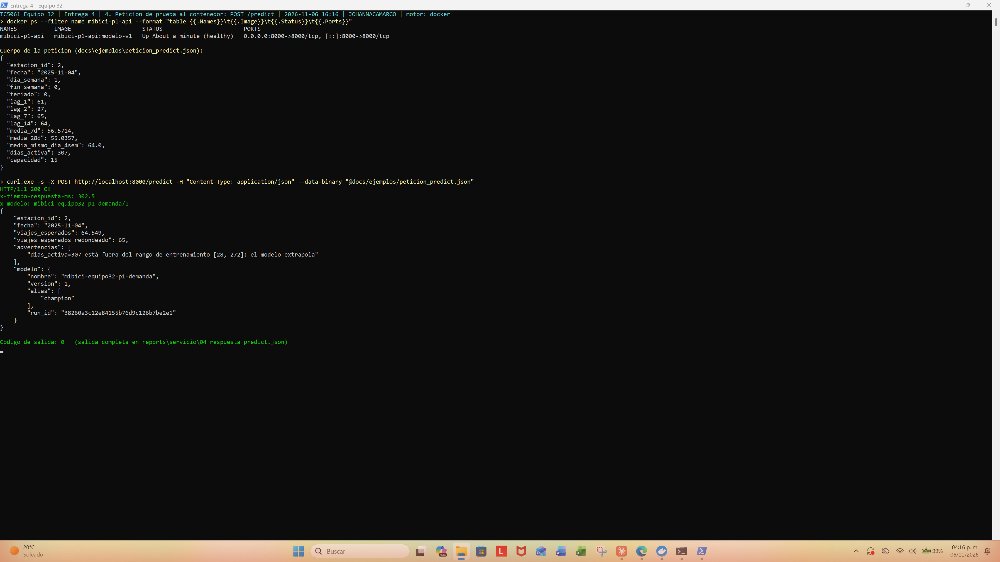

**Paso 1: modelo recuperado del Model Registry por alias → versión 1** (y la misma versión en la UI de MLflow, con `@champion`):

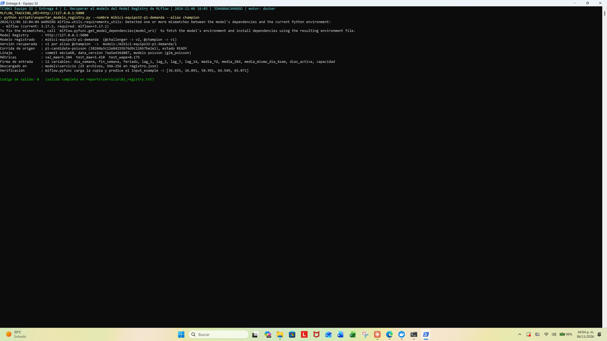

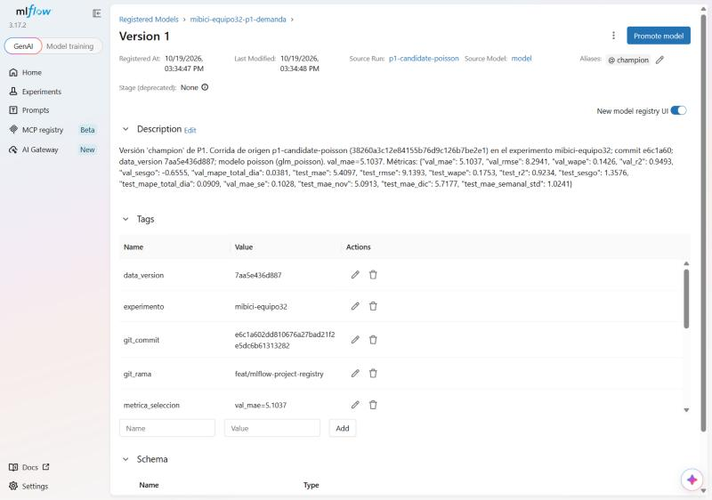

**Paso 2: `docker build`** (salida en `reports/servicio/02_build.txt`, con las dependencias en caché de la construcción anterior; la imagen ocupa 823 MB en disco, 183 MB de contenido):

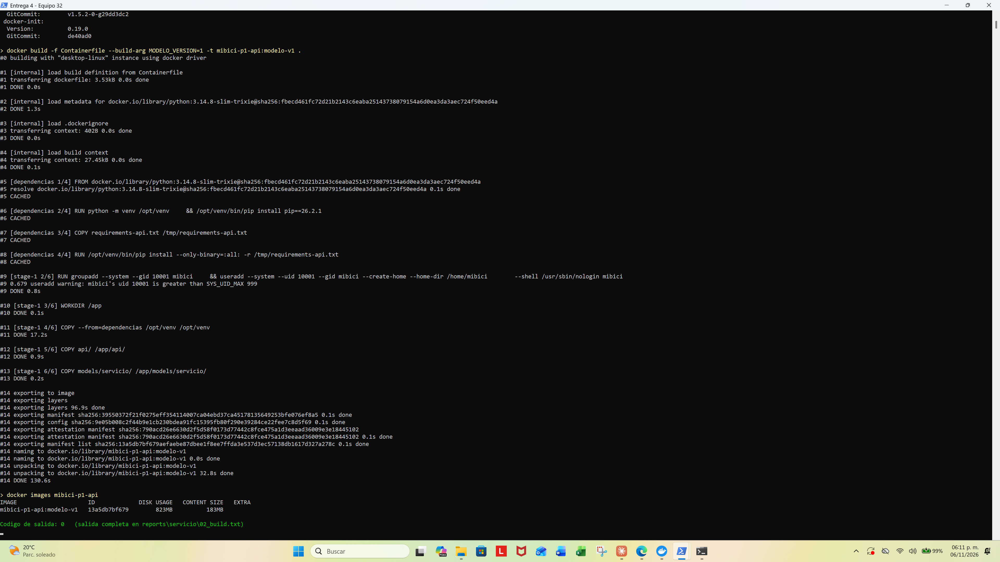

**Paso 3: `docker run`, contenedor `healthy` y logs** (el modelo carga con integridad verificada):

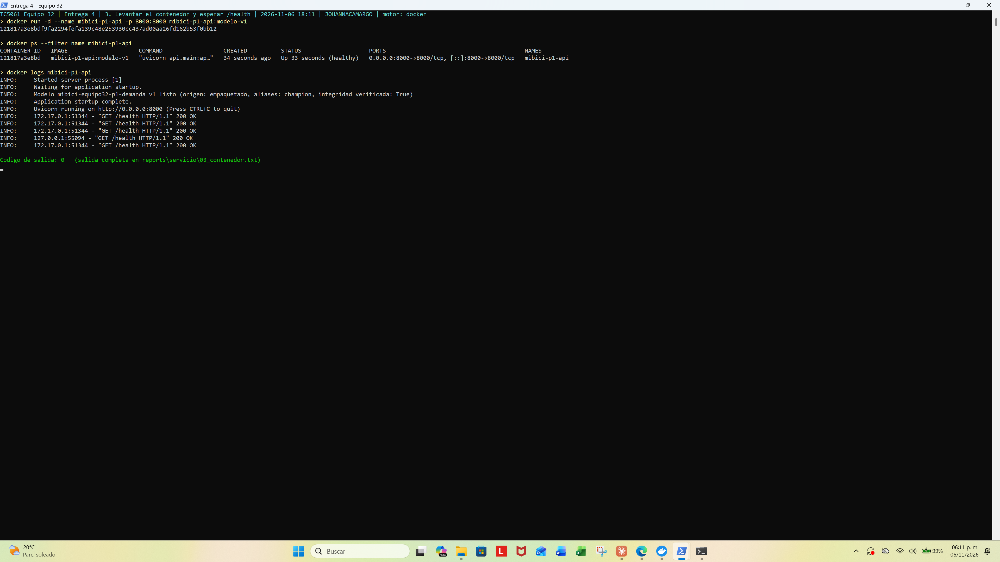

| Lote de 3 estaciones y `/health` | `GET /modelo` | Entrada inválida → 422 |
|---|---|---|
| 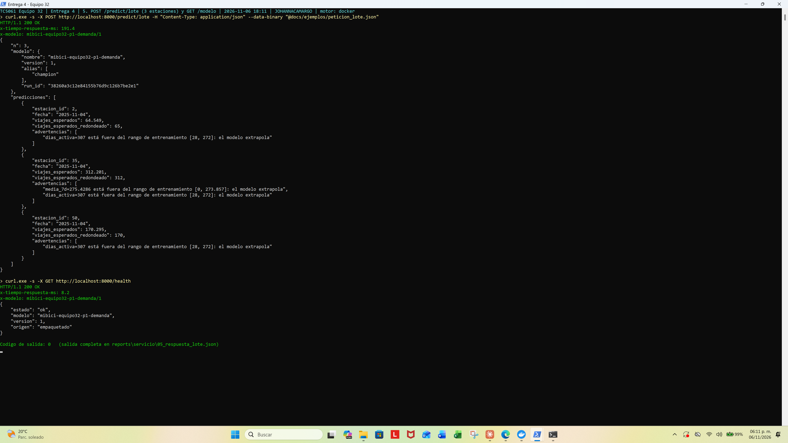 | 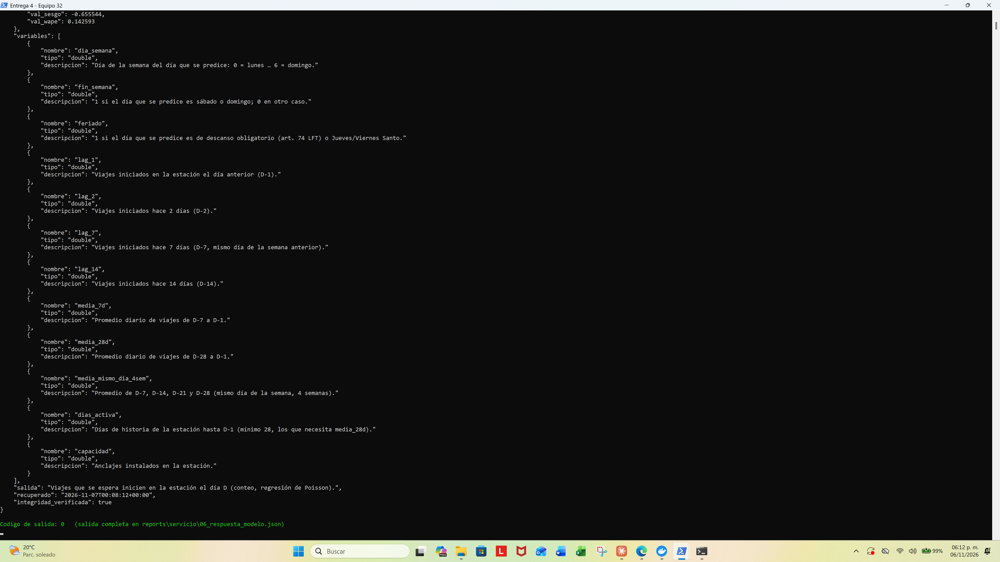 | 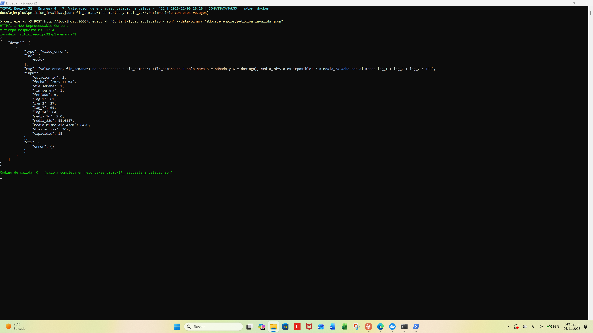 |

**Swagger UI del contenedor** (`http://localhost:8000/docs`) y `POST /predict` ejecutado desde ahí
(capturas del navegador integrado de la aplicación de Claude en la misma computadora; la petición se hizo
mientras corrían las pruebas completas):

| Endpoints y descripción | Respuesta 200 con cabeceras de trazabilidad |
|---|---|
| 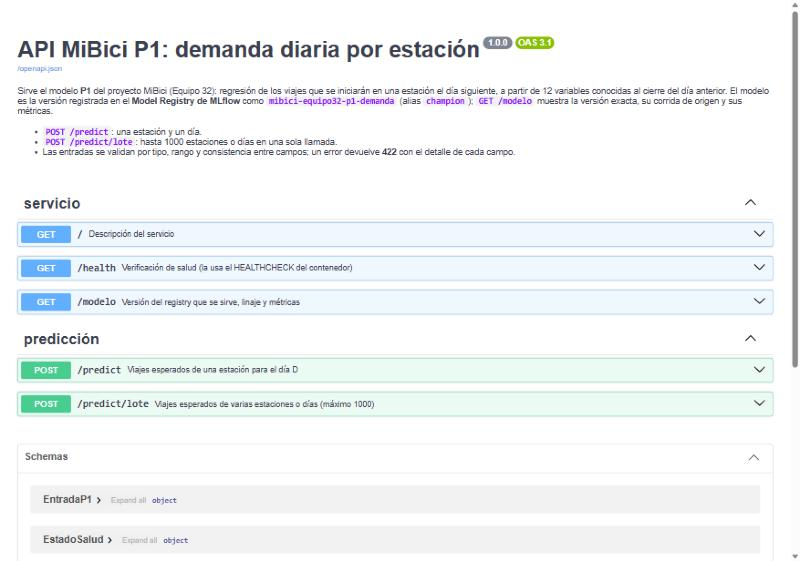 | 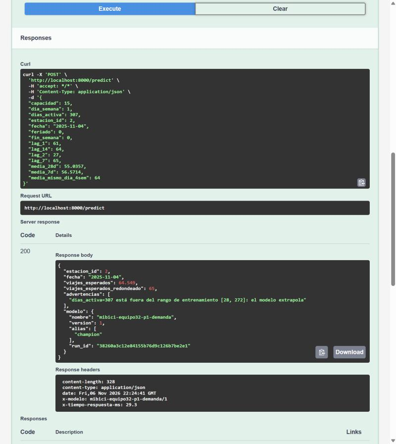 |

**Resumen de la ejecución:**

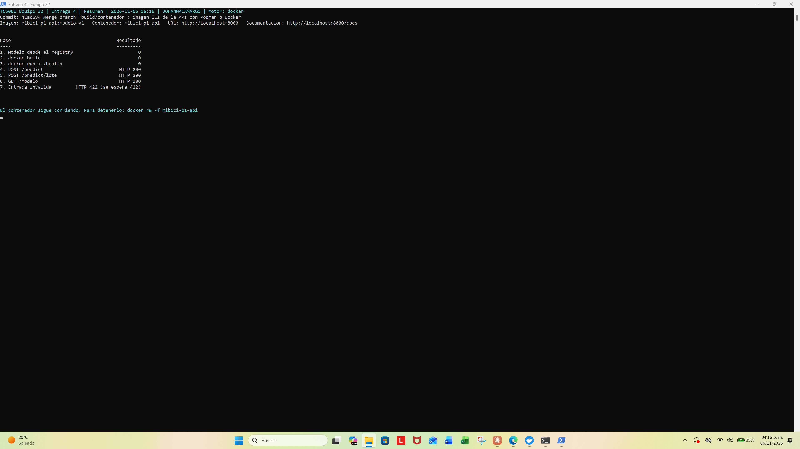

Verificaciones adicionales en la misma computadora (salida en `reports/servicio/`):

- **Todas las pruebas del proyecto: 175 aprobadas** (`python -m pytest`, 7 min; incluye las 43 de la
  API y las 24 del contenedor; [`09_pytest_completo.txt`](reports/servicio/09_pytest_completo.txt) y
  [`08_pytest_api.txt`](reports/servicio/08_pytest_api.txt)). Entre ellas, con el modelo real y los
  datos reales: ninguna de las 124,234 filas se rechaza en la validación y la API, al predecir por
  `/predict/lote` las 22,565 filas de prueba, reproduce el `test_mae` registrado en MLflow (5.4097).
- **Seguridad sin hallazgos** sobre el commit que precede al que agrega esos reportes (`python scripts/chequeos_seguridad.py`;
  [`10_seguridad.txt`](reports/servicio/10_seguridad.txt) y [`reports/seguridad/RESUMEN.md`](reports/seguridad/RESUMEN.md)):
  bandit sin hallazgos en `mibici/`, `scripts/` y `api/`; pip-audit sin vulnerabilidades en
  `requirements.txt`, en las 53 dependencias de la imagen y en el entorno; sin secretos en el árbol ni
  en el historial (las coincidencias de detect-secrets son hashes y identificadores revisados uno por
  uno con reglas explícitas y probadas).
- **Reproducible desde un clon limpio** ([`11_clon_limpio.txt`](reports/servicio/11_clon_limpio.txt)):
  `git clone` del commit `58cd599` (rama local `entrega4-servicio`), los 25 archivos del modelo coinciden
  con su SHA-256, `docker build`, `docker run` y `POST /predict` devuelve 64.549, igual que en la
  ejecución principal. En esa computadora Git usa `core.autocrlf=input`, así que ahí no se ejercita la
  conversión a CRLF que evita `.gitattributes`; eso lo cubre `test_git_no_cambia_los_finales_de_linea_del_modelo`.

### Historial de Git de la entrega 4

Cada tema en su rama, integrada a `main` con `git merge --no-ff` (`git log --graph --oneline main`):

| Rama | Commits | Contenido |
|---|---|---|
| `feat/registry-exportar-modelo` | 2 | Constantes de la entrega y script que recupera el modelo del registry por nombre y versión o alias |
| `feat/api-fastapi` | 7 | Esquemas Pydantic, carga verificada del modelo, endpoints, dependencias, pruebas de la API y peticiones de ejemplo |
| `build/contenedor` | 5 | Dependencias de la imagen, `Containerfile` y `.dockerignore`, pruebas del contenedor, script de Windows y `make`, y auditoría de la imagen |
| `build/modelo-servicio-v1` | 2 | La v1 descargada del registry en la computadora de la autora y `.gitattributes` para que Git no cambie sus bytes |
| `fix/escaner-registro-modelo` | 1 | Regla revisada del escáner de secretos para las huellas SHA-256 de `registro.json` |
| `docs/readme-servicio` | 3 | Este README, `CONTRIBUCIONES.md`, capturas y salida de la primera ejecución |
| `fix/revision-independiente-e4` | 5 | Correcciones de una revisión independiente contra la rúbrica: `estacion_id` y `fecha` más estrictos y rango real de `lag_14`, costo de inferencia en `registro.json` y `/modelo`, imagen base fijada por *digest* y versión del modelo como argumento, `make probar-api` que espera a `/health`, script que no pisa la evidencia sin `-Capturas` y `registro.json` regenerado |
| `docs/revision-e4` | 4 | Regla del escáner para las respuestas guardadas de la API, capturas y salida de la ejecución sobre `58cd599`, reportes de seguridad y este README |
| `build/dockerfile-por-defecto` | 2 | `Dockerfile` idéntico al `Containerfile` para que `docker build .` funcione sin `-f` (Docker 29 no busca `Containerfile`), con su prueba, y este README |

**Uso de herramientas de IA.** El código, las pruebas y este documento se elaboraron con apoyo de
Claude (Anthropic) como asistente de programación; los commits lo declaran con `Co-Authored-By: Claude`.
La descarga del registry, la construcción de la imagen, el contenedor, las peticiones y las capturas se
ejecutaron en la computadora de la autora.

**Referencias.** Huyen, C. (2022). *Designing machine learning systems* (cap. 7). O'Reilly Media.
Treveil, M., Omont, N., Stenac, C., Lefevre, K., Phan, D., Zentici, J., Lavoillotte, A., Miyazaki, M.
y Heidmann, L. (2020). *Introducing MLOps* (cap. 6). O'Reilly Media.

## Entrega 3: pruebas automatizadas, validación de datos y seguridad

**Versión individual de Leydy Johanna Camargo Medina (A01840540).** De acuerdo con la mecánica que
acordó la coordinación con el profesor para las actividades en equipo que faltan, cada integrante
puede entregar su propia versión. Esta versión vive en este repositorio
(<https://github.com/JohannaCamargo2805/TC5061-Proyecto-Equipo32>, rama `main`). Se trabajó en seis
ramas, integradas a `main` con *merge commits* (ver [Historial de Git](#historial-de-git-de-la-entrega-3)).

### Cómo ejecutar todo (un solo comando por paso)

```bash
python -m pip install -r requirements.txt     # incluye deepchecks, bandit, pip-audit y detect-secrets

python -m pytest                              # 1. TODAS las pruebas (106): unitarias, reproducibilidad, DeepChecks y seguridad
python -m pytest -m "not datos"               #    solo las que no necesitan data/processed (p. ej. en un clon sin datos)
python -m mibici.validacion                   # 2. reportes de DeepChecks en reports/deepchecks (HTML + RESUMEN.md); necesita data/processed
python scripts/chequeos_seguridad.py          # 3. bandit + pip-audit + secretos; reportes en reports/seguridad (pip-audit consulta PyPI/OSV: requiere Internet)

make calidad                                  # los tres pasos (Linux/macOS)
powershell -ExecutionPolicy Bypass -File scripts\ejecutar_calidad.ps1 -Capturas   # los tres pasos en Windows + capturas
```

Las pruebas marcadas `datos` usan los Parquet de `data/processed` (se generan con
`python -m mibici.dataset`); si no existen, pytest las omite y lo indica. La configuración de pytest
(carpeta, marcadores y filtros de avisos) está en `pyproject.toml`.

### 1. Pruebas unitarias con PyTest

Todas las pruebas están en `tests/` y se corren con `python -m pytest`. Cubren las funciones clave
de cada etapa del pipeline, con casos normales y casos límite:

| Archivo | Funciones probadas | Casos normales | Casos límite |
|---|---|---|---|
| `test_dataset.py` (19) | Ingesta: `_normalizar_nombre`, `normalizar_viajes`, `leer_csv`, `_sha256`, `descargar`, manifiesto | Esquema de columnas, UTF-8 y Latin-1, hash conocido, copia local | Encabezado vacío, variantes del año de nacimiento, fecha inválida (NaT), archivo vacío, error HTTP, descarga idempotente sin red |
| `test_features_p1.py` (8) | `p1_construir_panel_diario`, `p1_agregar_features` | Panel contiguo, rezagos y medias | Rango sin actividad, feriado y fin de semana, capacidad desconocida, estación sin historia, **no fuga al alterar el futuro**, rezago < horizonte |
| `test_features_p2.py` (13) | `p2_construir_panel`, `p2_agregar_etiqueta`, `p2_agregar_features`, `p2_historico_pasado`, `p2_aplicar_historico`, `cortar` | Neto = llegadas − salidas, horas sin viajes en 0 | Etiqueta **justo en el umbral** del 40 %, capacidad 0, horizonte 0/24/−1, histórico sin la fila actual, ventana que cruza el corte |
| `test_features_p3.py` (12) | `p3_filtrar_viajes`, `p3_entropia_normalizada`, `p3_construir_features` | Proporciones que suman 1, balance en [−1, 1] | Duraciones de 59, 60, 86 400 y 86 401 s; serie vacía o constante; estación nueva no elegible; sin estaciones elegibles |
| `test_metricas.py` (6) | `p1.evaluar`, `p2.elegir_umbral`, `p2.evaluar` | Valores conocidos de MAE, WAPE y RMSE | Predicción perfecta, predicciones negativas, modelo que nunca alerta |
| `test_mlproject.py` (8) | `MLproject`, `resolver`, `convertir`, regla de selección, estimadores propios | (entrega 2) | Parámetros inválidos |
| `test_reproducibilidad.py` (10) | `P1Tarea`, `P2Tarea`, `P3Tarea` (los mismos constructores de `mlflow run -e train`) y `train.ejecutar` | Ver abajo | Control negativo: otra semilla cambia el resultado |
| `test_validacion_deepchecks.py` (16) | `mibici/validacion.py` | Ver [sección 2](#2-validación-de-datos-con-deepchecks) | |
| `test_seguridad.py` (14) | Escáner de secretos, `.gitignore`, configuración, `git_seguro`, bandit | Ver [sección 3](#3-chequeos-de-seguridad) | |

**Reproducibilidad del entrenamiento** (`tests/test_reproducibilidad.py`). Con la semilla del
proyecto (`config.SEED = 42`), dos entrenamientos dan el mismo resultado:

- **P1** (ingenuo, Poisson y HGB): mismas métricas y predicciones **bit a bit**.
- **P1 random forest** (`n_jobs=-1`): los árboles son idénticos (variables, umbrales y hojas). Las
  predicciones promedian los árboles en paralelo y el orden de la suma puede cambiar entre hilos,
  así que las métricas se comparan con tolerancia relativa de 1e-9 y las predicciones con 1e-12
  (las diferencias observadas son del orden de 1e-15).
- **P2** (HGB): mismo umbral de decisión, mismas métricas y mismas predicciones.
- **P3** (K-Means, GMM y aglomerativo): mismas etiquetas de grupo.
- **Control negativo:** con `SEED + 1` el bosque aleatorio cambia sus predicciones, así que la
  igualdad se debe a la semilla y no al azar. Varios modelos del catálogo son deterministas (ingenuo,
  Poisson, aglomerativo y HGB sin `early_stopping`); la semilla es la que decide el resultado en el
  bosque aleatorio, K-Means y GMM, y en todos queda fijada desde `config.py`.
- **Con los datos reales y MLflow:** `train.ejecutar` entrena P1 dos veces y las dos corridas
  registran en MLflow las mismas métricas, el mismo `random_state` y la misma `data_version`.

### 2. Validación de datos con DeepChecks

`mibici/validacion.py` arma los conjuntos con las **mismas funciones y la misma partición temporal**
del pipeline (`config.py`) y corre dos suites de DeepChecks 0.19.1 sobre cada uno:

| Conjunto | Entrenamiento contra prueba | Filas |
|---|---|---|
| `viajes` | Viajes procesados antes / desde el 1 de noviembre de 2025 | 3,816,284 / 715,748 (reglas sobre todas; chequeos estadísticos sobre 300,000 por conjunto) |
| `p1` | Tabla estación × día: TRAIN ene-sep / TEST nov-dic | 90,230 / 22,565 |
| `p2` | Tabla estación × hora: TRAIN ene-sep / TEST nov-dic | muestra de 200,000 por conjunto |
| `p3` | Perfiles por estación: 1 ene-19 oct / 20 oct-31 dic | 367 / 367 |

- **Integridad (cada conjunto):** porcentaje de nulos (umbral 0 %), nulos de distinto tipo, tipos
  mezclados (cualquier mezcla reprueba), columnas con un solo valor, duplicados (umbral 0 %),
  caracteres especiales, variantes de texto, muestras atípicas, correlación entre variables, PPS de
  cada variable con la etiqueta (> 0.9 sugiere fuga), desbalance de clases y etiquetas en conflicto (P2).
- **Chequeo propio `ReglasDeNegocio`** (una subclase de `SingleDatasetCheck`): cuenta las violaciones
  de reglas del dominio en **todas** las filas. Las reglas críticas tienen la condición "0 violaciones"
  y las informativas solo se reportan. Ejemplos: `viaje_id` único, fin posterior al inicio, estaciones
  en el catálogo, mes del archivo igual al mes del viaje, llave estación-fecha única, proporciones en
  [0, 1] y bloques horarios que suman 1.
- **Entrenamiento contra prueba:** drift por variable (Kolmogorov-Smirnov o Cramér's V, umbral 0.2),
  drift de la etiqueta, drift multivariado (clasificador de dominio, umbral 0.25), categorías y
  etiquetas nuevas, fuga por fechas (traslape y duplicados), fuga por índice (`viaje_id`), muestras
  repetidas entre conjuntos y tamaño de los conjuntos.

Los reportes HTML (`reports/deepchecks/*.html`, de 10 a 40 MB cada uno, fuera de Git) se regeneran con
`python -m mibici.validacion`; el estado de cada chequeo queda versionado en
[`reports/deepchecks/RESUMEN.md`](reports/deepchecks/RESUMEN.md) y `resumen.json`.

**Problemas detectados y cómo se documentan** (datos `data_version = 7aa5e436d887`):

| # | Conjunto | Chequeo | Resultado | Interpretación y acción |
|---|---|---|---|---|
| 1 | viajes | Reglas de negocio (crítica) | **No aprobado:** 1,076 viajes repetidos (898 en entrenamiento y 178 en prueba, 0.024 %). `Data Duplicates`, sin la columna `viaje_id`, también los detecta en la muestra (advertencia). | Son pares de registros con `viaje_id` consecutivo o casi consecutivo (diferencia de 1 o 2) y el mismo origen, destino, inicio y fin al segundo, repartidos en los 12 meses: probable doble registro en la fuente. El efecto sobre los conteos de P1 y P2 es menor a 0.03 %. Queda documentado; se recomienda deduplicarlos en la ingesta en la siguiente versión de datos (cambia la `data_version` y obliga a reentrenar). La prueba fija el máximo tolerado en 0.05 %. |
| 2 | viajes | Reglas de negocio (informativas) | 117,226 viajes de menos de 60 s (2.6 %), 6 de más de 24 h y 254,801 circulares (5.6 %) | Los dos primeros ya los descarta el filtro de duración de P1-P3 (`*_MIN/MAX_DURATION_SECONDS`). Los viajes circulares (mismo origen y destino) son uso válido y se conservan. |
| 3 | viajes | Nulos, identificadores, tipos, catálogo y calendario | **Aprobado:** 0 nulos, 0 `viaje_id` duplicados, 0 estaciones fuera del catálogo de 484, 0 viajes que terminan antes de empezar y 0 viajes en un archivo mensual equivocado | Integridad de la ingesta confirmada sobre los 4,532,032 viajes. |
| 4 | viajes | Drift y fuga | **Aprobado:** drift máximo por variable 0.04 (día de la semana), drift multivariado 0.04 (AUC 0.52), sin fechas ni `viaje_id` compartidos | La partición temporal no tiene fuga. En prueba aparece 1 estación nueva (la 402, origen de 122 de los 715,748 viajes). El 0.22 % de muestras idénticas entre conjuntos son combinaciones repetidas de origen, destino, hora y duración, no viajes repetidos (su `viaje_id` es distinto). |
| 5 | P1 | Feature Drift y Multivariate Drift | **No aprobado:** `dias_activa` con KS = 0.99 y drift multivariado 1.0 (AUC 1.0) | `dias_activa` es la antigüedad de la estación en días y crece con el calendario: en entrenamiento llega a 272 y en prueba a 364, así que separa los conjuntos por construcción. **Sin esa variable** (suite aparte `p1_train_test_sin_tiempo`) ninguna variable supera 0.2 y el drift multivariado es 0.0003 (AUC 0.50). Acción recomendada: acotarla (p. ej. `min(dias_activa, 90)`) o sustituirla por un indicador de estación nueva, porque los árboles no extrapolan fuera del rango de entrenamiento. |
| 6 | P1 | Feature-Feature Correlation | **No aprobado:** varios rezagos y medias móviles con correlación > 0.9 | Es esperado: todas salen de la misma serie diaria. El modelo Poisson lineal usa regularización (`alpha`) y los modelos de árboles no se ven afectados; queda como dato para una futura selección de variables. |
| 7 | P1 | Nulos, duplicados, reglas, PPS, etiqueta y fechas | **Aprobado:** sin nulos ni llaves estación-fecha repetidas, PPS < 0.9 (sin variables que filtren la etiqueta), drift de la etiqueta 0.04 y sin traslape de fechas | Las variables `p1_*` cumplen la regla de no fuga también con los datos reales. |
| 8 | P2 | Integridad, drift y fuga | **Aprobado:** drift máximo 0.07 (`tasa_riesgo_hist`), drift multivariado 0.13, drift de la etiqueta 0.02, PPS < 0.9 y sin traslape de fechas | Desbalance esperado: 3.8 % de horas en riesgo en entrenamiento y 2.9 % en prueba (tabla completa; ≈4 % y ≈3 % en la muestra), lo que justifica `class_weight` balanceado y elegir el umbral en validación. Etiquetas en conflicto 0.01 %. El 9.6 % de vectores idénticos entre conjuntos son horas sin movimiento (flujos en 0), no fuga. |
| 9 | P3 | Integridad y estabilidad | **Aprobado:** sin nulos ni duplicados, proporciones en [0, 1] que suman 1, drift máximo 0.11 y drift multivariado 0.14 | Los perfiles de las 367 estaciones son estables entre periodos, lo que respalda los grupos de P3. |

Las pruebas de `tests/test_validacion_deepchecks.py` comprueban dos cosas. Con datos sintéticos, que
las suites **detectan** nulos, duplicados, tipos mezclados, nulos de distinto tipo, drift, fuga por
fechas y violaciones de reglas, y que ningún chequeo termina en error. Con los datos reales, que las
reglas críticas se cumplen (los viajes repetidos, el único hallazgo, quedan acotados a menos de
0.05 %), que no hay fuga entre conjuntos y que el drift de P1 se debe solo a `dias_activa`.

**Compatibilidad.** DeepChecks 0.19.1, la versión más reciente, todavía usa APIs que ya no existen en
NumPy 2, pandas 3 y scikit-learn 1.9. `mibici/compat_deepchecks.py` aplica siete ajustes mínimos y
documentados: tres sustituyen funciones solo dentro de módulos de DeepChecks y los demás agregan
alias de nombres que ya no existen (`np.Inf`, `DataFrame.applymap`, el scorer `max_error`,
`pkg_resources`), sin cambiar nada de lo que ya existía en esas librerías. Entre ellos está un `pkg_resources` mínimo en lugar de fijar
`setuptools<81`, que pip-audit marcó como vulnerable. Una prueba verifica que la condición de
correlación corregida reporta solo el par realmente correlacionado.

### 3. Chequeos de seguridad

**Prácticas en el repositorio**

- **Sin datos ni credenciales en Git:** `.gitignore` excluye `data/` (salvo el manifiesto), `*.csv`,
  `*.parquet`, `mlflow.db`, `mlruns/`, `mlartifacts/`, modelos serializados, `.env` y `.env.*`, llaves
  (`*.pem`, `*.key`, `*.p12`, `*.pfx`, `id_rsa*`), `credentials*.json`, `secrets*.json`, `.netrc` y `.pypirc`.
- **Variables de entorno:** `config.py` carga un `.env` local con `python-dotenv` (sin sobrescribir las
  variables del sistema); la plantilla [`.env.example`](.env.example) se versiona sin valores secretos.
  El código no contiene usuarios, contraseñas ni tokens.
- **Minimización de datos:** la ingesta elimina el pseudónimo de usuario, el género y el año de
  nacimiento antes de guardar los Parquet (entrega 1).
- **Dependencias con versión exacta** (`==`) en `requirements.txt`, verificadas por una prueba.

**Herramientas** (`python scripts/chequeos_seguridad.py`; reportes en
[`reports/seguridad/`](reports/seguridad/RESUMEN.md)):

| Herramienta | Qué revisa | Resultado inicial | Corrección | Resultado final |
|---|---|---|---|---|
| **bandit** 1.9.4 | Código de `mibici/` y `scripts/` (~4,800 líneas) | 16 hallazgos de severidad baja (B404, B603 y B607): `subprocess` llamando a `git` sin ruta absoluta en cuatro módulos | `mibici/git_seguro.py` centraliza las llamadas: `git` se resuelve con `shutil.which`, sin shell y con argumentos fijos. Las llamadas a `subprocess` del paquete y de los scripts se revisaron y se marcaron con `# nosec` | **0 hallazgos** (alta 0, media 0, baja 0) |
| **pip-audit** 2.10.1 (`-r requirements.txt`) | Versiones fijadas del proyecto | `mlflow 3.17.1`: CVE-2026-53995 (path traversal en el servidor de tracking con FileStore) | `mlflow==3.17.2` en `requirements.txt` y `python_env.yaml` | **0 vulnerabilidades** |
| pip-audit (`-r requirements.txt`) | `setuptools==80.10.2`, agregado en `2813b77` porque DeepChecks necesita `pkg_resources` | CVE-2026-59890 y GHSA-xmj3-9gf7-h52w | Se retiró en `09ebda8`; un sustituto mínimo de `pkg_resources` en `mibici/compat_deepchecks.py` evita fijar `setuptools` | **0 vulnerabilidades** |
| **pip-audit** (entorno instalado) | Todos los paquetes del `.venv`, incluidas las dependencias transitivas | 7 CVE: `tornado 6.5.10` (CVE-2026-116577, -115927 y -116578; la usan Jupyter e ipykernel) y `pyasn1 0.6.4` (CVE-2026-119194 a -119197) | `tornado==6.6` y `pyasn1==0.6.5` fijadas en `requirements.txt` | **0 vulnerabilidades** |
| **detect-secrets** 1.5.0 (`scripts/escanear_secretos.py`) | Cada versión de cada archivo de texto en **todo el historial** de Git (todas las ramas) | Coincidencias de los detectores de entropía: hashes SHA-256 de los manifiestos, imágenes PNG en base64 de los notebooks, vectores de prueba de SHA-256 y hashes de Git del propio reporte | Cada tipo se clasifica con una regla explícita y revisada; el reporte solo guarda los primeros 12 caracteres de la línea | **0 secretos reales** |
| `git check-ignore` | 12 rutas sensibles (`.env`, datos, `mlflow.db`, `mlruns/`, modelos, llaves, credenciales) | — | `.gitignore` reforzado | **12 de 12 ignoradas**, ninguna versionada |

`tests/test_seguridad.py` vuelve automática parte de esta revisión. Comprueba que el escáner detecta
una llave de AWS, un token de GitHub y una llave privada, todos falsos y armados en tiempo de
ejecución. También comprueba que las reglas de falsos positivos no ocultan un token, que `.gitignore`
cubre las rutas sensibles, que `.env.example` no trae valores, que la configuración se lee de variables
de entorno, que todas las dependencias tienen versión exacta y que bandit no reporta hallazgos.

### 4. Evidencia de la ejecución

Ejecución con `scripts\ejecutar_calidad.ps1 -Capturas` en la computadora de la autora (Windows 11,
Python 3.14.8, `.venv` del proyecto) sobre el commit `fb304c7`, que es el anterior al que agrega esta
evidencia; el hash aparece en la captura del resumen y en `reports/calidad/00_resumen.txt`. El script toma las cuatro
capturas de la terminal al terminar cada paso, y la salida completa de cada paso está en
[`reports/calidad/`](reports/calidad/). Las seis capturas de los reportes de DeepChecks se tomaron
abriendo en un navegador (Chromium, con Playwright) los archivos HTML que generó esa misma ejecución.

**Paso 1 — `python -m pytest -v`: 105 pruebas aprobadas** (salida completa en `reports/calidad/01_pytest.txt`;
la prueba número 106, agregada después de esta ejecución, cubre la regla del escáner para los hashes de Git)

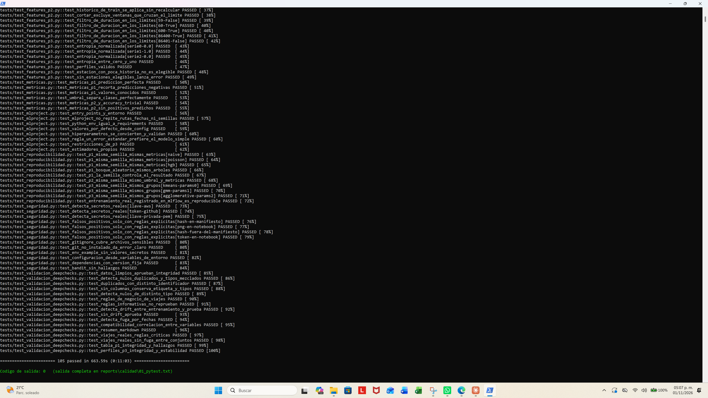

**Paso 2 — `python -m mibici.validacion`: DeepChecks sobre viajes, P1, P2 y P3**

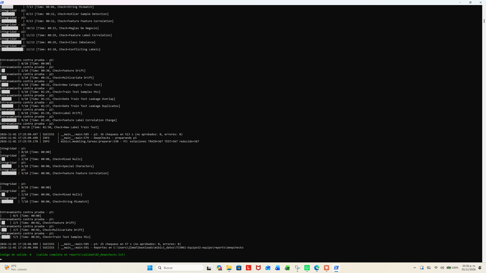

Capturas de los reportes HTML de DeepChecks que generó esa ejecución:

| Viajes: resumen de condiciones | Viajes: reglas de negocio sobre 3.8 millones de viajes |
|---|---|
| 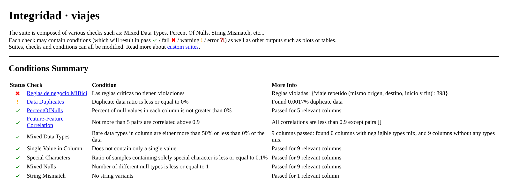 | 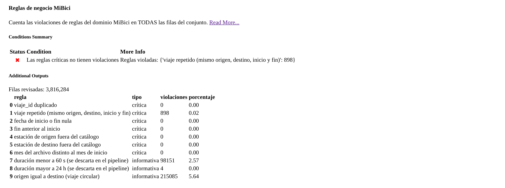 |

| P1: drift de `dias_activa` | P1 sin `dias_activa`: sin drift |
|---|---|
| 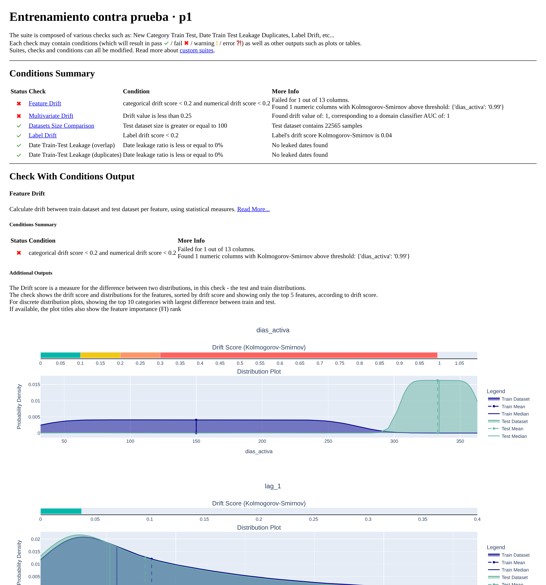 | 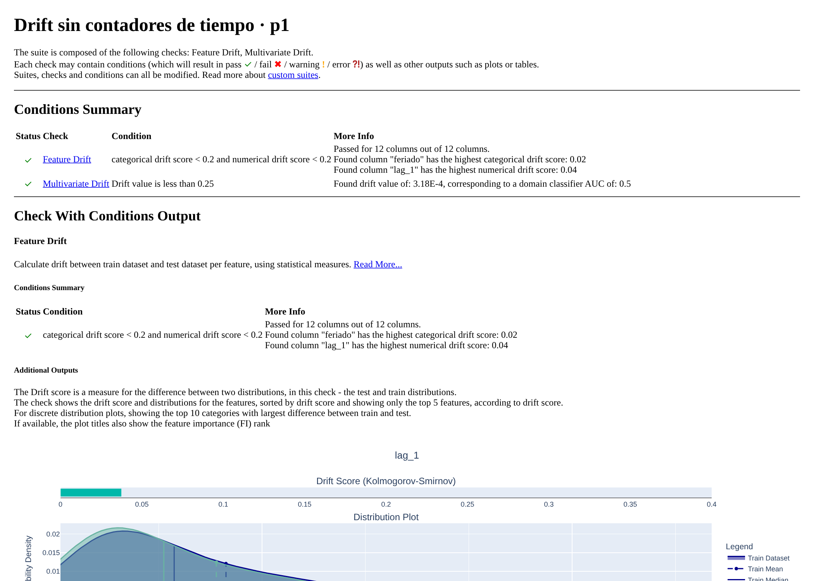 |

| P2: entrenamiento contra prueba | P3: entrenamiento contra prueba |
|---|---|
| 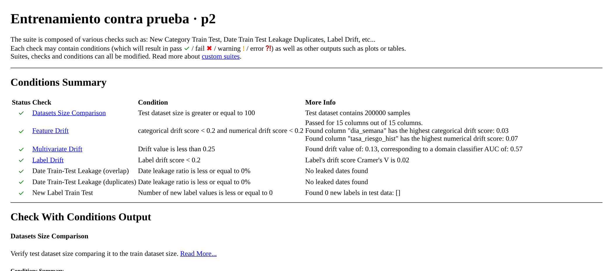 | 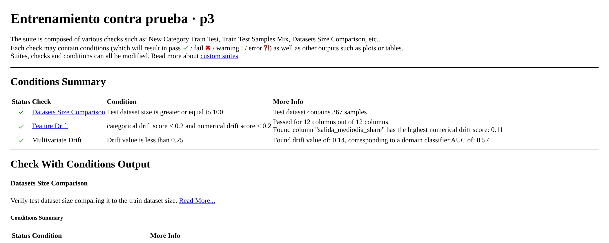 |

**Paso 3 — `python scripts/chequeos_seguridad.py`: bandit, pip-audit y secretos**

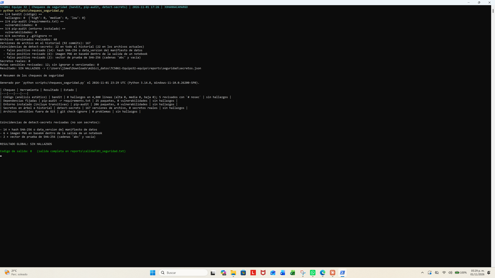

**Resumen de los tres pasos**

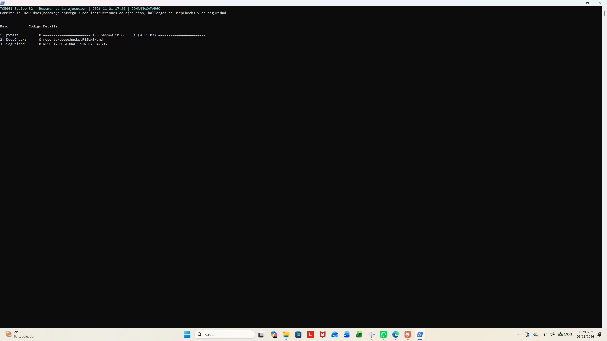

### Historial de Git de la entrega 3

Cada tema se desarrolló en su propia rama y se integró a `main` con `git merge --no-ff`, así que el
historial conserva la rama y su *merge commit* (`git log --graph --oneline main`). Los mensajes siguen
[Conventional Commits](https://www.conventionalcommits.org/es/v1.0.0/).

| Rama | Commits | Contenido |
|---|---|---|
| `test/pruebas-unitarias` | 8 | Configuración de pytest y fixtures; pruebas de ingesta, variables de P1, P2 y P3, métricas y reproducibilidad |
| `test/validacion-deepchecks` | 4 | DeepChecks y capa de compatibilidad, suites y chequeo propio, pruebas de detección y `.gitignore` de los reportes |
| `chore/seguridad` | 9 | Llamadas a git sin hallazgos de bandit, `.env`, `mlflow` 3.17.2, sin `setuptools` 80, herramientas fijadas, escáner de secretos, script de seguridad y pruebas |
| `fix/ajustes-primera-ejecucion` | 7 | Script de Windows y objetivos de `make`; correcciones que salieron de la primera ejecución en Windows: drift de P1 sin `dias_activa`, reportes que se sobrescriben, `tornado` y `pyasn1` corregidas y escaneo de secretos más rápido |
| `fix/revision-independiente` | 4 | Correcciones de una revisión independiente: duplicados sin `viaje_id`, más tipos de archivo sensible, prueba de `.gitignore` sin `.git` y commit en el resumen de la ejecución |
| `docs/readme-evidencia` | 3 | Este README, `CONTRIBUCIONES.md`, reportes de DeepChecks y de seguridad, capturas de la ejecución final y, después de ella, una regla del escáner para los hashes de Git que guarda su propio reporte |

**Uso de herramientas de IA.** El código, las pruebas y este documento se elaboraron con apoyo de
Claude (Anthropic) como asistente de programación; los commits correspondientes lo declaran con la
línea `Co-Authored-By: Claude`. Todas las ejecuciones (pruebas, DeepChecks y seguridad) se hicieron
en la computadora de la autora, que revisó los resultados; las capturas de los reportes de DeepChecks
se tomaron de los HTML de esa ejecución.

## Entrega 2: MLflow Project, experimentación y Model Registry

**Repositorio de entrega:** <https://github.com/JohannaCamargo2805/TC5061-Proyecto-Equipo32>. Conserva el historial completo del repositorio del equipo
([`a01840537/TC5061-Proyecto-Equipo32`](https://github.com/a01840537/TC5061-Proyecto-Equipo32), donde se integró la Propuesta de proyecto con los
Pull Requests #1–#12 de ese repositorio) y recibe la entrega 2 en `main` mediante el Pull Request
[#5](https://github.com/JohannaCamargo2805/TC5061-Proyecto-Equipo32/pull/5). Los commits son los mismos en ambos repositorios; por eso las etiquetas
`git_commit` de las corridas (`e6c1a60`) se pueden consultar aquí.

El repositorio es un **MLflow Project** (`MLproject` + `python_env.yaml`): cualquier integrante
ejecuta la ingesta, el entrenamiento, las búsquedas y el registro con un solo comando
`mlflow run`, contra un **servidor local de tracking respaldado por SQLite** (requerido por el
Model Registry). Todas las corridas de esta entrega se lanzaron así, no desde un notebook.

### 1. Servidor de tracking

```bash
# Terminal 1 (déjala abierta). En Windows: powershell -ExecutionPolicy Bypass -File scripts\servidor_mlflow.ps1
mlflow server --backend-store-uri sqlite:///mlflow.db --artifacts-destination ./mlartifacts \
    --host 127.0.0.1 --port 5000

# Terminal 2: apunta MLflow al servidor y al experimento único del equipo
export MLFLOW_TRACKING_URI=http://127.0.0.1:5000          # PowerShell: $env:MLFLOW_TRACKING_URI="http://127.0.0.1:5000"
export MLFLOW_EXPERIMENT_NAME=mibici-equipo32             # PowerShell: $env:MLFLOW_EXPERIMENT_NAME="mibici-equipo32"
```

`mlflow.db`, `mlruns/` y `mlartifacts/` están en `.gitignore`: la base de datos de MLflow, los
artefactos y los modelos serializados no se versionan.

### 2. Puntos de entrada del `MLproject`

| Punto de entrada | Qué hace | Parámetros principales |
|---|---|---|
| `ingest` | Ejecuta `dataset.py`: descarga/normaliza los CSV y genera `data/manifest.json` (`data_version`) | `raw_source` (carpeta con copia local de los CSV, opcional) |
| `train` | Entrena **un** modelo de **una** pregunta y registra métricas, artefactos y modelo con firma | `question` (p1, p2, p3), `model`, `stage` (baseline/candidate), hiperparámetros (`n_estimators`, `learning_rate`, `max_leaf_nodes`, `min_samples_leaf`, `alpha`, `C`, `k`, `linkage`, …), `from_search` |
| `search` | Búsqueda de hiperparámetros: una corrida **padre** y una corrida **hija anidada** por combinación | `question`, `model`, `grid` |
| `register` | Registra la corrida elegida en el Model Registry y le asigna los aliases `champion`/`challenger` | `question`, `run_id`, `challenger_run_id` |
| `verify` | Carga `models:/<nombre>@champion` y comprueba que reproduce la métrica registrada | `question`, `alias` |

Los parámetros con valor `config` (o `auto`) toman su valor de `mibici/config.py` (catálogos `P1_MODELOS`,
`P2_MODELOS`, `P3_MODELOS`, rejillas `BUSQUEDAS`, partición temporal, rutas y semilla): el
`MLproject` no repite rutas, fechas ni semillas. Se usan palabras clave y no cadenas vacías porque
`mlflow run` en Windows ejecuta el comando con `cmd /c`, que no transmite bien los argumentos vacíos.

### 3. Comandos para reproducir desde un clon limpio

```bash
git clone https://github.com/JohannaCamargo2805/TC5061-Proyecto-Equipo32.git
cd TC5061-Proyecto-Equipo32
python -m venv .venv && source .venv/bin/activate      # Windows: .venv\Scripts\Activate.ps1
python -m pip install -r requirements.txt
# (servidor y variables de entorno del paso 1)

mlflow run . -e ingest --env-manager local             # data_version = 7aa5e436d887
mlflow run . -e train  --env-manager local -P question=p1 -P model=poisson               # P1 champion
mlflow run . -e train  --env-manager local -P question=p2 -P model=hgb                   # P2 champion
mlflow run . -e train  --env-manager local -P question=p3 -P model=kmeans -P k=4         # P3 champion
```

- `--env-manager local` usa el entorno ya activado (instalado con `requirements.txt`, mismas
  versiones que `python_env.yaml`). Sin esa opción, MLflow crea el entorno declarado en
  `python_env.yaml` (`--env-manager uv` si tienes `uv`, o `virtualenv` con `pyenv`).
- Si no hay red hacia el portal de MiBici, la ingesta puede copiar los CSV de una carpeta local
  (`-P raw_source=<carpeta>`); el SHA-256 del manifiesto confirma que son los mismos archivos.
- Protocolo completo de la entrega (baselines, candidatas, búsquedas, registry y verificación):
  `scripts/ejecutar_entrega2.ps1` (Windows) o `scripts/ejecutar_entrega2.sh` / `make experimentos`
  (Linux/macOS).

Ejemplos de variaciones:

```bash
mlflow run . -e train -P question=p1 -P model=rf -P n_estimators=300
mlflow run . -e train -P question=p2 -P model=hgb -P learning_rate=0.05 -P max_leaf_nodes=63
mlflow run . -e search -P question=p1                    # rejilla de BUSQUEDAS["p1"] (nested runs)
mlflow run . -e train -P question=p1 -P from_search=latest   # entrena la mejor combinación
```

### 4. Qué registra cada corrida candidata

| Elemento | Dónde |
|---|---|
| Etiquetas para filtrar | `question`, `model_family`, `stage_of_work` (`baseline`, `search`, `candidate`), `entrega`, `equipo`, `git_commit`, `git_sucio`, `data_version`, `responsable` (y `mlflow.source.git.commit` que agrega `mlflow run`) |
| Modelo con firma y ejemplo de entrada | *Logged model* `model` (skops; el paquete `mibici` viaja con el modelo en `code_paths`) |
| Versión de los datos | `data/manifest.json`, `data/resumen_conjuntos.json` y los conjuntos TRAIN/VAL/TEST con `mlflow.log_input` (solo esquema, filas y huella digital) |
| Gráficas | `plots/`: P1 real contra predicho, residuales, total diario y MAE por día; P2 matriz de confusión, curva precisión-recall y elección del umbral; P3 PCA, perfiles de los grupos y mapa |
| Configuración | `config/`: `config.py`, `MLproject`, `python_env.yaml`, `requirements.txt` y `run_config.json` (parámetros resueltos) |
| Evaluación | `evaluation/`: métricas, predicciones de prueba, importancia por permutación y tablas |

Métricas: las mismas de la entrega anterior con prefijo `train_`, `val_` y `test_` (P1: MAE, RMSE,
WAPE, R², sesgo, error del total diario; P2: PR-AUC, F1, recall, precisión, recall por tipo;
P3: silueta, Davies-Bouldin, Calinski-Harabasz y ARI de estabilidad), más estabilidad
(`test_mae_semanal_std`, `test_f1_semanal_std`, `estabilidad_semillas_ari`), error estándar de
validación (`val_mae_se`, `val_pr_auc_se`) y costo (`costo_entrenamiento_seg`,
`costo_inferencia_ms_1k`, `tamano_modelo_mb`). No se registran datos personales: la ingesta
elimina el pseudónimo, el género y el año de nacimiento.

### 5. Model Registry: esquema de aliases

| Pregunta | Modelo registrado | Producción | Retador |
|---|---|---|---|
| P1 | `mibici-equipo32-p1-demanda` | `@champion` | `@challenger` |
| P2 | `mibici-equipo32-p2-riesgo` | `@champion` | `@challenger` |
| P3 | `mibici-equipo32-p3-grupos` | `@champion` | `@challenger` |

```bash
mlflow run . -e register -P question=p1        # run_id=auto: aplica la regla de selección de config.py
mlflow run . -e verify                         # carga models:/<nombre>@champion de las tres preguntas
```

```python
import mlflow
modelo = mlflow.pyfunc.load_model("models:/mibici-equipo32-p1-demanda@champion")
```

Usamos **aliases** y no las etapas clásicas (`Staging`/`Production`) porque las etapas están
obsoletas desde MLflow 2.9 y los aliases son el esquema vigente: un alias es un puntero
mutable a una versión, así que pasar a producción o hacer *rollback* es mover `@champion`
sin que los consumidores cambien su URI, y `@challenger` deja lista la siguiente mejor versión
para comparación. Cada versión guarda su linaje como etiquetas (`experimento`,
`source_run_id`, `git_commit`, `data_version`, `mlproject_entry_point`) y en su descripción.

**Regla de selección** (`SELECCION` en `config.py`, se calcula solo con TRAIN/VAL): P1 y P2
usan la regla de un error estándar (entre los candidatos a menos de 1 EE del mejor en
validación se elige el de menor complejidad); P3 maximiza la silueta entre los modelos con al
menos 3 grupos, `ari_historico_reducido >= 0.8` y `estabilidad_semillas_ari >= 0.9`.

<a target="_blank" href="https://cookiecutter-data-science.drivendata.org/">
    
</a>

Entregas: Propuesta de proyecto (semana 5), MLflow Project con experimentación y Model Registry (semana 6), pruebas, validación de datos y seguridad (semana 7) y el modelo P1 como API REST en contenedor (semana 8).

### 6. Resultados de la entrega 2

Corridas oficiales lanzadas con `mlflow run` desde el commit `e6c1a60` (árbol limpio,
`data_version = 7aa5e436d887`) en el experimento `mibici-equipo32`. Detalle, análisis y capturas en
`TC5061_Reporte_MLFlow_Equipo32.pdf`; bitácora en [`docs/entrega2_bitacora.md`](docs/entrega2_bitacora.md).

| Pregunta | Corrida | Métrica de selección (VAL) | Métrica de prueba | Registry |
|---|---|---|---|---|
| P1 | `p1-baseline-naive` | `val_mae` = 6.232 ± 0.116 | `test_mae` = 7.219 |  |
| P1 | `p1-candidate-poisson` | `val_mae` = 5.104 ± 0.103 | `test_mae` = 5.410 | @champion (v1) |
| P1 | `p1-candidate-hgb` | `val_mae` = 5.326 ± 0.113 | `test_mae` = 6.339 |  |
| P1 | `p1-candidate-rf` | `val_mae` = 5.068 ± 0.090 | `test_mae` = 5.718 |  |
| P1 | `p1-candidate-hgb-tuned` | `val_mae` = 5.129 ± 0.095 | `test_mae` = 5.904 | @challenger (v2) |
| P2 | `p2-baseline-logreg` | `val_pr_auc` = 0.415 ± 0.006 | `test_pr_auc` = 0.351 |  |
| P2 | `p2-candidate-hgb` | `val_pr_auc` = 0.484 ± 0.009 | `test_pr_auc` = 0.394 | @champion (v1) |
| P2 | `p2-candidate-rf` | `val_pr_auc` = 0.470 ± 0.008 | `test_pr_auc` = 0.383 |  |
| P2 | `p2-candidate-hgb-tuned` | `val_pr_auc` = 0.488 ± 0.008 | `test_pr_auc` = 0.402 | @challenger (v2) |
| P3 | `p3-baseline-kmeans` | `train_silhouette` = 0.198 | `test_silhouette` = 0.186 |  |
| P3 | `p3-candidate-kmeans` | `train_silhouette` = 0.186 | `test_silhouette` = 0.167 | @champion (v1) |
| P3 | `p3-candidate-agglomerative` | `train_silhouette` = 0.109 | `test_silhouette` = 0.122 |  |
| P3 | `p3-candidate-gmm` | `train_silhouette` = 0.162 | `test_silhouette` = 0.132 | @challenger (v2) |


## Project Organization

```
├── LICENSE            <- Open-source license if one is chosen
├── Containerfile      <- Entrega 4: imagen OCI de la API (Podman o Docker)
├── .dockerignore      <- Entrega 4: contexto de construcción en lista blanca
├── .gitattributes     <- Entrega 4: el modelo empaquetado se versiona sin cambiar finales de línea
├── requirements-api.in / requirements-api.txt <- Entrega 4: dependencias de la imagen (todas fijas)
├── api                <- Entrega 4: API REST con FastAPI (main, esquemas, modelo, config)
├── MLproject          <- MLflow Project: puntos de entrada ingest, train, search, register y verify
├── python_env.yaml    <- Entorno del MLflow Project (mismas versiones que requirements.txt)
├── Makefile           <- Comandos: `make server`, `make data`, `make experimentos`, `make verify`,
│                         `make test`, `make deepchecks`, `make seguridad`, `make calidad`,
│                         `make modelo-servicio`, `make api`, `make imagen`, `make contenedor`, `make probar-api`
├── .env.example       <- Plantilla de variables de entorno (el .env local no se versiona)
├── CONTRIBUCIONES.md  <- Qué hizo cada integrante en cada entrega
├── README.md          <- The top-level README for developers using this project.
├── data
│   ├── external       <- Data from third party sources.
│   ├── interim        <- Intermediate data that has been transformed.
│   ├── processed      <- The final, canonical data sets for modeling.
│   └── raw            <- The original, immutable data dump.
│
├── docs               <- A default mkdocs project; see www.mkdocs.org for details
│   ├── ejemplos       <- Entrega 4: peticiones de ejemplo para la API (JSON)
│   └── evidencia      <- Capturas de la entrega 3 y, en entrega4/, del contenedor y la API
│
├── models             <- Trained and serialized models, model predictions, or model summaries
│   └── servicio       <- Entrega 4: versión del Model Registry que sirve la API (con registro.json)
│
├── notebooks          <- Jupyter notebooks. Naming convention is a number (for ordering),
│                         the creator's initials, and a short `-` delimited description, e.g.
│                         `1.0-jqp-initial-data-exploration`.
│
├── pyproject.toml     <- Project configuration file with package metadata for 
│                         mibici and configuration for tools like black
│
├── references         <- Data dictionaries, manuals, and all other explanatory materials.
│
├── scripts            <- Protocolo de la entrega 2 (Windows/Linux) y servidor de tracking;
│                         entrega 3: ejecutar_calidad.ps1, chequeos_seguridad.py, escanear_secretos.py;
│                         entrega 4: exportar_modelo_registry.py, ejecutar_servicio.ps1
│
├── tests              <- Pruebas de PyTest (un solo comando: python -m pytest)
│
├── reports            <- Generated analysis as HTML, PDF, LaTeX, etc.
│   ├── figures        <- Generated graphics and figures to be used in reporting
│   ├── deepchecks     <- RESUMEN.md y resumen.json de DeepChecks (los HTML se regeneran)
│   ├── seguridad      <- Reportes de bandit, pip-audit y del escáner de secretos
│   ├── calidad        <- Salida completa de pytest, DeepChecks y seguridad
│   └── servicio       <- Entrega 4: salida de la construcción, el contenedor y las respuestas de la API
│
├── requirements.txt   <- The requirements file for reproducing the analysis environment, e.g.
│                         generated with `pip freeze > requirements.txt`
│
└── mibici   <- Source code for use in this project.
    │
    ├── __init__.py             <- Makes mibici a Python module
    │
    ├── config.py               <- Store useful variables and configuration
    │
    ├── dataset.py              <- Scripts to download or generate data
    │
    ├── features.py             <- Code to create features for modeling
    │
    ├── validacion.py           <- Entrega 3: suites de DeepChecks y reglas de negocio de MiBici
    ├── compat_deepchecks.py    <- Entrega 3: compatibilidad de DeepChecks con NumPy 2 y pandas 3
    ├── git_seguro.py           <- Entrega 3: llamadas a git sin shell (bandit sin hallazgos)
    │
    ├── modeling                
    │   ├── __init__.py 
    │   ├── p1_regresion.py     <- P1: viajes diarios por estación (baseline + 2 candidatos, MLflow)
    │   ├── p2_clasificacion.py <- P2: riesgo de quedarse sin bicis/anclajes (MLflow)
    │   ├── p3_clustering.py    <- P3: clustering de estaciones por patrón de uso (MLflow)
    │   ├── tareas.py           <- Entrega 2: datos, modelos, métricas y gráficas de P1, P2 y P3
    │   ├── train.py            <- Punto de entrada `train` (una corrida por modelo)
    │   ├── search.py           <- Punto de entrada `search` (nested runs)
    │   ├── registry.py         <- Punto de entrada `register` (Model Registry con aliases)
    │   ├── predict.py          <- Punto de entrada `verify` (carga models:/<nombre>@champion)
    │   ├── seguimiento.py      <- Etiquetas, versión de datos, config y modelo con firma en MLflow
    │   ├── seleccion.py        <- Regla de selección (1 error estándar / restricciones de P3)
    │   └── estimadores.py      <- Estimadores propios (baseline ingenuo, log1p, aglomerativo, GMM)
    │
    └── plots.py                <- Code to create visualizations
```

--------


## Reproducibilidad y MLOps

El proyecto utiliza una estructura basada en Cookiecutter Data Science. La lógica final se mantiene dentro del paquete `mibici`; los notebooks se reservan para exploración.

El entorno fue probado con Python 3.14.4. Las dependencias directas se encuentran fijadas por versión en `requirements.txt`.
También se verificó la ejecución completa (ingesta, pruebas, P1, P2 y P3) con **Python 3.12.13** desde un clon limpio.

### Instalación

```bash
python -m venv .venv
source .venv/bin/activate
python -m pip install -r requirements.txt


```

La consistencia del entorno puede verificarse con:

```bash
python -m pip check
```

### Datos

La ingesta se ejecuta desde el módulo:

```bash
python -m mibici.dataset
```

`dataset.py` descarga los datos públicos de MiBici definidos en `config.py`, genera los archivos procesados y crea `data/manifest.json`.

El manifiesto incluye una `data_version` calculada a partir de los archivos de entrada. Esta versión se registra posteriormente en MLflow para mantener trazabilidad entre datos y experimentos.

Los datos crudos, intermedios y procesados no se versionan en Git.

## Reproducción de la Propuesta de proyecto (entrega 1)

Desde la entrega 2 la reproducción oficial se hace con el **MLflow Project** (ver
[Entrega 2](#entrega-2-mlflow-project-experimentación-y-model-registry)): `mlflow run . -e ingest`
y `mlflow run . -e train ...` contra el servidor de tracking. Los scripts de la propuesta
(`python -m mibici.modeling.p1_regresion`, `p2_clasificacion` y `p3_clustering`) se conservan
como referencia; sus baselines se reproducen ahora con `stage=baseline`:

```bash
mlflow run . -e train -P question=p1 -P model=naive  -P stage=baseline   # p1_baseline_naive_semanal
mlflow run . -e train -P question=p2 -P model=logreg -P stage=baseline   # p2_baseline_logreg
mlflow run . -e train -P question=p3 -P stage=baseline                   # p3_baseline_kmeans_k2
python -m pytest tests                                                          # pruebas
```

La ingesta debe producir `data_version = 7aa5e436d887`; si el valor cambia, los archivos de MiBici
descargados no son los mismos que se usaron en los experimentos.

**Privacidad.** Los CSV de MiBici incluyen un pseudónimo de usuario, el género y el año de nacimiento.
Como ninguna pregunta los necesita, `dataset.py` los elimina antes de escribir los Parquet procesados
(minimización de datos). Los datos se usan con fines académicos citando la fuente (portal de datos
abiertos de MiBici) y no se redistribuyen en este repositorio.

## P1 — Regresión de viajes diarios por estación

**Pregunta:** ¿cuántos viajes se iniciarán en cada estación el día siguiente? Usuario: operador del
sistema (planeación de flota y turnos). Granularidad: estación × día; horizonte: 1 día (la predicción
del día D se emite al cierre de D-1).

```bash
python -m mibici.modeling.p1_regresion
```

- **Partición temporal:** TRAIN ene-sep 2025, VAL oct 2025 (selección del modelo), TEST nov-dic 2025.
- **Variables** (`mibici/features.py`, funciones `p1_*`): calendario del día objetivo (día de la semana,
  fin de semana, feriado), rezagos de 1, 2, 7 y 14 días, medias móviles de 7 y 28 días que terminan en
  D-1, promedio del mismo día de las 4 semanas previas, antigüedad y capacidad de la estación.
  `p1_agregar_features` lanza `LeakageError` si se pide un rezago menor que el horizonte.
- **Modelos:** baseline ingenuo semanal (`t − 7 días`), candidato lineal `PoissonRegressor`
  (conteos en `log1p`) y candidato `HistGradientBoostingRegressor` con pérdida Poisson.
- **Métricas:** `train_/val_/test_` + `mae`, `rmse`, `wape`, `r2`, `sesgo` y `mape_total_dia`.
- **Runs:** `p1_baseline_naive_semanal`, `p1_candidato_poisson_lineal`, `p1_candidato_hgb_poisson`.

## P2 — Clasificación de riesgo de disponibilidad

**Pregunta:** ¿una estación estará en riesgo de quedarse sin bicicletas o sin anclajes en las próximas
2 horas? Usuario: equipo de rebalanceo.

```bash
python -m mibici.modeling.p2_clasificacion
```

- **Etiqueta:** riesgo si `|neto(t+1 … t+2)| >= 0.4 × capacidad` (`p2_agregar_etiqueta`).
- **Partición temporal:** TRAIN ene-sep, VAL oct (umbral de decisión que maximiza F1), TEST nov-dic 2025.
- **Modelos:** baseline regresión logística balanceada y candidato `HistGradientBoostingClassifier`.
- **Runs:** `p2_baseline_logreg`, `p2_candidato_hgb`.

## P3 — Clustering de estaciones

La pregunta P3 busca agrupar estaciones de MiBici de acuerdo con sus patrones de uso y evaluar si esos perfiles se mantienen estables en el tiempo.

La configuración de P3 se encuentra centralizada en `mibici/config.py`. El pipeline final se ejecuta con:

```bash
python -m mibici.modeling.p3_clustering
```

### Partición temporal

Para evitar fuga de información se utiliza una separación temporal sin mezcla aleatoria:

- TRAIN: 1 de enero al 19 de octubre de 2025.
- TEST: 20 de octubre al 31 de diciembre de 2025.
- Ventana histórica reducida: 1 de abril al 19 de octubre de 2025.

Los viajes con duración menor a 60 segundos o mayor a 24 horas se excluyen. También se eliminan viajes que cruzan los límites temporales entre TRAIN y TEST.

### Construcción de características

El feature engineering se encuentra en `mibici/features.py`.

Una estación se considera elegible cuando:

- tiene al menos 30 días de historial;
- presenta menos de 60 días de inactividad al cierre del periodo.

Para cada estación se generan 12 características de comportamiento relacionadas con intensidad, balance, uso en fin de semana y distribución de salidas y llegadas por bloque horario.

Las variables de intensidad se transforman con `log1p` y posteriormente se aplica `StandardScaler`. El escalador se ajusta exclusivamente con TRAIN.

### Comparación de modelos

El pipeline reproduce tres alternativas:

- Baseline: K-Means con k=2.
- Candidato: Agglomerative Clustering con enlace Ward y k=4.
- Modelo final: K-Means con k=4.

La comparación utiliza Silhouette, Davies-Bouldin y Calinski-Harabasz. Para el modelo final también se evalúa estabilidad temporal mediante ARI, NMI y proporción de estaciones que conservan su cluster.

### MLflow Tracking

Todos los runs del proyecto se registran en el experimento único `mibici-equipo32`;
la pregunta atendida se distingue mediante tags (`problema: P1/P2/P3`).

Los runs tienen nombres descriptivos:

- `p3_baseline_kmeans_k2`
- `p3_candidato_agglomerative_k4`
- `p3_kmeans_final`

Además de los tres runs de P3, el experimento contiene los runs de P1 (`p1_baseline_naive_semanal`,
`p1_candidato_poisson_lineal`, `p1_candidato_hgb_poisson`) y de P2 (`p2_baseline_logreg`,
`p2_candidato_hgb`). Todos llevan los tags `equipo = equipo32`, `problema` (P1/P2/P3), `pregunta`,
`etapa` (baseline/candidato), `git_commit` y `data_version`.

Cada run registra, según corresponda:

- versión de los datos (`data_version`);
- commit de Git (`git_commit`);
- pregunta atendida;
- rango temporal;
- semilla y modelo;
- hiperparámetros;
- reglas de filtrado y elegibilidad;
- número de características;
- transformación y escalamiento;
- métricas diferenciadas por conjunto, como `train_silhouette` y `test_silhouette`.

El run final registra como artefactos el modelo serializado, la visualización PCA, el mapa interactivo, el resultado geográfico y la tabla resumen de clusters.

La interfaz local de MLflow puede iniciarse desde la raíz del repositorio con:

```bash
mlflow ui --backend-store-uri sqlite:///mlflow.db --port 5000
```

y consultarse en `http://localhost:5000`.

## Git y control de versiones

Los datos de MiBici, modelos serializados, base de datos de MLflow, artefactos de MLflow y resultados generados por P3 se excluyen mediante `.gitignore`. La excepción es `models/servicio/` (entrega 4): la versión del Model Registry que se empaqueta en la imagen de la API, versionada con su `registro.json` y sin conversión de finales de línea (`.gitattributes`).

El código se desarrolla en ramas independientes y todo cambio hacia `main` debe incorporarse mediante Pull Request revisado por otro integrante del equipo. En las entregas 3 y 4, que son versiones individuales, cada rama se integró a `main` con `git merge --no-ff` (ver [Historial de Git de la entrega 3](#historial-de-git-de-la-entrega-3) y [de la entrega 4](#historial-de-git-de-la-entrega-4)).

Convenciones: ramas `feat/`, `fix/`, `docs/`, `test/`, `build/` y `chore/` + descripción corta; mensajes de commit
siguiendo [Conventional Commits](https://www.conventionalcommits.org/es/v1.0.0/). En el
repositorio del equipo la rama `main` está protegida; cada integrante abre al menos un PR y revisa al
menos uno.

Para P3 se utiliza la rama `feature/p3-clustering`.

## Equipo 32

| Integrante | Matrícula | GitHub | Rol |
|------------|-----------|--------|-----|
| Rolando Calderón Carballo | A01840537 | `a01840537` | Infraestructura: repo, ingesta reproducible, versionado de datos, configuración |
| Leydy Johanna Camargo Medina | A01840540 | `JohannaCamargo2805` | P1 — Regresión: demanda de viajes por estación |
| Manuel Alejandro Cardona Esquivel | A01795954 | `alexcard33` | P2 — Clasificación: riesgo de disponibilidad por estación |
| Gerardo Iván Conde Reynoso | A01840602 | `GIvanConder` | P3 — Clustering: patrones de uso de estaciones |

El detalle de qué hizo cada integrante (commits, Pull Requests y revisiones) está en
[`CONTRIBUCIONES.md`](CONTRIBUCIONES.md).